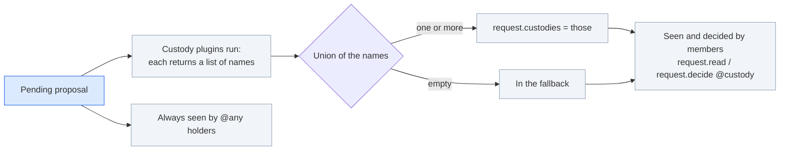

# Custody

Two kinds of custody: **proposal custody** (before approval, no category yet) and
**category custody** (after approval, a category is chosen). Both determine who sees
and acts on records.

## Proposal Custody

Who sees and decides a proposal **before** it has a category. Extracted from
`docs/design/shared/entities/proposal-custody.md`.

### Why it exists

Category custody places everything **after** approval. A proposal has **no category yet**
—the category is chosen at approval, so category custody cannot say whose a proposal is.

### The entity

```ts
interface CustodyRecord {
  id: string;
  name: string;
  description: string;
  isFallback: boolean;        // exactly one, always
  memberIds: string[];        // users who are members
  groupIds: string[];         // groups whose members are members
  openCount: number;          // open proposals currently in this custody
  placedByIds: string[];      // custody plugin instances that can name it
}
```

### How it resolves



- **Evaluated live** — when the proposal is made, when checks finish, when catalog record
  changes, when Custody instances change, over every open proposal on re-runs.
- **Overlap is a union** — a proposal with two custodies is seen and decidable by both.
- **A plugin that fails** leaves that instance's answer out. If no instance answered, the
  proposal is in the fallback.
- **After approval it is over** — the chosen category places the item in category custody.

### The fallback

- Exactly one, always, created at installation, never deletable.
- Catches what no plugin placed.
- With no members, only `request.decide@any` holders (admin) see it.
- Marked "fallback" so admins can spot proposals no rule reaches.

### Where it appears

| Surface | What |
|---|---|
| **Proposals** | Custody chips on rows, Custody filter, header's "N in my custody" |
| **Documents** | Before approval, only visible in my custodies |
| **Users & Groups** | Custody detail: name, description, members, open count |
| **Plugins** | Custody instances: jq rule, warning for unknown names |
| **User record** | Custodies they are in, direct or via group |
| **Home / Proposals card** | "N waiting for your review" |

## Category Custody

Who is responsible for a category subtree **after** approval. Inherits downward.

### The entity

```ts
interface CategoryMembership {
  categoryId: string;
  userIds: string[];
}
```

### How it resolves

Custody inherits downward — if you have custody of "Periodicals", you have custody of
"Periodicals / Regional", "Periodicals / Regional / Local News", etc.

In the permission system, `custody`-scoped grants check `categoryPathIds` against the
user's `custodyCategoryIds`:

```ts
function isInCustody(holder: ScopeHolder, record: ScopedRecord): boolean {
  switch (record.kind) {
    case "proposal": return true;  // proposal custody (resolved elsewhere)
    case "iteration":
    case "category":
      return record.categoryPathIds.some(
        id => holder.custodyCategoryIds.includes(id)
      );
  }
}
```

### Granting custody

`category.grant_custody@custody` means "within my own subtree" — a curator holding
Periodicals can bring someone onto Periodicals/Regional without an administrator.

### Where it appears

| Surface | What |
|---|---|
| **Categories** | Custody assigned to categories, members listed |
| **User record** | Category custodies (direct and via group) |
| **Group detail** | Category custody the group carries |

## Proposal reach

`proposalReachOf()` determines what a proposal custody's member can do:

```ts
type ProposalReach = "decides" | "sees" | null;

function proposalReachOf(roles: readonly Role[], roleIds: string[]): ProposalReach
```

Returns:
- `"decides"` — if the user holds `request.decide@custody` or `@any`
- `"sees"` — if they hold `request.read@custody` or `@any`
- `null` — neither permission held through any role

**Membership is not capability.** A custody member without the role reaches nothing.
