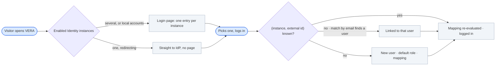
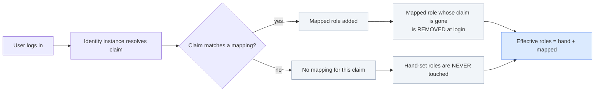

# Identity

How users arrive in VERA and log in. Extracted from `frontend/src/domain/entities.ts`,
`frontend/src/domain/access.ts`, and `docs/design/shared/entities/identity.md`.

## Identity plugins

Each instance is one way to log in: **MZK Keycloak**, **Local accounts**, **eduID**, or any
OIDC/SAML provider. **Several can be enabled at once.**

| Setting | Description |
|---|---|
| **label** | What the login page says: "Log in with MZK account" |
| **order** | Position on the login page; the first is the default |
| **user id** | Which claim the instance returns as the user's identifier (`sub`, `preferred_username`, `email`) |
| **default role** | What a new user gets: `guest`, `reader`, or none (null = no access) |
| **attribute mapping** | Claims → roles: group `mzk-staff` → staff, domain `mzk.cz` → reader |
| **match by email** | When on, a first login whose verified email matches an existing user links to that user |

**Agents have no identity.** A plugin acting as a user is created with the plugin and never
logs in.

## The login flow



- **Order** decides the sequence and which entry is the default. With one redirecting
  instance there is no page at all.
- A **disabled** instance disappears from the login page; its users keep their records
  but cannot log in through it.
- **Guest** is whatever the default role gives. An instance with a default role lets anyone
  with an account there in. Without one, an unknown login gets an account with no role and
  sees "You have no access yet."

## User ↔ Identity relationship

```
user
  id, display_name, email, kind (person | agent)
  disabled_at          ← null

user_identity
  user_id              → user
  identity_instance_id → plugin instance
  external_id          text              — the value of that instance's user id claim
  last_login_at        ← timestamp
  UNIQUE (identity_instance_id, external_id)
```

- A **user is found by (instance, external id)**, never by a name.
- **One person, several ways in**: an admin links a second identity, or "match by email"
  does it at first login.
- **Agents have no identity** — they never log in.

## Mapped roles

Mapped roles follow the provider and are **evaluated at every login**:



- A mapped role whose claim is gone is **removed** at login (access event).
- Roles set by hand are **never touched** by a mapping.
- A user may hold the same role both ways; removing the hand grant leaves the mapped one.
- **Which instance mapped it** is part of the provenance: "staff — mapped by MZK Keycloak
  from group mzk-staff".
- **Between logins** nothing changes. To cut access at once, an admin disables the user.
