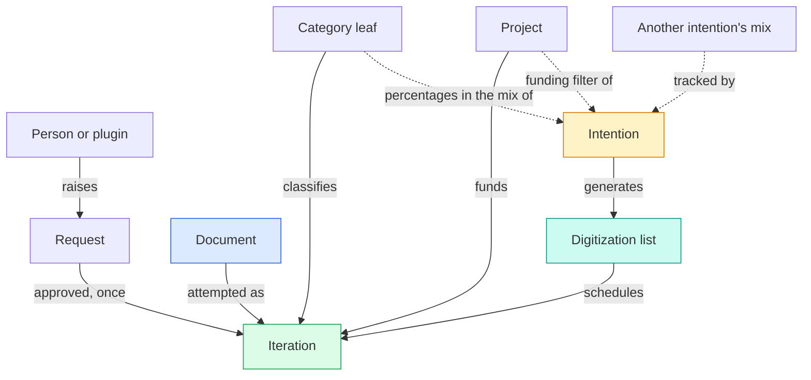

# Concepts

Every other document here describes a **mechanism**. This one describes what the
things *are*, in the terms a person would use before they knew any of it.

Read this first. If something below is not true of the system, the system is
wrong — not this page.

---

## The one sentence

> VERA decides **what gets digitized next**, and keeps track of why.

Everything else exists to answer that in a way that survives being audited,
inherited by a new colleague, and disagreed with.

---

## Document

**What.** One physical thing that can be scanned: a book, a volume of a
periodical, a bundle. Named by its catalog record plus, if it is one part of a
larger record, which part ([[document-identity]]).

**Why.** Because *"digitize the 1923 volume"* has to name something precise
enough that two people asking for it are recognised as asking for the same
thing, and a scanning operation can find it on a shelf.

**For whom.** Everyone. It is the only concept a reader ever needs.

**The distinction that matters:** a document is the *item*; an **iteration** is
one *attempt* to digitize it. A book scanned in 2019 and rescanned in 2029 is
one document and two iterations. Everything that can differ between attempts —
category, priority, funding, which list it was on, whether it was approved —
belongs to the iteration, not the document ([[relationships]] §6). Every view
that appears to list documents is in fact listing iterations.

---

## Category

**What.** The subject tree. *Periodicals → Regional → Moravian.* A document sits
at exactly one **leaf** of it ([[intentions]] §1.2).

**Why.** It does two jobs at once, and knowing both is the only way the design
makes sense:

| Job | Means |
|-----|-------|
| **classification** | what kind of thing this is — the basis for planning a balanced mix |
| **access** | who is responsible for it — the basis for every curator's queue |

**For whom.** Curators, who work a queue defined by the categories they hold;
and whoever plans the mix of what gets digitized.

**The distinction that matters:** those two jobs attach to the tree
*differently*. **Custody attaches at any node and inherits downward** — hold
*Periodicals* and you are responsible for every leaf under it.
**Classification attaches only at leaves.** One is about people and applies to
subtrees; the other is about documents and applies to the bottom
([[relationships]] §5.2).

> **Why a tree and not tags.** A tag set cannot express *"responsible for all of
> this branch"*, and responsibility is the load-bearing half. The cost is that
> reclassification is a move rather than an edit, which is the right trade for a
> library where subject boundaries change slowly and staff change often.

---

## Project

**What.** A funded, time-boxed envelope. A grant, a commission, a budget line —
with a description, a manager, and members who propose documents into it. It
is *Proposed*, *Approved* or *Rejected*: approving it sets the priority its
items get and approves what was proposed into it so far.

**Why.** Because somebody paid for some of this work, and at some point has to
be told what their money produced — accurately enough to withstand an audit.

**For whom.** Digitization managers and whoever reports upward.

**The distinction that matters:** a project funds **iterations**, not documents.
A rescan in 2029 can be funded by a different grant than the 2019 scan of the
same book, and both statements must stay true forever. This is why funding hangs
off the attempt.

> **A project is not a plan.** It is money and a deadline. *What* that money
> should buy — the mix, the targets — is an **intention**, and projects and
> intentions are separate so that a target can exist with no funding behind it
> and funding can exist before anyone has decided how to spend it.

---

## Intention

**What.** A stated target: *this many pages, in roughly this mix, by this date* —
or, with no page target, a mix to track: *is what we deliver shaped the way we
said?*

**Why.** Without one, "what should we digitize next" has no answer except
whatever is loudest. An intention is what makes a digitization list **generated
rather than assembled** — and what lets anyone check afterwards whether the plan
was followed.

**For whom.** Digitization managers, who generate lists against it; and anyone
asking whether the library is digitizing what it said it would.

**No kinds — a scope and an objective** ([[intentions]] §3):

| | |
|---|---|
| **Scope** | what counts: any funding, no project, or one project; the whole tree or one subtree |
| **Objective** | what it should look like: a mix, an optional page target, a counting start (locked once set) and an optional end |

With a page target it has progress — the *Targets* column on Intentions;
without one it tracks the mix — *Tracking*. Derived, not stored. A "project
intention" is simply one whose funding is that project.

**Overall** is the one protected intention: everything, no target, no end —
the default mix for generating and the yardstick output is measured against.
Exactly one, always.

**The distinction that matters:** an intention is a **target, not a selection**.
It never names documents, and nothing is attached to it: an item counts
towards every intention whose scope it matches, so the figures of different
intentions overlap and are never added. Generation finds documents matching an
intention's shape at the moment it runs. This is also why *planned* pages and
*delivered* pages are two numbers that must never be added together
([[relationships]] §5.3).

---

## Mix

**What.** What percentage of effort each part of the category tree deserves.
Percentages split recursively — the top level splits 100%, each parent's
children split their parent's share. A mix belongs to an **intention**: its own,
or tracked from another intention, typically Overall ([[intentions]] §2).

**Why.** So two intentions can share one shape without copying it.
*Last year's mix, applied to this year's grant* is one intention tracking
another, not a copy that quietly drifts. Editing a shared mix says first which
intentions it reaches, and lets one **detach** onto its own copy.

**For whom.** Digitization managers.

**The distinction that matters:** the mix is the **shape**; an intention is the
shape **plus a scope, a size and a deadline**. Underneath, a mix is stored as a
revisioned *distribution*, so history can say what the percentages were — but
nobody picks or names one.

---

## Request

**What.** One person asking for one document to be digitized — or one harvesting
plugin proposing it, which is the same thing with a machine as the asker
([[view-map]] §6). Asks always arrive in a **batch** — one submission, a batch
of one included — which carries the reason, and may carry a project.

**Why.** So *"who wanted this, and what happened to their ask"* always has an
answer. A request is what a person sees in *My Documents*; an iteration is what
the library works on. They are linked, and the link is what stops somebody
losing sight of their own request the moment it is approved.

**For whom.** Readers and staff, who track their own; curators, who decide them.

**"Proposal" and "addition" are not other things.** They are names for *where a
request currently is* — a proposal is a request nobody has decided yet; an
addition is an approved one whose ingest has not finished. One row, changing
state ([[relationships]] §1). The pages keep those names because that is what
the work at each phase is called.

**The distinction that matters:** several people may ask for the same document,
and a document is only scanned once. So requests either **produce** an iteration
or **shadow** one — and a request that shadows shows the live status of the work
it is following, rather than being told it is a duplicate
([[status-model]] §2.7).

---

## Digitization list

**What.** A set of iterations a scanning operation will work through, with dates.

**Why.** It is the hand-off. Everything before it is VERA deciding; the list is
what leaves the building.

**For whom.** Digitization managers, who build it; the scanning operation, which
executes it.

**The distinction that matters:** a list is **current state, not history**.
Deleting one returns its documents to the pool ([[status-model]] §2.6) — so the
fact that something *was* scheduled lives in the [[status-log]], not in the
list. What a list **counts towards** is worked out from its members and its
start date, never attached; a generated list records which intention shaped
it, as provenance ([[intentions]] §5).

---

## How they fit

Two edges deliberately absent, and their absence is load-bearing
([[relationships]] §4): **category has no link to project**, and **intention has
no link to document**. A project reaches the tree only through an intention
that counts it; an intention reaches documents only through its scope, matched
against what is on lists.
Any view needing either of those direct links is a view built on a join with no
answer.

---

## Related

- [[relationships]] — the same entities, exactly, with cardinalities
- [[status-model]] — what state each of them can be in
- [[intentions]] — how shares and targets actually work
- [[view-map]] — which page each concept is worked on
