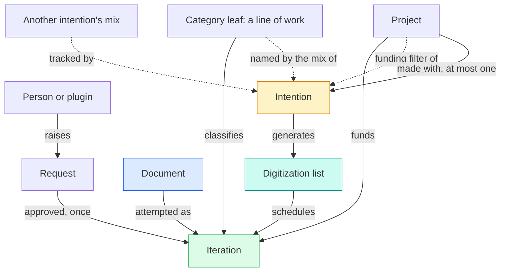

# Concepts

Every other document here describes a **mechanism**. This one describes what the
things *are*, in the terms a person would use before they knew any of it.

Read this first. If something below is not true of the system, the system is
wrong — not this page.

---

## The one sentence

> VERA decides **what gets digitized next**, and keeps track of why.

Everything else exists to answer that in a way that survives being audited,
inherited by a new colleague, and disagreed with.

---

## Document

**What.** One physical thing that can be scanned: a book, a volume of a
periodical, a bundle. Named by its catalog record plus, if it is one part of a
larger record, which part ([[document-identity]]).

**Why.** Because *"digitize the 1923 volume"* has to name something precise
enough that two people asking for it are recognised as asking for the same
thing, and a scanning operation can find it on a shelf.

**For whom.** Everyone. It is the only concept a reader ever needs.

**The distinction that matters:** a document is the *item*; an **iteration** is
one *attempt* to digitize it. A book scanned in 2019 and rescanned in 2029 is
one document and two iterations. Everything that can differ between attempts —
category, priority, funding, which list it was on, whether it was approved —
belongs to the iteration, not the document ([[relationships]] §6). Every view
that appears to list documents is in fact listing iterations.

---

## Category, mix, intention, project

> Defined hard with the user on 2026-10-07. Four concepts that the earlier
> drafts let overlap: a project had a target and pace of its own beside its
> intention's, the mix was edited "on the tree" as if shares were the
> category's, and a shared mix changed owner when an edit was declined. Each
> now has one job, and one question it answers. When a view needs an answer,
> it asks the concept that owns the question.

| | Answers | Is responsible for | Is **not** responsible for |
|---|---|---|---|
| **Category** | *which line of work is this attempt in, and whose is it?* | classifying an iteration (one leaf) · custody (who looks after the line) | what a book is about; numbers of any kind: shares, targets, money |
| **Mix** | *in what proportion?* | the share each branch of the tree deserves | which documents, how many pages, when, whose money |
| **Intention** | *are we digitizing what we said, as much as we said, by when?* | scope, window, target, pace, drift, and the shape a list is generated to | holding documents, money, approval, priority |
| **Project** | *who paid, and who may ask under it?* | funding, its members' right to propose, the decision, the priority it gives | a target, pace, a mix, categories |

Four rules that follow, each one a view must not break:

1. **Only an intention has a target or pace.** Anything showing *planned*,
   *delivered*, *on pace* or *behind* is showing an intention, even on the
   Projects page.
2. **Only an intention has a mix.** Percentages are edited on the intention;
   Categories may display them, never own them.
3. **Only a category classifies or gives custody.** An intention reaches
   the tree only by its scope, and a project only through its intention;
   neither attaches to a node.
4. **A category is a line of work, not a subject.** A node that fails the
   three tests below is a filter on catalog data, not a category.

### Category

> Defined with the user on 2026-10-07. "The subject tree" left open what it
> classifies by: the demo tree split on material type, then period, then
> geography, so nobody could say why a category belongs where it does.

**What.** **A line of digitization work**: a stream the library plans and
staffs on its own. *Periodicals*, *Monographs*, *Manuscripts*, *Maps* — and
under them whatever split the library plans or staffs separately:
*Periodicals → Regional*, *Monographs → 19th century*. It classifies the
**attempt**, not the book: it says which line of work this iteration is
done in. An iteration sits at exactly one **leaf** ([[intentions]] §1.2).

**What makes a category.** A node earns its place by passing all three:

| Test | Because |
|---|---|
| **someone is responsible for it** | custody is given on the tree; a branch nobody looks after is a branch whose items no queue shows |
| **the library would set a share for it** | a mix splits effort over the tree; a split nobody would plan differently is noise in every mix |
| **a decider can place an item in it at approval** | from the record and the ask, without research; a category that needs research is guessed, and a guessed category corrupts custody and counting at once |

A split that fails them is **not a category but a filter**: subject,
language, period of publication, physical condition. Those stay catalog data
and document properties, searchable and filterable everywhere, never planned
or held ([[document-properties]]).

**Its jobs.** Both follow from the definition:

| Job | Means | Attaches |
|-----|-------|----------|
| **classification** | which line this attempt is worked in | at **leaves** only — `iteration.category_id` |
| **custody** | who is responsible for the line — the basis for every curator's queue | at **any node**, inheriting downward |

Because the tree is shaped by how the work is planned and staffed, custody,
the mix and an intention's scope fall on the same boundaries by
construction, not by luck. And because it is about the work, it belongs on
the iteration: a 2029 rescan may be done in another line than the 2019 scan,
and *Reclassify* moves the work to another line, it does not change what the
book is.

**How an item gets one.** At approval, the decider confirms a leaf. A
**Classifier** plugin suggests it from the record and the ask — material
type, the catalog's own classification, the project — with its reason, and
the decide form opens on that suggestion ([[plugins]] §4.13). With no
classifier, or no suggestion, the decider picks. The category is a human
decision either way; the plugin only saves typing. *Reclassify* changes it
later, logged.

**What it is not.**

- **Not a subject classification.** What a book is about is the catalog's.
  A line of work may be defined by subject (*Moravica*), but then because the
  library staffs and plans that subject as a line, not because it is one.
- **Not a number.** A category holds no share, target or money. The tree is
  the frame a mix is written against, but the percentages are the mix's, and
  through it an intention's. Removing a category leaves a gap in every mix
  that named it ([[intentions]] §1.1.1); it never edits one.
- **Not linked to a project.** A project funds work in whatever lines its
  items are in; *what did this grant pay for, by line* is read through the
  iterations. A grant that is about one line says so through its intention's
  scope.

**Relationship to the other three**, in one line each:

| | Uses the tree how |
|---|---|
| **Mix** | writes a share on nodes of it: *how much effort for each line* |
| **Intention** | scopes to one node and its subtree, and reads progress and drift per line |
| **Project** | does not: its iterations each have a line, and that is all |

**For whom.** Curators, who work a queue defined by the lines they hold;
digitization managers, who plan the split between lines.

> **Why a tree and not tags.** A tag set cannot express *"responsible for all of
> this branch"*, and responsibility is the load-bearing half. The cost is that
> reclassification is a move rather than an edit, which is the right trade for
> lines of work that change slowly while staff change often.

### Mix

**What.** Percentages over the category tree: the top level splits 100%, each
parent's children split their parent's share, recursively ([[intentions]] §1).
The **shape** of the work and nothing else — no scope, no size, no dates, no
name.

**Whose.** A mix is always **one intention's own**. Other intentions may
**track** it: they use it live, one step away, never a chain. Editing it changes
it for every tracker, and the edit says so first; an intention that should keep
the old shape **detaches** onto its own copy before the edit, and from then on
owns that copy ([[intentions]] §2). Ownership never moves on its own.

**Why it is separate from the intention.** So two intentions can share one
shape without copying it: *last year's mix, applied to this year's grant* is
one intention tracking another, not a copy that quietly drifts.

**What it is not.** Not an entity anybody names, picks or opens. Underneath it
is stored as a revisioned *distribution*, so history can say what the
percentages were ([[relationships]] §2) — that is storage, not a concept.

**For whom.** Digitization managers.

### Intention

**What.** A **scope** and an **objective**:

| | |
|---|---|
| **Scope** — what counts | any funding, no project, or one project; the whole tree or one subtree |
| **Objective** — what it should look like | a window (a start, an optional end), a mix (own or tracked), an optional page target |

With a page target it has progress and pace — the *Targets* column on
Intentions; without one it tracks the mix — *Tracking*. Derived, not stored.

**What it is responsible for**, alone in VERA: targets, pace, drift against
the mix, and the shape a generated list aims at. Without one, "what should we
digitize next" has no answer except whatever is loudest.

**What it is not.** A target, not a selection: it never names documents, and
nothing is attached to it. An iteration counts towards every intention whose
scope it matches, so the figures of different intentions overlap and are
never added. *Planned* and *delivered* are two numbers that are never added
together either ([[relationships]] §5.3).

**Three kinds of origin, one entity:**

| | Made by | Its scope and window |
|---|---|---|
| **Overall** | installation — exactly one, protected | everything, from the reporting baseline, no end, no target. The default shape for generating and the yardstick output is measured against |
| **a project's intention** | the project — at most one per project, made with it | the project's funding, and the project's period, **read from the project** ([[projects]] §1.1) |
| **any other** | a dig-curator, or a repeat | its own; its start is locked once made |

**For whom.** Digitization managers, who generate lists against it; and anyone
asking whether the library is digitizing what it said it would.

### Project

**What.** Money and people: a funded, time-boxed envelope — a grant, a
commission, a budget line — with a description, a manager, and members who
propose documents into it. It is *Proposed*, *Approved* or *Rejected*:
approving it sets the priority its items get and approves what was proposed
into it so far.

**What it is responsible for:**

- **funding** — which iterations it paid for (`iteration.project_id`); a
  project funds attempts, not documents, so a rescan can be funded by another
  grant than the first scan;
- **who may ask under it** — its members, while it is Proposed or Approved;
- **the decision**, and the **priority** it gives at approval;
- **the period** the money covers.

**What it is not.** A project is not a plan and has no numbers of its own.
*How many pages* and *in what shape* is **its intention**: made with the
project, counting what the project funds over the project's period. The
project form edits that intention's target, and the Projects card shows that
intention's progress and pace — one number, kept in one place
([[projects]] §1.1). A project with no target still has its intention, which
then tracks the mix.

**Why.** Because somebody paid for some of this work, and at some point has to
be told what their money produced — accurately enough to withstand an audit.

**For whom.** Digitization managers and whoever reports upward.

---

## Request

**What.** One person asking for one document to be digitized — or one harvesting
plugin proposing it, which is the same thing with a machine as the asker
([[view-map]] §6). Asks always arrive in a **batch** — one submission, a batch
of one included — which carries the reason, and may carry a project.

**Why.** So *"who wanted this, and what happened to their ask"* always has an
answer. A request is what a person sees in *My Documents*; an iteration is what
the library works on. They are linked, and the link is what stops somebody
losing sight of their own request the moment it is approved.

**For whom.** Readers and staff, who track their own; curators, who decide them.

**"Proposal" and "addition" are not other things.** They are names for *where a
request currently is* — a proposal is a request nobody has decided yet; an
addition is an approved one whose ingest has not finished. One row, changing
state ([[relationships]] §1). The pages keep those names because that is what
the work at each phase is called.

**The distinction that matters:** several people may ask for the same document,
and a document is only scanned once. So requests either **produce** an iteration
or **shadow** one — and a request that shadows shows the live status of the work
it is following, rather than being told it is a duplicate
([[status-model]] §2.7).

---

## Digitization list

**What.** A set of iterations a scanning operation will work through, with dates.

**Why.** It is the hand-off. Everything before it is VERA deciding; the list is
what leaves the building.

**For whom.** Digitization managers, who build it; the scanning operation, which
executes it.

**The distinction that matters:** a list is **current state, not history**.
Deleting one returns its documents to the pool ([[status-model]] §2.6) — so the
fact that something *was* scheduled lives in the [[status-log]], not in the
list. What a list **counts towards** is worked out from its members and its
start date, never attached; a generated list records which intention shaped
it, as provenance ([[intentions]] §5).

---

## How they fit

Two edges deliberately absent, and their absence is load-bearing
([[relationships]] §4): **category has no link to project**, and **intention has
no link to document**. A project reaches the tree only through an intention
that counts it; an intention reaches documents only through its scope, matched
against what is on lists. A project's own intention is an intention like any
other in this: it counts what the project funds, and holds nothing.
Any view needing either of those direct links is a view built on a join with no
answer.

---

## Related

- [[relationships]] — the same entities, exactly, with cardinalities
- [[status-model]] — what state each of them can be in
- [[intentions]] — how shares and targets actually work
- [[view-map]] — which page each concept is worked on
