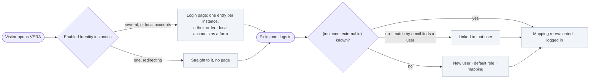

# Identity

How people get into VERA: **Identity plugins**, several at once, each a way
to log in. Decided with the user on 2026-09-26 and 2026-10-01.

Roles, grants and scopes are [[permissions]]; this page is where a user and
their mapped roles come from.

---

## 1. Identity plugins

A plugin kind of its own, **Identity**. Each instance is one way to log in:
*MZK Keycloak*, *Local accounts*, *eduID*. **Several can be enabled at
once.**

| Setting | |
|---|---|
| **label** | what the login page says: *Log in with MZK account* |
| **order** | its place on the login page; the first is the default |
| **user id** | which claim the instance returns as the user's identifier: `sub`, `preferred_username`, `email`, … Declared by the instance and **never changed once users exist**, since changing it would turn every user into a new one |
| **default role** | what a user first seen through this instance gets: `guest`, `reader`, or none |
| **attribute mapping** | claims → roles: *an IdP group `mzk-staff` → staff*, *email domain `mzk.cz` → reader*. Evaluated at every login |
| **match by email** | off by default. When on, a first login whose verified email belongs to an existing user is linked to that user, not created anew |

**Implementations**: Keycloak (OIDC), local accounts (username and password
kept by VERA), and any OIDC or SAML provider. Local accounts is the one that
needs a form on the login page; the others are a button that redirects.

---

## 2. A user and their identities

```
user
  id, display_name, email, kind (person | agent)
  disabled_at                        null

user_identity
  user_id          → user
  identity_instance_id → plugin instance
  external_id      text              — the value of that instance's user id claim
  last_login_at
  UNIQUE (identity_instance_id, external_id)
```

- **A user is found by (instance, external id)**, never by a name. The same
  `jnovak` in two providers is two identities, and two users unless linked.
- **One person, several ways in**: an admin links a second identity to an
  existing user on Users & Groups (*Link identity*), or *match by email*
  does it at first login. Unlinking leaves the user and their history.
- **Agents have no identity.** A plugin acting as a user is created with the
  plugin and never logs in ([[view-map]] §6).

---

## 3. The login page is built from the instances



- **Order** decides the sequence and which entry is the default. With one
  redirecting instance there is no page at all.
- A **disabled** instance disappears from the page; its users keep their
  records and history but cannot log in through it.
- **Guest** is whatever the default role gives. An instance whose default
  role is `guest` lets anyone with an account there in, read-only. Without
  one, an unknown login gets an account with no role, sees *You have no
  access yet*, and is listed for an admin to give a role.

---

## 4. Mapped roles follow the provider

- **Evaluated at every login.** A mapped role whose claim is gone is
  **removed** at that login; a new match is added. Both are `access` events
  ([[status-log]] §3).
- **Roles set by hand are never touched** by a mapping, and a mapping never
  removes one. A user may hold the same role both ways; removing the hand
  grant leaves the mapped one.
- **Which instance mapped it** is part of the provenance: *staff — mapped
  by MZK Keycloak from group `mzk-staff`*.
- **Between logins** nothing changes. A provider that removes someone's
  group takes effect at their next login; to cut access at once, an admin
  disables the user.

---

## 5. Who may

| Act | Permission |
|---|---|
| configure Identity instances, their order and mapping | `plugin.configure` |
| link or unlink an identity, disable a user, set roles by hand | `access.manage` |

---

## 6. Open

- **Session length and logout across providers** (single logout with
  Keycloak) — implementation, not design.

## Related

- [[permissions]]: §1.1 roles come through Identity plugins, §6 provenance
- [[status-log]]: `access` events
- [[view-catalog]]: Users & Groups, Plugins
