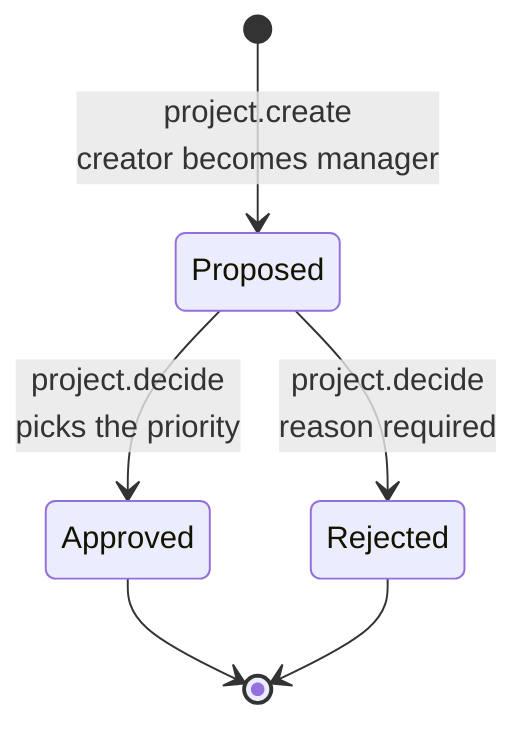

# Projects

A funded, time-boxed envelope that people propose documents into, and its
lifecycle. Decided with the user on 2026-09-26, 2026-09-30 and 2026-10-01.

What a project **is** (money and a deadline, not a plan) is in [[concepts]];
how it reaches iterations and intentions is in [[relationships]] §5.3. This
page is how a project is made, decided and run.

---

## 1. The entity

```
project
  id, name, description
  starts, ends            date            — the funded period
  target                  pages   null
  manager_id              → user          — whoever created it, until handed over
  state                   Proposed | Approved | Rejected
  priority                → priority level   null — set once, at approval
  decided_by, decided_at  null until decided
  decision_reason         text   null     — required on reject

project_members         (project_id, user_id)
project_group_members   (project_id, group_id)
```

Two separate things read as a project's "state", and they never mix:

| | Values | From |
|---|---|---|
| **decision** | *Proposed · Approved · Rejected* | stored, §2 |
| **period** | *Upcoming · Active · Ended* | derived from `starts` / `ends` and today |

A project can be *Approved · Upcoming*, or *Proposed · Active*. The card on
Projects shows both. Pace (*On pace*, *Behind pace*) is computed only for an
Approved project.

---

## 2. Lifecycle



- **Proposed.** The manager edits it and its members; members propose
  documents into it ([[flows]] I13). Those proposals are ordinary Pending
  proposals: they are in Proposals, in their proposal custody, and a curator
  **may** decide one on its own before the project is decided.
- **Approved.** Approving picks the project's **priority**. Every proposal in
  it still Pending at that moment is approved at that priority, except those
  with an existing copy, which are skipped and decided on their own as
  rescans ([[flows]] D11). Proposals already decided keep their decision.
- **Rejected.** A reason is required, and every member reads it. The
  project's requests are rejected; a document others asked for too stays
  theirs ([[flows]] D12). A Rejected project takes no more proposals.
- **Both are final.** No un-approving, no un-rejecting. A rejected project
  that should be tried again is a new project.

### 2.1 Priority

- **The project's priority is set once, at approval, and never changes.** It
  is what the approval gave the proposals approved with it. It is not a live
  setting, so there is nothing for a later change to propagate.
- **It pre-fills** the priority of a proposal flagged *after the project's
  approval* ([[flows]] I14), decided on its own in Proposals. The curator may
  pick another.
- **After approval each item's priority is its own.** A curator changes it
  on the item as for any other, logged on the iteration ([[status-log]] §3).

---

## 3. Who does what

| Act | Permission | Shipped roles |
|---|---|---|
| see a project | `project.read@project` · `@any`, or `project.decide` | members (via their role) · dig-curator · curator · admin |
| start one | `project.create` | staff and up; a reader cannot. Starting is its own grant, not implied by proposing |
| edit details, description, dates, target | `project.edit@managed` · `@any` | the manager · dig-curator · admin |
| add or remove members, hand over the manager role | `project.manage_members@managed` · `@any` | the manager · dig-curator · admin |
| propose documents into it | `request.create` + membership | members, while Proposed or Approved |
| approve or reject it | `project.decide@any` | curator · admin |
| delete it, only while it has no proposals | `project.delete@managed` · `@any` | the manager · dig-curator · admin |

- **`managed` is a new scope**: *a project whose `manager_id` is me*. It sits
  beside `project` (a project I am a member of), so a manager can edit the
  projects they run and nothing else, and plain members cannot edit at all.
- **The manager is always a member.** Handing over moves `manager_id`; the
  old manager stays a member until removed.
- **The manager cannot change the decision** and cannot decide the
  project's proposals, unless they also hold `project.decide` or
  `request.decide` through their role.
- **What an Approved project still allows to change**: description, members,
  manager. Its **dates and target** stay editable too, since a grant can be
  extended (confirmed 2026-10-01); a change warns that its intentions' counting follows. Its
  **priority** and its **decision** do not change.
- **`project.decide` includes seeing projects** (decided 2026-10-01): whoever
  decides a project can read every project, without a separate
  `project.read@any`.
- **Deleting** (decided 2026-10-01) is offered only for a project with **no
  proposals** in any state. Anything else is history and stays. It is
  logged.
- **Removing a member** leaves their proposals as they are, still in the
  project (confirmed 2026-10-01).

---

## 4. Where it appears

| Surface | What |
|---|---|
| **Projects** | each card: decision and period, manager, description, members, priority once approved, pace once approved. A Proposed project has **Approve…** and **Reject…** for `project.decide` holders, and a count of its proposals: *N pending · N with a copy (will be skipped)* |
| **Projects, the decision dialog** | approve: pick the priority, read what it will approve and what it will skip. Reject: a reason, and what it will decline versus leave to other askers |
| **Proposals** | a project chip on a row; *after the project's approval* flag; filter by project |
| **Propose form** | the projects I am a member of that are Proposed or Approved; a Rejected one is not offered |
| **Documents / My Documents** | the project on the item; project filter and grouping (decided 2026-09-26) |
| **Home** | later |
| **Hooks** | `project.created`, `project.approved`, `project.rejected` |

---

## 5. Logged

Every change, as `project` events ([[status-log]] §3): created · details or
description changed · dates or target changed · member added or removed ·
manager changed · deleted (empty only) · approved, with its priority and what it approved and
skipped · rejected, with its reason.

---

## 6. Open

Nothing yet. Answered 2026-10-01: `project.decide` implies seeing projects;
only a project with no proposals can be deleted (§3).

## Related

- [[concepts]]: what a project is
- [[relationships]]: §1 the entity, §5.3 funding
- [[permissions]]: §3 the project permissions, §2 the `managed` scope
- [[flows]]: I13, I14, D11, D12, and PJ1–PJ6
- [[status-log]]: §3 project events
