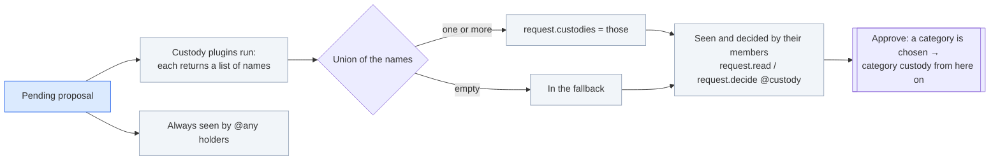

# Proposal custody

Who sees and decides a proposal before it has a category. Decided with the user
on 2026-09-26 and 2026-09-30.

---

## 1. Why it exists

Category custody places everything **after** approval: an iteration has a
category, and a curator holding that branch looks after it
([[relationships]] §5.2). A proposal has **no category yet**. The category is
chosen at approval, so category custody cannot say whose a proposal is.

Proposal custody fills that gap. It has two parts, kept apart on purpose:

| | Is | Lives in | Edited by |
|---|---|---|---|
| **a custody** | a name with members: users and groups | Users & Groups | admins, `access.manage` |
| **which proposals are in it** | a **property of the proposal**, set by *Custody* plugins | on the proposal, computed | the plugin's configuration, on Plugins |

A proposal carries the custodies its plugins gave it. The members of those
custodies **see and decide** it: `request.read@custody` and
`request.decide@custody` both resolve through it ([[permissions]] §3).

---

## 2. The entity

```
proposal_custody
  id, name, description
  is_fallback      bool   — exactly one, from installation
  (revision history)

proposal_custody_members        (custody_id, user_id)
proposal_custody_group_members  (custody_id, group_id)

request.custodies   → proposal_custody[]   — computed by Custody plugins; never typed in
```

- **Members are users or groups**, like category custody. A group gives its
  members this custody; groups give no roles ([[permissions]] §1).
- **Membership is not capability.** A member reaches nothing without
  `request.decide@custody` or `request.read@custody` held through a role. A
  member without the role sees nothing, and the Users & Groups record says so.
- **Nobody sets `request.custodies` by hand.** It is always the plugins' answer,
  so *why is this proposal here* is always the plugin's rule, which can be read.

### 2.1 The fallback

- **Exactly one, always.** It is created at installation and cannot be
  deleted. No plugin names it.
- **It catches only what no plugin placed.** A proposal every Custody instance
  answered with an empty list is in the fallback, and in nothing else.
- Admins edit its members. With no members, only holders of
  `request.decide@any` (admin) see what lands in it.
- A row in it says *fallback*, so an admin can see which proposals no rule
  reaches.

---

## 3. Custody plugins

A plugin kind of its own, **Custody**. An instance looks at one proposal and
**returns the names of the custodies it belongs in**: an empty list for none,
several names for several.

| | |
|---|---|
| **given** | the proposal as one JSON document: the request (requester, their groups and IdP attributes, project, reason, batch and how it was filled), the document (material type, unit, signature, page count), the **catalog record** as the adapter returned it, registry states, and the results of the checks |
| **returns** | `["Periodicals", "Moravica"]`, or `[]` |
| **reference implementation** | **jq**: one jq expression per instance, evaluated over that JSON, that must return an array of names |

```jq
[ if .document.type == "Periodical" then "Periodicals" else empty end,
  if (.record.fields."260".c // "" | test("^18")) then "19th-century prints" else empty end,
  if .request.project == "Moravica" then "Moravica" else empty end ]
```

**One instance can name any number of custodies.** Evaluating one instance per
custody would run as many rules as there are custodies over every proposal.
Several instances are still allowed, for example one per catalog, and their
answers are a **union**.

**A name that is not a custody** (misspelt, or deleted since) is ignored for
that proposal, and the instance shows a warning on Plugins, with the unknown
names and how many proposals they came from.

**Other implementations** may decide differently, from shelf-mark prefixes, a
lookup table or a model. The contract is the same: a proposal in, names out.

---

## 4. How it resolves



- **Evaluated live** (decided 2026-09-30). The plugins run when the proposal is
  made, when its checks finish, when its catalog record or its request
  changes, and over every open proposal when a Custody instance changes or a
  custody is deleted (§7). So a proposal can move between custodies, or in and out of the
  fallback, as facts arrive. A re-run over open proposals is a task on Tasks.
- **Overlap is a union** (decided 2026-09-30). A proposal with two custodies
  is seen and decidable by both sets of members, and its row names both. There
  is no "owner" among them. The first to decide decides for everyone, as with
  several askers ([[status-model]] §2.7).
- **A plugin that fails** on a proposal leaves that instance's answer out. If
  no instance answered, the proposal is in the fallback. The failure is a task
  error, never a silent drop.
- **After approval it is over.** The chosen category places the item in
  category custody for everything after. The custodies it had when it was
  decided are recorded in the log, not kept on the item.
- **Held items** (*approve now* or a plugin's `additions` entry that found a
  copy) resolve the same way. They are proposals.

---

## 5. Where it appears

| Surface | What |
|---|---|
| **Proposals** | a custody chip on each row (*Periodicals*, or *fallback*), a **Custody** filter, and the header's *N in my custody*. Default: every proposal I may see |
| **Documents** | before approval, other people's asks and their reasons are visible only in my custodies (`request.read@custody`) |
| **Users & Groups** | the custodies: name, description, members (users and groups), open proposals in each, and the fallback pinned first |
| **Plugins** | the Custody instances: the jq expression, the custody names it can return, the warning for unknown names, and *Run over open proposals* |
| **a user's record** | the proposal custodies they are in, direct or via a group |
| **Home / the Proposals card** | *N waiting for your review*: the proposals in my custodies |
| **Hooks** | a hook on `request.created` can filter by custody, e.g. *mail the Periodicals custody's members* |

---

## 6. Rules

1. **Nothing is unreachable.** The fallback exists and cannot be deleted, so
   every proposal is always in at least one custody.
2. **Custody never picks the category.** A decider may approve into any leaf,
   including one outside their category custody. The item then belongs to that
   branch's curators.
3. **Custody is never typed in.** It is the plugins' answer. To move a proposal,
   change a rule.
4. **Changes are logged**: custodies created, renamed, deleted, members added
   or removed, and rule changes as `access` events ([[status-log]] §3); the
   custodies a proposal had when it was decided on the request's decision
   entry.

---

## 7. Deleting a custody

Decided 2026-10-01. **Allowed**, even while a rule still names it.

- Deleting starts the same re-run as a rule change: every open proposal is
  evaluated again. Proposals that had only that custody land in the fallback.
- The rule's answer now contains a name that is not a custody, so the instance
  shows the unknown-name warning (§3) until the rule is changed.
- The deletion is logged, as an `access` event ([[status-log]] §3).

Any change to a Custody plugin, its rule, enabling or disabling an instance,
re-runs over **all open proposals**. Decided proposals are never re-run.

## Related

- [[permissions]]: §3 `request.decide` and `request.read`, the scopes this resolves
- [[relationships]]: §1 the entity, §2 membership
- [[flows]]: D10, a proposal no custody covers
- [[view-map]]: §2.2 Proposal Review
