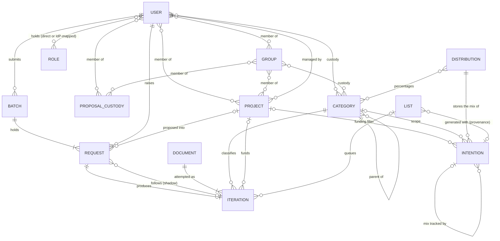

# Entity Relationships

The exact shape of the model the demos are drawn against. Every relationship in
VERA between **users, groups, projects, intentions, categories and documents**
is listed here — including the ones that deliberately do *not* exist, because
those are what stop a view from inventing a join that has no answer.

This is a redesign decision, not a description of the current system.

**[[concepts]] first** if you have not read it — this page is the cardinalities,
not the meanings.

---

## 1. The entities

Six were asked for. The rest carry relationships between them and cannot be
left out without making the map wrong:

| Entity | What it is | Why it exists |
|--------|-----------|---------------|
| **User** | one person | identity |
| **Group** | a named set of users | so custody and project membership are given to a team, not a list — a group never gives a role |
| **Role** | a named set of permissions | so *what you may do* is separate from *who you sit with* |
| **Project** | a funded, time-boxed envelope with a description and a manager; *Proposed · Approved · Rejected*, a priority set once at approval. Its target is its intention's ([[projects]] §1.1) | funding; members propose into it |
| **Intention** | a planning target: *N pages of this mix, by this date* | what list generation aims at |
| **Distribution** | the stored form of an intention's mix: category percentages, revisioned — **backend only**, never shown as its own thing | so intentions can share one mix, and history can say what the mix was |
| **Category** | the tree of **lines of work** — streams the library plans and staffs on its own, never a subject classification ([[concepts]] *Category*) | classification of the attempt **and** custody |
| **Document** | one bibliographic item | the thing being digitized |
| **Iteration** | one pass of a document through digitization | re-scans are not new documents |
| **Request** | one person's ask for one document | provenance, and "my stuff" |
| **Batch** | one submission of one or more asks — a batch of one included | the reason, and for additions category, priority and *approve now*, given once for everything submitted together |
| **Proposal custody** | a name with members; which proposals are in it is set by *Custody* plugins; exactly one is the *fallback* | who decides a proposal before it has a category ([[permissions]] §3) |

**Role is not Group.** A group answers *who do I belong with*; a role answers
*what may I do*. Merging them is the mistake that makes "give Jana access to
periodicals" and "let Jana approve things" the same action, which they are not.
So a group **never gives a role** (decided 2026-09-26): roles are held directly
or mapped by the IdP plugin ([[permissions]] §1.1).

**Proposal and addition are not entities.** They are **phase names for one
Request**, and there is no row for either. The phase is derived
([[status-model]] §5):

| Called | When |
|--------|------|
| a **proposal** | `decision = Pending` |
| an **addition** | `decision = Approved` ∧ its iteration does not exist yet |
| — | the iteration exists; the request has produced work |

This is why there is no `request.proposal_id` and no *approved into* edge. The
archived system had two tables and copied one into the other on approval, which
is where "a user loses sight of their request the moment it is approved" came
from — the thing they were following stopped existing. One row that changes
state cannot have that failure.

**A batch is the one submission entity.** Every ask arrives in a batch — a
batch of one included — whichever way it was filled; there is no separate
addition batch. An addition is a batch submitted with *approve now*.

The **Proposals** page keeps its name, because that is what the work at that
phase is called. There is no Additions page any more: an addition is a
proposal approved at the moment it is made ([[status-model]] §2.8), and its
ingest failures are a status in Documents ([[view-map]] §2.1). The page names
are phases; the entity is the request.

**Iteration, not Document, is the unit of work.** Category, priority, project
and list membership all hang off the iteration. A document re-digitized in 2029
is the same document with a second iteration, classified differently, funded
differently, on a different list. Every view that lists "documents" is in fact
listing iterations.

---

## 2. Every relationship, exactly

Cardinality is written from left to right. **Holder** is where the link is
stored — the side that changes when the link changes.

### Access

| From | To | Card. | Holder | Optional |
|------|----|:-----:|--------|:--------:|
| User | Group | M:N | `group_members` | yes |
| User | Role | M:N | `user_roles` | yes — held directly, or mapped by the IdP plugin |
| User | Category | M:N | `category_members` | yes |
| Group | Category | M:N | `category_group_members` | yes |
| User | Proposal custody | M:N | `proposal_custody_members` | yes |
| Group | Proposal custody | M:N | `proposal_custody_group_members` | yes |
| Request | Proposal custody | M:N | `request.custodies` — computed by *Custody* plugins, never typed in ([[proposal-custody]]) | yes — none means the fallback |
| User | Project | M:N | `project_members` | yes |
| Group | Project | M:N | `project_group_members` | yes |
| Project | User (manager) | N:1 | `project.manager_id` | no — whoever created it, until handed over |

**There is no Group → Role.** A group gives custody, proposal custody and
project membership; capability reaches a user only as a role they hold.

A user may hold **no** roles, and then sees an empty application — that is the
intended failure, not a default ([[permissions]] §2.1). Proposing, tracking and
withdrawing your own requests are **self-scoped permissions**: they need a
grant, but no scope, because authorship (§5.1) is how they resolve rather than
something a role chooses.

Groups are **flat**. No group contains another. Nesting groups gives two
inheritance systems — group nesting and the category tree — whose interaction
nobody can predict from a screen.

### Structure

| From | To | Card. | Holder | Optional |
|------|----|:-----:|--------|:--------:|
| Category | Category (parent) | N:1 | `category.parent_id` | root only |
| Intention | Project | N:1 | `intention.funding_filter` — a scope, not ownership: the intention counts what that project funds ([[intentions]] §3) | yes — any funding when empty |
| Intention | Project (its own) | 1:1 | `intention.project_id`, unique — the project's own intention: funding and window read from the project, and the only holder of its target ([[intentions]] §3.4) | yes — every project has one; most intentions are no project's |
| Intention | Category | N:1 | `intention.scope_category` — one node, with its subtree ([[intentions]] §3.2) | yes — all categories when empty |
| Intention | Intention template | N:1 | `intention.template_id` — the repeat that made it ([[intentions]] §3.3) | yes |
| Intention | Intention (tracked mix) | N:1 | `intention.tracks_mix_of` — uses another intention's mix; **no chains**: the one tracked has its own | yes — its own mix when empty |
| Intention | Distribution | N:1 | `intention.distribution_id` — the mix as stored; an intention tracking another points at the same row | no |
| Distribution | Category | M:N **+ percentage** | `category_share` | yes |
| Digitization list | Intention | N:1 | `list_generation.intention_id` — **provenance only**: what the list was generated with, plus the mix as it was ([[intentions]] §5). What a list *counts towards* is derived, never stored | yes — hand-built lists have none |

**The mix belongs to the intention; the distribution is how it is stored**
(decided 2026-09-26). An intention either has its own mix or tracks another
intention's — Overall's, typically — and every intention tracking a mix shares
one distribution row. Editing a shared mix lists every intention it affects
first, with the choice to **detach** this one onto its own copy. The
distribution is revisioned, which is what lets a list's provenance say what
the mix was ([[intentions]] §2, §5). Nobody picks or names a distribution.

`category_share` carries `(distribution_id, category_id, percentage)`, the only
weighted relationship in the model. Three properties that are easy to get wrong:

- **A sibling set sums to 100**, and a category's effective share is its own
  percentage **multiplied by its parent's**, recursively. The percentages do not
  sum to 100 across the distribution — they sum to 100 per level.
- **The write unit is the sibling set, under a lock on the distribution.** One
  row cannot be edited alone, because changing one child's percentage is a
  decision about where the difference comes from ([[intentions]] §1.1).
- **A set summing to less than 100 is flagged, not corrected.** The remainder
  is unallocated and generation reports it as such rather than scaling the rest
  up. `0%` means deliberately excluded.

### Work

| From | To | Card. | Holder | Optional |
|------|----|:-----:|--------|:--------:|
| Document | Catalog record | N:1 | `document.catalog_record_id` | no |
| Iteration | Document | N:1 | `iteration.document_id` | no |
| Iteration | Category | N:1 | `iteration.category_id` | **no** |
| Iteration | Project | N:1 | `iteration.project_id` | yes |
| Iteration | Digitization list | N:1 | `iteration.list_id` | yes — null = not queued |
| Iteration | Request | N:1 | `iteration.request_id` | **no** — see below |
| Request | User | N:1 | `request.created_by` | no — person or agent |
| Request | Project | N:1 | `request.project_id` — shown in Projects, and in Documents / My Documents | yes |
| Request | Batch | N:1 | `request.batch_id` | **no** — every submission is a batch |
| Request | Iteration (shadows) | N:1 | `request.tracks_iteration_id` | yes — [[status-model]] §2.7 |
| Document | Registry | 1:N | `document_registry_state` | yes — [[registry-status]] |

`iteration.category_id` is **not nullable**, and **must reference a leaf**. An
iteration with no category is invisible to custody-based access — it would
belong to nobody and appear in no curator's queue — so classification happens at
ingest or ingest fails. The leaf constraint is what keeps distribution shares
clean ([[intentions]] §1.2); it is a trigger or an application invariant, since
*is a leaf* is a statement about other rows.

Note the asymmetry, which is deliberate: **custody attaches at any node and
inherits down; classification attaches only at leaves.** Custody is about people
and applies to subtrees (§5.2); classification is about documents and applies to
the bottom of the tree.

`iteration.request_id` is **not nullable either**, and `request.created_by` is
always a user. Nothing enters VERA authorless: a plugin that discovers a
document creates a request attributed to its **agent**, and the plugin's
configured entry point decides whether that request needs review
([[view-map]] §6). An agent is a user record flagged as non-human, so custody,
authorship and the status log all work against it unchanged.

**Everyone who asks is a user** — a person or an agent. Somebody from outside
the library is a person holding a role such as `guest` or `reader`, which the
IdP plugin assigns ([[permissions]] §1.1); *guest* is a role, not a kind of
user. That is why `created_by` can stay a plain foreign key instead of a
nullable contact record.

`request.reason` — **the asker's own words for why they want this**, optional,
free text. It is not decoration: it is the only decision-relevant thing a
curator learns that no plugin can supply. *"Needed for the March exhibition"*
and *"came across it, looked interesting"* lead to the same approval and a
different **priority**, which is set at that same moment ([[view-map]] §2).

It is per **request**, so one document may carry several — and each asker sees
only their own ([[view-catalog]] §3).

---

## 3. The map



---

## 4. What deliberately does not exist

The negative space is load-bearing. Each of these was considered and rejected;
a view that needs one of them is a view built on a join with no answer.

| Not related | Why | Get there by |
|-------------|-----|--------------|
| **User → Document** | a person never owns an item | custody (§5.2) or authorship (§5.1) |
| **Category → Project** | the lines of work outlive any grant | an intention: its funding filter and its category scope |
| **Intention → Document** | an intention is a target, not a selection | its scope matched against iteration → list start ([[intentions]] §6) |
| **Group → Group** | one inheritance system is enough | flat membership |
| **Group → Role** | capability reaches a person only as a role they hold, never by joining a team (decided 2026-09-26) | `user_roles`, set by hand or by the IdP mapping |
| **Project → Category** | same as above, other direction | an intention: its funding filter and its category scope |
| **Document → Category** | classification is per attempt | iteration |
| **Document → Project** | funding is per attempt | iteration |

The last two are the ones most often assumed — the archived feature specs in
`docs/bak/` list `project` and `category` as *document* fields throughout. They
are iteration fields. Anything drawn against those specs is drawn against a
join that has no answer.

---

## 5. Reaching documents

Three paths, and **only** three. Every list of documents in every view is one
of these, or an intersection of them.

### 5.1 Authorship — "things I asked for"

```
me → request.created_by → request → iteration.request_id → iteration
```

Answers *My Documents*. Survives the proposal → addition → document transition
because `iteration.request_id` links back to the request that produced it. Break
that link and a user can follow their request up to the moment it is approved
and then loses it — which is the single most common complaint about the current
system.

A system-discovered document appears in **its agent's** *My Documents*, not in
nobody's. Having the harvester be a requester like any other is what keeps this
path from needing a null case — and it means an admin can open an agent's
requests and see exactly what a sweep proposed, which is otherwise a question
only the logs can answer.

### 5.2 Custody — "things in my care"

```
me → category_members ∪ (my groups → category_group_members)
   → category + its descendants
   → iteration.category_id → iteration
```

Answers the curator queues. **Membership inherits downward only.** A member of
*Periodicals* has custody of *Periodicals / Regional*; a member of
*Periodicals / Regional* has no claim on *Periodicals* or its siblings.

> **Effective members** of a category = its own members ∪ the members of every
> ancestor. Computed on read, never stored — storing it means every category
> move rewrites a membership table.

### 5.3 Funding — "things this project paid for"

```
project → iteration.project_id → iteration
```

Answers project reporting: *what did this money pay for?* How much, against
what target and at what pace is the project's own intention, which measures
the same funded iterations over the project's period ([[intentions]] §3.4,
§6); its planned pages and the project's documents must never be summed
together.

---

## 6. Where each property lives

The question "is this on the document or the iteration?" decides every column
in every view, so it is answered once, here.

| Property | Lives on | Because |
|----------|----------|---------|
| catalog record, identifiers | Document | the item does not change between attempts |
| page count, size, material type | Document | physical facts |
| digitization state, registry records | Document | "is this digitized anywhere" is about the item |
| **category** | Iteration | may be reclassified for a re-scan |
| **priority** | Iteration | urgency is per attempt |
| **project** | Iteration | a re-scan can be funded by a different grant |
| **list membership** | Iteration | a document is queued once per attempt |
| **status / reason** | Iteration | approval applies to the attempt |
| **requester** | Request → Iteration | provenance |

---

## 7. Open decisions

- ~~**Where a role attaches**~~ — **answered: to users only** (2026-09-26,
  reversing the earlier "both"). Roles are held directly or mapped by the IdP
  plugin; groups give custody, proposal custody and project membership
  ([[permissions]] §1).
- `TODO(Tenancy):` **more than one library in one VERA.** Deferred until the
  views exist; nothing in the model blocks it, and three things are worth
  knowing before anybody designs against the current assumption:

  1. **Access mostly falls out already.** Custody inherits down the tree
     (§5.2), so a per-library **root category** is the cheapest tenancy
     boundary there is — no new mechanism.
  2. **Identity is the actual decision.** Two libraries can hold the same
     catalog record. One shared document with per-library iterations makes
     [[status-model]] §2.7 into native cross-library duplicate detection —
     the job [[registry-status]] uses RDCZ for. Two separate documents keeps
     them fully isolated. Neither is obviously right.
  3. **Do not encode the library into group names.** `MZK - curator` puts a
     role inside a group name and re-merges exactly what §1 separates, with no
     integrity check to catch a typo. A role held *at* a library —
     `user_roles(user, role, library)` — costs the same and stays queryable.

  Configuration is the part that breaks outright rather than bending: plugin
  and registry adapters, and the identifier patterns below, are all global
  today and are all per-library in reality.

- **Can an iteration change project after it is listed?** If yes, historical
  project reporting stops being reproducible without an event log.
- **`request.project_id` vs `iteration.project_id`** — the iteration inherits
  the request's project at ingest, but they can diverge afterwards. Deciding
  they cannot would remove a column; deciding they can needs the curator UI to
  say which one it is editing.
- ~~Whether a **request may produce more than one iteration**~~ — **answered**
  by [[status-model]] §2.7, and the answer is that the other direction is not
  needed. A request either **produces** an iteration (`iteration.request_id`,
  N:1, unchanged) or **shadows** one (`request.tracks_iteration_id`), never
  both. A re-scan is a new request. No join table.

## Related

- [[document-identity]] — how a document is named once you have one
- [[priority-levels]] — the four-value enum on the iteration
- [[view-rules]] — §4 actors, which consume §5's three paths
- [[view-map]] — which view runs which path
