# Flows

Every path a document and a digitization list can take, from the ask to
the published scan. **One scenario, one diagram.** The list below is the
index. A path that is not in it is a gap in the design.

Drawn 2026-09-30 from [[status-model]], [[document-use-cases]],
[[view-map]] §2, [[intentions]] §4–§6, and the review decisions in
`docs/demos/STATUS.md` (*From the outside review*). Where those disagree
with an older passage elsewhere, this page follows the review decisions.

**How to read a diagram**

- **Blue box**: a state, with what the requester reads underneath.
- **Rounded, white**: something a person does: *page · action ·
  permission*.
- **Grey**: something the system does by itself.
- **Orange**: not decided yet. The diagram shows the branches.
- **Counts**: *planned* is on a list that still exists and starts inside an
  intention's window. *Delivered* and *output* start at Digitized
  ([[intentions]] §6).

Projects are PJ1–PJ6, with their approval and rejection in D11 and D12
([[projects]]). Mixes are M1–M7 ([[intentions]] §2). Proposal custody gets its own set later.

**Composite diagrams.** The same scenarios merged, one file per stage, with
each edge labelled with the IDs below:

| File | Covers |
|---|---|
| [`flows/document-lifecycle.mermaid`](flows/document-lifecycle.mermaid) | the whole path, on one page |
| [`flows/intake-and-decision.mermaid`](flows/intake-and-decision.mermaid) | I1–I14, D1–D12 |
| [`flows/ingest-gates-cancellation.mermaid`](flows/ingest-gates-cancellation.mermaid) | G1–G3, V1–V14, C1–C4, P2 |
| [`flows/lists-and-publishing.mermaid`](flows/lists-and-publishing.mermaid) | L1–L17, P1–P3 |

---

## Index

| | Scenario | | Scenario |
|---|---|---|---|
| **Intake** | | **Gates and validation** | |
| [I1](#i1) | propose one new item | [V1](#v1) | no defect, no restriction |
| [I2](#i2) | propose several: a batch, and the limit | [V2](#v2) | defect fixed in place |
| [I3](#i3) | not in the catalog | [V3](#v3) | defects accepted |
| [I4](#i4) | which volume? | [V4](#v4) | some accepted, some outstanding |
| [I5](#i5) | a catalog VERA cannot search | [V5](#v5) | denied, then fixed |
| [I6](#i6) | already being digitized | [V6](#v6) | re-check finds the same or fewer |
| [I7](#i7) | digitized before: existing copy | [V7](#v7) | re-check finds something new |
| [I8](#i8) | approve now, no copy | [V8](#v8) | acceptance revoked |
| [I9](#i9) | approve now, copy found | [V9](#v9) | catalog record changes upstream |
| [I10](#i10) | harvester, *proposals* entry | [V10](#v10) | forbidden, then overruled |
| [I11](#i11) | harvester, *additions* entry, no copy | [V11](#v11) | forbidden for good |
| [I12](#i12) | harvester, *additions* entry, copy found | [V12](#v12) | the rule stops finding it |
| [I13](#i13) | propose into a project | [V13](#v13) | reclassify |
| [I14](#i14) | propose into an approved project | [V14](#v14) | a gate fails after Ready |
| **Decision** | | **Cancellation** | |
| [D1](#d1) | approve | [C1](#c1) | cancelled before Ready |
| [D2](#d2) | approve a document several people asked for | [C2](#c2) | cancelled while Ready |
| [D3](#d3) | approve as rescan | [C3](#c3) | cancelled while on a list |
| [D4](#d4) | bulk approve on a batch | [C4](#c4) | a new ask for a held item |
| [D5](#d5) | decline | **Lists** | |
| [D6](#d6) | one of several askers withdraws | [L1](#l1) | by hand, starts later |
| [D7](#d7) | the only asker withdraws | [L2](#l2) | by hand, starts now |
| [D8](#d8) | checks still running | [L3](#l3) | Generate: none, one, several generators |
| [D9](#d9) | forbidden before ingest, approved | [L4](#l4) | Generate with a shortfall |
| [D10](#d10) | no proposal custody covers it: fallback | [L5](#l5) | Generate tops up a list |
| [D11](#d11) | a project is approved | [L6](#l6) | correcting run |
| [D12](#d12) | a project is rejected | [L7](#l7) | catch-up run |
| **Ingest** | | [L8](#l8) | starts outside its intention's window |
| [G1](#g1) | ingest succeeds | [L9](#l9) | an item taken off |
| [G2](#g2) | ingest fails, retried | [L10](#l10) | dates moved |
| [G3](#g3) | no catalog record | [L11](#l11) | a member gains a blocker |
| **After scanning** | | [L12](#l12) | an item cancelled from the list |
| [P1](#p1) | the link is set: Published | [L13](#l13) | an item could not be digitized |
| [P2](#p2) | a defect found after digitizing | [L14](#l14) | mark Done |
| [P3](#p3) | a rescan, years later | [L15](#l15) | an unfinished list deleted |
| | | [L16](#l16) | a Done list cannot be deleted |
| **Projects** | | [L17](#l17) | a copy found after approval |
| [PJ1](#pj1) | start a project | | |
| [PJ2](#pj2) | the manager edits it, or hands it over | | |
| [PJ3](#pj3) | one of its proposals decided before the project | | |
| [PJ4](#pj4) | a member removed | | |
| [PJ5](#pj5) | an item's priority after approval | | |
| [PJ6](#pj6) | dates or target changed after approval | | |
| **Mixes** | | | |
| [M1](#m1) | a new intention: track or copy | | |
| [M2](#m2) | detach a tracker | | |
| [M3](#m3) | an owner switches to tracking | | |
| [M4](#m4) | an owner others track switches to tracking | | |
| [M5](#m5) | edit a mix nobody tracks | | |
| [M6](#m6) | edit a mix others track | | |
| [M7](#m7) | open a tracker's mix | | |

---

## Intake

### I1

**Propose one new item.** A batch of one ([[view-map]] §2.1).

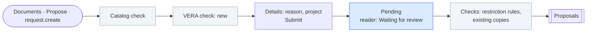

### I2

**Propose several at once.** One submission is one batch, whichever way
the list was filled.

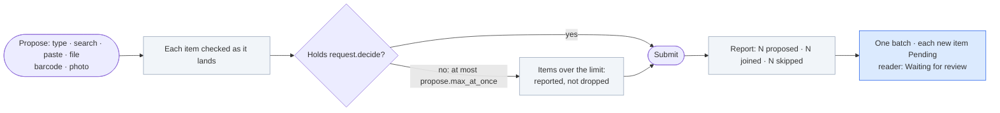

### I3

**Not in the catalog, or not a known identifier.**

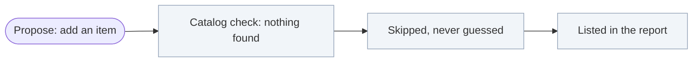

### I4

**Which volume?** The record has several units, and none has been picked.

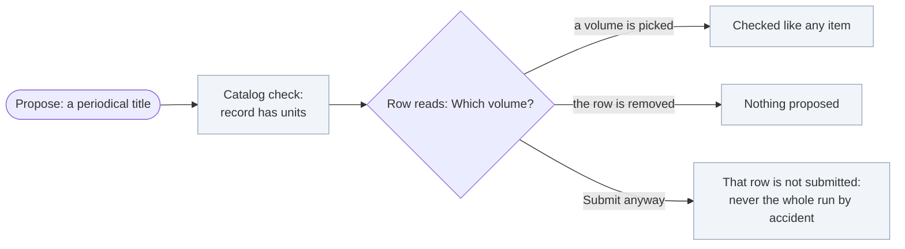

### I5

**A catalog VERA cannot search** (the adapter has `search` off).

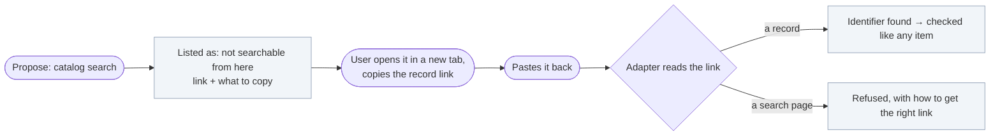

### I6

**Already being digitized.** The document has active work
([[status-model]] §2.7, case 2).

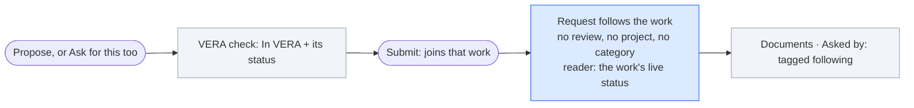

### I7

**Digitized before.** A registry or an earlier VERA iteration has a copy.
It blocks nothing; it goes in front of whoever decides.

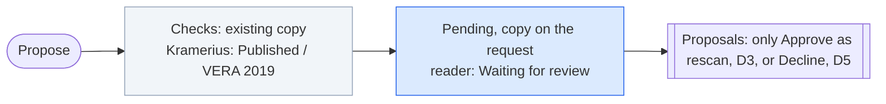

### I8

**Approve now, no copy.** An addition is a proposal approved at the moment
it is made ([[status-model]] §2.8).

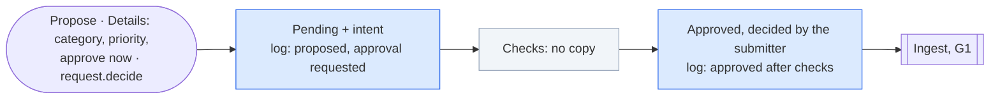

### I9

**Approve now, copy found.** A rescan is never a shortcut.

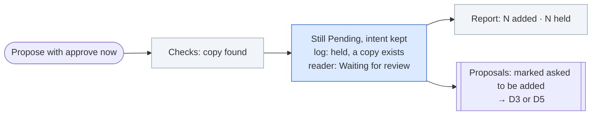

### I10

**Harvester with the *proposals* entry.** The agent is the requester.

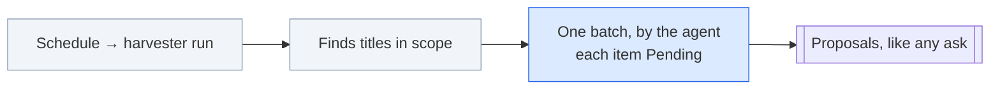

### I11

**Harvester with the *additions* entry, no copy.**

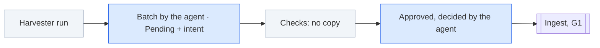

### I12

**Harvester with the *additions* entry, copy found.**

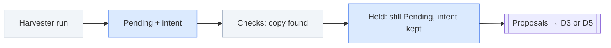

### I13

**Propose into a project.** Members may only propose into their own
project.

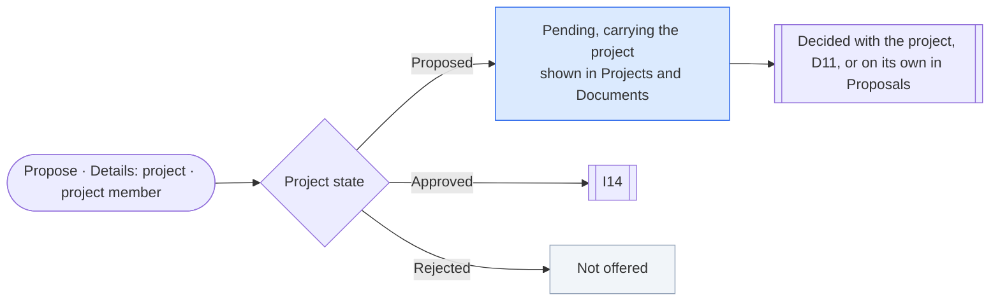

### I14

**Propose into an approved project.** Approval is not taken back to add
documents. There is no lock.

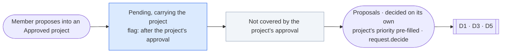

---

## Decision

### D1

**Approve.** The one place a human classifies an item.

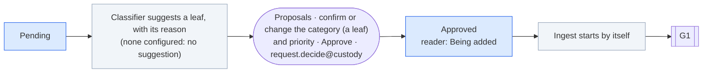

### D2

**Approve a document several people asked for.** One decision covers every
asker ([[status-model]] §2.7, case 1).

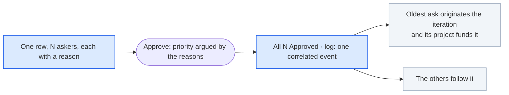

### D3

**Approve as rescan.** A copy exists and the curator decides to scan
again. One item at a time.

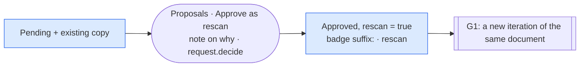

### D4

**Bulk approve on a batch.** There is no bulk decline.

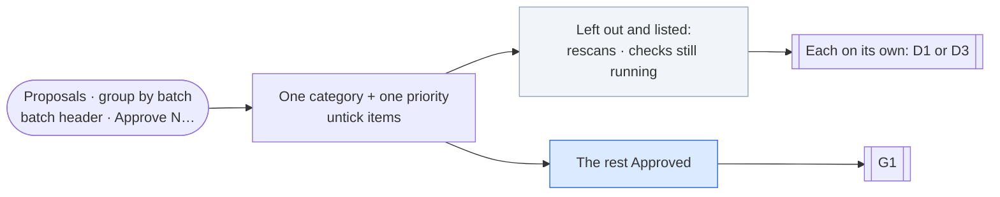

### D5

**Decline.** Every asker reads the reason, so it is about the document,
not a motive.

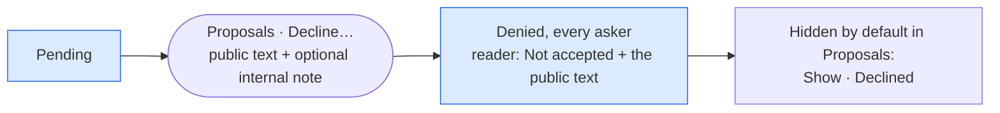

### D6

**One of several askers withdraws.**

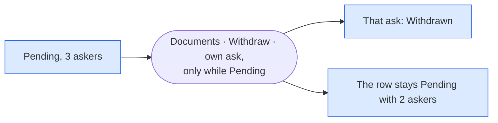

### D7

**The only asker withdraws.**

```mermaid
flowchart LR
  classDef st fill:#dbeafe,stroke:#2563eb
  A["Pending, 1 asker"]:::st --> B(["Documents · Withdraw"])
  B --> C["Withdrawn<br/>reader: Withdrawn"]:::st
  C --> D["Hidden by default in Proposals:<br/>Show · Withdrawn"]
  E["After approval there is no Withdraw"]
```

### D8

**Checks still running.** Nothing is decided on a half-checked item.

```mermaid
flowchart LR
  classDef st fill:#dbeafe,stroke:#2563eb
  classDef sys fill:#f1f5f9,stroke:#94a3b8
  A["Pending, checks not done"]:::st --> B["Proposals pane: no decision card<br/>bulk approve skips it"]:::sys
  B --> C[Checks finish]:::sys
  C --> D[[D1 · D3 · D5]]
```

### D9

**Forbidden before ingest, then approved.** A decision does not lift a
prohibition.

```mermaid
flowchart LR
  classDef st fill:#dbeafe,stroke:#2563eb
  classDef sys fill:#f1f5f9,stroke:#94a3b8
  A["Pending + restriction by a rule"]:::st --> B(["Proposals · Approve"])
  B --> C["Approved"]:::st
  C --> D["Ingest; the iteration inherits the restriction"]:::sys
  D --> E[[V10 or V11]]
```

### D10

**No proposal custody covers it.** No *Custody* plugin named a custody for
it ([[proposal-custody]]), so it lands in the fallback custody.

```mermaid
flowchart LR
  classDef st fill:#dbeafe,stroke:#2563eb
  classDef sys fill:#f1f5f9,stroke:#94a3b8
  A["Pending: every Custody plugin<br/>returned an empty list"]:::st --> B["Fallback custody: exactly one,<br/>catches only what nothing else covers"]:::sys
  B --> C{"Fallback has members?"}
  C -->|yes| D(["Its members · Proposals, row marked fallback<br/>request.decide@custody"])
  C -->|no| E(["Admins only · request.decide@any"])
  D & E --> F[[D1 · D3 · D5]]
  B -.-> G(["Admin changes a Custody plugin's rule:<br/>re-run moves it to that custody"])
```

### D11

**A project is approved.** It covers the proposals that exist at that
moment, except rescans.

```mermaid
flowchart LR
  classDef st fill:#dbeafe,stroke:#2563eb
  classDef sys fill:#f1f5f9,stroke:#94a3b8
  A["Project Proposed,<br/>its proposals Pending"]:::st --> B(["Curator · approve project · picks its priority"])
  B --> C["Project Approved"]:::st
  B --> D["Its proposals without a copy:<br/>Approved at that priority"]:::st
  D --> E[[G1 each]]
  B --> F["With an existing copy: skipped, listed"]:::sys
  F --> G[[D3 on its own]]
  C --> I[["Later proposals: flagged, decided on their own, I14"]]
```

### D12

**A project is rejected.** Only the project's own requests are rejected.

```mermaid
flowchart LR
  classDef st fill:#dbeafe,stroke:#2563eb
  classDef sys fill:#f1f5f9,stroke:#94a3b8
  A(["Curator · reject project"]) --> B["Project Rejected"]:::st
  A --> C{"Each document it asked for"}
  C -->|only the project asked| D["Declined<br/>reader: Not accepted"]:::st
  C -->|others asked too| E["The project's request declined<br/>the others stay Pending"]:::st
  E --> F{"Was it the one the others followed?"}
  F -->|yes| G["Oldest remaining request<br/>becomes the originator"]:::sys
  F -->|no| H[Nothing else changes]:::sys
```

---

## Ingest

### G1

**Ingest succeeds.** Starts by itself on every approval.

```mermaid
flowchart LR
  classDef st fill:#dbeafe,stroke:#2563eb
  classDef sys fill:#f1f5f9,stroke:#94a3b8
  A["Approved"]:::st --> B["Enqueued<br/>reader: Being added"]:::st
  B --> C[Catalog record, property sources,<br/>checks]:::sys
  C --> D[[Gates: V1 … V14]]
```

### G2

**Ingest fails, retried.** Machinery, not judgement: an admin's job.

```mermaid
flowchart LR
  classDef st fill:#dbeafe,stroke:#2563eb
  classDef sys fill:#f1f5f9,stroke:#94a3b8
  A["Enqueued"]:::st --> B[Adapter error]:::sys
  B --> C["Could not be added<br/>reader: Being added"]:::st
  C --> D["Documents · group by batch<br/>curator: failure text, no actions · addition.read"]
  C --> E(["Retry item or batch · addition.retry"])
  E --> F{Ingest}:::sys
  F -->|succeeds| G[[G1]]
  F -->|fails again| C
  C --> H[Event → hook, e.g. ops channel]:::sys
```

### G3

**No catalog record.** Ingest finished and found nothing: a defect, not a
failure.

```mermaid
flowchart LR
  classDef st fill:#dbeafe,stroke:#2563eb
  classDef sys fill:#f1f5f9,stroke:#94a3b8
  A[Ingest: identifier resolves to nothing]:::sys --> B["Review needed: no catalog record<br/>reader: Being checked"]:::st
  B --> C(["Repaired in the catalog ·<br/>Validations · Recheck"])
  C --> D[Re-check: the defect is gone]:::sys
  D --> E[[V1]]
```

---

## Gates and validation

The four gates: approved · no restriction, or overruled · validation
NotRequired or Approved · not cancelled ([[status-model]] §3).

### V1

**No defect, no restriction.**

```mermaid
flowchart LR
  classDef st fill:#dbeafe,stroke:#2563eb
  classDef sys fill:#f1f5f9,stroke:#94a3b8
  A[Checks: D empty, no restriction]:::sys --> B["Ready: in the pool<br/>reader: Waiting to be scheduled"]:::st
  B --> C[[Lists: L1 …]]
```

### V2

**A defect, repaired.** A repair needs no verdict. The record is repaired in
the catalog and *Recheck* pulls it again; a page count is entered in VERA and
runs the re-check itself (decided 2026-10-06).

```mermaid
flowchart LR
  classDef st fill:#dbeafe,stroke:#2563eb
  classDef sys fill:#f1f5f9,stroke:#94a3b8
  A["Review needed<br/>reader: Being checked"]:::st --> B(["Repaired in the catalog, then Recheck ·<br/>or Enter page count…"])
  B --> C[Checks run again]:::sys
  C -->|defect gone| D[[V1]]
  C -->|still there, or another| A
```

### V3

**Defects accepted.** The curator takes responsibility.

```mermaid
flowchart LR
  classDef st fill:#dbeafe,stroke:#2563eb
  A["Review needed: outstanding shown"]:::st --> B(["Validations · Accept all, or one by one<br/>optional note · validation.approve@custody"])
  B --> C["Verdict row: actor, at, note, keys"]
  C --> D["Validation Approved"]:::st
  D --> E[[V1: Ready]]
```

### V4

**Some accepted, some still outstanding.**

```mermaid
flowchart LR
  classDef st fill:#dbeafe,stroke:#2563eb
  A["Review needed: 2 defects"]:::st --> B(["Accept one"])
  B --> C["Still Review needed: 1 outstanding<br/>the accepted one in its own card"]:::st
  C --> D[[V2 · V3 · V5 for the rest]]
```

### V5

**Denied, then fixed.** A denial is about the defect; when the defect goes,
so does the denial.

```mermaid
flowchart LR
  classDef st fill:#dbeafe,stroke:#2563eb
  classDef sys fill:#f1f5f9,stroke:#94a3b8
  A["Review needed"]:::st --> B(["Validations · Deny…: pick the substantial ones,<br/>text every asker reads · validation.deny"])
  B --> C["Denied in review<br/>reader: On hold"]:::st
  C --> D(["Repair in the catalog, then Recheck ·<br/>or enter the page count"])
  D --> E[Re-check: that defect is gone]:::sys
  E --> F[[V1]]
```

### V6

**Re-check finds the same or fewer.** Nobody is disturbed.

```mermaid
flowchart LR
  classDef st fill:#dbeafe,stroke:#2563eb
  classDef sys fill:#f1f5f9,stroke:#94a3b8
  A["Approved: A covers D"]:::st --> B[Scheduled re-check]:::sys
  B -->|same defects| A
  B -->|none left| C["NotRequired"]:::st
```

### V7

**Re-check finds something new.** Only the new defect is shown.

```mermaid
flowchart LR
  classDef st fill:#dbeafe,stroke:#2563eb
  classDef sys fill:#f1f5f9,stroke:#94a3b8
  A["Approved"]:::st --> B[Re-check: a new defect key]:::sys
  B --> C["Review needed: only the new one<br/>the old ones stay accepted"]:::st
  C --> D[[V2 · V3 · V5]]
  B -.->|item already on a list| E[[L11]]
```

### V8

**An acceptance is revoked.**

```mermaid
flowchart LR
  classDef st fill:#dbeafe,stroke:#2563eb
  A["Approved"]:::st --> B(["Validations · Already accepted · Revoke<br/>validation.revoke@custody"])
  B --> C["Review needed: the defects are outstanding again"]:::st
  C --> D[[V2 · V3 · V5]]
```

### V9

**The catalog record changes upstream.** A catalog sync re-runs the checks
against the new record.

```mermaid
flowchart LR
  classDef sys fill:#f1f5f9,stroke:#94a3b8
  A[Catalog resync sees a change]:::sys --> B[Checks re-run]:::sys
  B -->|same D| C[[V6]]
  B -->|a new defect| D[[V7]]
  B -->|a defect repaired| E["It leaves D; a denial lapses"]:::sys
```

### V10

**Forbidden, then overruled.** Only rules forbid; only an admin says *yes
anyway*.

```mermaid
flowchart LR
  classDef st fill:#dbeafe,stroke:#2563eb
  classDef sys fill:#f1f5f9,stroke:#94a3b8
  A[A rule: never, e.g. conservation hold]:::sys --> B["Forbidden<br/>reader: Not available for digitization"]:::st
  B --> C(["Validations · Show: Forbidden<br/>curator messages an admin"])
  C --> D(["Documents · Overrule restriction…<br/>restriction.overrule@any"])
  D --> E["Forbidden (overruled): both records kept"]:::st
  E --> F[[the other gates]]
```

### V11

**Forbidden for good.**

```mermaid
flowchart LR
  classDef st fill:#dbeafe,stroke:#2563eb
  A["Forbidden"]:::st --> B["Nobody overrules"]
  B --> C["Stays at the gate, in no list pool<br/>visible in Validations · Forbidden"]:::st
```

### V12

**A later re-check no longer finds the restriction.** It is cleared.

```mermaid
flowchart LR
  classDef st fill:#dbeafe,stroke:#2563eb
  classDef sys fill:#f1f5f9,stroke:#94a3b8
  A["Forbidden"]:::st --> B[Re-check: the rule no longer fires]:::sys
  B --> C["Restriction cleared · logged"]:::st
  C --> D[[the other gates]]
```

### V13

**Reclassify.** Category and priority after approval, from Documents or
Validations. It may hand the item to another custody.

```mermaid
flowchart LR
  classDef st fill:#dbeafe,stroke:#2563eb
  classDef sys fill:#f1f5f9,stroke:#94a3b8
  A["Any state before Digitized"]:::st --> B(["More ▾ · Reclassify… · iteration.classify@custody"])
  B --> C{"New category"}
  C -->|inside my custody| D["Changed · logged"]:::st
  C -->|outside my custody| E["Changed · logged<br/>now in the other custody's queues,<br/>no longer in mine"]:::st
```

### V14

**A gate fails after the item was Ready.** Ready means every gate passed.

```mermaid
flowchart LR
  classDef st fill:#dbeafe,stroke:#2563eb
  classDef sys fill:#f1f5f9,stroke:#94a3b8
  A["Ready, not on a list"]:::st --> B[A new defect or a restriction]:::sys
  B --> C["Back to Enqueued: out of the pool"]:::st
  C --> D[[the blocking gate: V2 … V10]]
  D --> E["Ready again when it clears"]:::st
  B -.->|on a list instead| F[[L11]]
```

---

## Cancellation

Cancelling is a flag beside progress: nothing is lost, and resuming clears
the flag ([[status-model]] §2.5). A reason is always required.

### C1

**Cancelled before Ready** (Enqueued, in review).

```mermaid
flowchart LR
  classDef st fill:#dbeafe,stroke:#2563eb
  A["Enqueued or Review needed"]:::st --> B(["Documents or Validations · Cancel…<br/>public + internal reason · iteration.cancel"])
  B --> C["Cancelled<br/>reader: On hold + the public reason"]:::st
  C --> D(["Documents · Resume · iteration.resume"])
  D --> E[[back to the gates]]
```

### C2

**Cancelled while Ready.**

```mermaid
flowchart LR
  classDef st fill:#dbeafe,stroke:#2563eb
  A["Ready"]:::st --> B(["Cancel…"])
  B --> C["Cancelled: out of the pool"]:::st
  C --> D(["Resume"])
  D --> E["Ready"]:::st
```

### C3

**Cancelled while on a list.**

```mermaid
flowchart LR
  classDef st fill:#dbeafe,stroke:#2563eb
  classDef sys fill:#f1f5f9,stroke:#94a3b8
  A["Planned or In progress"]:::st --> B(["Documents, Validations, or the list · Cancel…"])
  B --> C["Off the list, Cancelled<br/>stops counting as planned"]:::st
  C --> D(["Resume"])
  D --> E["Ready: back in the pool, not on the old list"]:::st
```

### C4

**A new ask for a held item.** There is never a second active iteration.

```mermaid
flowchart LR
  classDef st fill:#dbeafe,stroke:#2563eb
  A(["Propose a cancelled item"]) --> B["Follows the held work<br/>reader: On hold"]:::st
  B --> C(["Resume, by whoever may"])
  C --> D["Every follower sees it move again"]:::st
```

---

## Lists

A list's state follows its date: Planned before `starts`, In progress
from that day, Done when marked. Everything in the editor is a draft until
*Save*.

### L1

**Built by hand, starts later.**

```mermaid
flowchart LR
  classDef st fill:#dbeafe,stroke:#2563eb
  classDef sys fill:#f1f5f9,stroke:#94a3b8
  A(["Lists · New list · list.create<br/>name, Starts on a date, ends"]) --> B(["Move items from Ready to list"])
  B --> C(["Save"])
  C --> D["List Planned · members Planned<br/>reader: Scheduled · counts as planned"]:::st
  D --> E[Start date arrives: nothing written]:::sys
  E --> F["In progress"]:::st
```

### L2

**Built by hand, starts now.**

```mermaid
flowchart LR
  classDef st fill:#dbeafe,stroke:#2563eb
  A(["New list · Starts now"]) --> B(["Move items · Save"])
  B --> C["In progress · members In progress<br/>reader: Scheduled"]:::st
```

### L3

**Generate: none, one, or several generators.**

```mermaid
flowchart LR
  classDef sys fill:#f1f5f9,stroke:#94a3b8
  A{List generators configured}:::sys -->|none| B[No Generate button: build by hand]:::sys
  A -->|one| C(["Generate…: pages · categories · shape by<br/>no picker"])
  A -->|several| D(["Generate…: picker, each marked<br/>rule-based or AI-based"])
  C & D --> E["Draft: picks marked generated,<br/>each with its reason"]:::sys
  E --> F(["Adjust by hand · Save"])
  F --> G["List records provenance:<br/>intention, mix, pages, generator"]:::sys
```

### L4

**Generate with a shortfall.** A list short of its plan says so.

```mermaid
flowchart LR
  classDef sys fill:#f1f5f9,stroke:#94a3b8
  A(["Generate: 4 000 pages"]) --> B[A category has too little Ready supply]:::sys
  B --> C["Report per category: short, and why<br/>e.g. N more waiting in review"]:::sys
  B --> D["Remainder re-spread to siblings with supply;<br/>never into a 0% category"]:::sys
  C --> E(["Accept the draft, or fill by hand"])
```

### L5

**Generate tops up an existing list.** Current members are fixed.

```mermaid
flowchart LR
  classDef sys fill:#f1f5f9,stroke:#94a3b8
  A(["Lists · Edit · list.edit"]) --> B(["Generate… towards the page target"])
  B --> C[Keeps every member, adds picks]:::sys
  C --> D(["Save: +N −M since opened"])
```

### L6

**Correcting run.** A tracking intention is out of band.

```mermaid
flowchart LR
  classDef sys fill:#f1f5f9,stroke:#94a3b8
  A(["Intentions · tracking card out of ±5 ·<br/>Generate correcting list…"]) --> B["Allocation per category, shown first:<br/>share · output · new pages · after · Ready"]:::sys
  B --> C(["Accept → Lists editor, shape locked, pages fixed"])
  C --> D["Generate against the allocation;<br/>what the pool cannot cover stays short"]:::sys
  D --> E(["Save: provenance keeps the allocation"])
  C -.-> F(["Use its plain mix instead"])
```

### L7

**Catch-up run.** A target intention is behind pace.

```mermaid
flowchart LR
  classDef sys fill:#f1f5f9,stroke:#94a3b8
  A(["Intentions · target card behind pace ·<br/>Generate catch-up list…"]) --> B[Pages pre-filled: what it is short]:::sys
  B --> C(["Lists editor, shaped by that intention"])
  C --> D[[L3 · L4]]
```

### L8

**The list starts outside the window of the intention it was shaped by.**

```mermaid
flowchart LR
  classDef sys fill:#f1f5f9,stroke:#94a3b8
  A(["Editor: generated with NDK Q3,<br/>starts 25 Jun"]) --> B[Warning: will not count towards NDK Q3]:::sys
  B --> C(["Move the start into the window"])
  B --> D(["Save anyway: counts towards<br/>what its dates match"])
```

### L9

**An item taken off.** Not a cancellation: no reason.

```mermaid
flowchart LR
  classDef st fill:#dbeafe,stroke:#2563eb
  A["Planned or In progress"]:::st --> B(["Lists · Edit · take off · Save"])
  B --> C["Ready: back in the pool<br/>stops counting as planned · logged"]:::st
```

### L10

**Dates moved on an unfinished list.** It warns first.

```mermaid
flowchart LR
  classDef st fill:#dbeafe,stroke:#2563eb
  classDef sys fill:#f1f5f9,stroke:#94a3b8
  A["Planned or In progress"]:::st --> B(["Edit · move the start"])
  B --> C{"Stops counting towards an intention?"}
  C -->|yes| D["Warning before Save:<br/>will stop counting towards NDK Q3"]:::sys
  C -->|no| E(["Save"])
  D --> E
  E --> F["State and member progress follow the new date"]:::st
```

### L11

**A member gains a blocker.** It stays on the list, flagged.

```mermaid
flowchart LR
  classDef st fill:#dbeafe,stroke:#2563eb
  classDef sys fill:#f1f5f9,stroke:#94a3b8
  A["On a list"]:::st --> B[A rule forbids it, or a new defect]:::sys
  B --> C["Still on the list, flagged:<br/>list and editor show N blocked"]:::st
  C --> D(["Dig-curator takes it off"]) --> E[[back to its gate]]
  C --> F(["Keeps it"]) --> G[Scanned as planned]:::sys
```

### L12

**An item cancelled from the list.**

```mermaid
flowchart LR
  classDef st fill:#dbeafe,stroke:#2563eb
  A["On a list"]:::st --> B(["Lists · item · Cancel… reason · iteration.cancel"])
  B --> C[[C3]]
```

### L13

**An item could not be digitized.** Set per item, with a message.

```mermaid
flowchart LR
  classDef st fill:#dbeafe,stroke:#2563eb
  A["In progress"]:::st --> B(["Lists · item · Could not be digitized…<br/>message · dig-curator"])
  B --> C["Could not be digitized<br/>reader: the message"]:::st
  C --> D(["Resume: found, repaired"])
  D --> E["Ready"]:::st
```

### L14

**Mark Done.**

```mermaid
flowchart LR
  classDef st fill:#dbeafe,stroke:#2563eb
  classDef sys fill:#f1f5f9,stroke:#94a3b8
  A["In progress"]:::st --> B(["Lists · Mark Done · dig-curator"])
  B --> C["Every member not marked in L13 → Digitized<br/>reader: Available once published"]:::st
  C --> D["Counts: delivered and output"]:::sys
  B --> E["List Done: dates can no longer move"]:::st
  C --> F[[P1]]
```

### L15

**An unfinished list deleted.** Lists are deleted, not cancelled.

```mermaid
flowchart LR
  classDef st fill:#dbeafe,stroke:#2563eb
  classDef sys fill:#f1f5f9,stroke:#94a3b8
  A(["Lists · Delete… · list.delete"]) --> B["Dialog counts what happens"]:::sys
  B --> C["Not digitized → Ready"]:::st
  B --> D["Cancelled → stay cancelled"]:::st
  B --> E["All stop counting as planned<br/>the log keeps that they were listed"]:::sys
```

### L16

**A Done list cannot be deleted.**

```mermaid
flowchart LR
  classDef st fill:#dbeafe,stroke:#2563eb
  classDef sys fill:#f1f5f9,stroke:#94a3b8
  A["Done list"]:::st --> B[No Delete: its members are digitized,<br/>its dates are fixed]:::sys
```

### L17

**A copy found after approval.** For example, another library publishes
the same volume in Kramerius between approval and scanning. Nobody decided
over it, so it is shown wherever the item could be listed
([[registry-status]] §10).

```mermaid
flowchart LR
  classDef st fill:#dbeafe,stroke:#2563eb
  classDef sys fill:#f1f5f9,stroke:#94a3b8
  A["Ready or on a list"]:::st --> B[Registry refresh: a copy appears]:::sys
  B --> C["Warning in the pool and on the list:<br/>nobody decided over it"]:::sys
  C --> D(["Dig-curator: keep it, or take it off<br/>and cancel with a reason"])
```

---

## After scanning

### P1

**The link is set: Published.**

```mermaid
flowchart LR
  classDef st fill:#dbeafe,stroke:#2563eb
  A["Digitized"]:::st --> B(["Documents · Set link where it is available<br/>iteration.publish@custody"])
  B --> C["Published<br/>reader: Available + the link"]:::st
  C --> D(["Update the link later · iteration.publish"])
```

### P2

**A defect found after digitizing.** Progress never moves back.

```mermaid
flowchart LR
  classDef st fill:#dbeafe,stroke:#2563eb
  classDef sys fill:#f1f5f9,stroke:#94a3b8
  A["Digitized or Published"]:::st --> B[Re-check: a new defect]:::sys
  B --> C["Published · review needed: a footnote"]:::st
  C --> D(["Validations: accept or deny, no fix in place"])
  D --> E["Footnote goes; progress unchanged"]:::st
```

### P3

**A rescan, years later.** One document, a second iteration.

```mermaid
flowchart LR
  classDef st fill:#dbeafe,stroke:#2563eb
  classDef sys fill:#f1f5f9,stroke:#94a3b8
  A["Iteration 1 Published"]:::st --> B(["Someone proposes it again"])
  B --> C[Checks: existing copy, VERA iteration 1]:::sys
  C --> D[[D3: Approve as rescan]]
  D --> E["Iteration 2: own category, priority,<br/>project, list · iteration 1 in the pane"]:::st
```

---

## Projects

### PJ1

**Start a project.** It starts Proposed; members propose into it.

```mermaid
flowchart LR
  classDef st fill:#dbeafe,stroke:#2563eb
  classDef sys fill:#f1f5f9,stroke:#94a3b8
  A(["Projects · New project · project.create"]) --> B["Proposed · creator is manager and a member"]:::st
  B --> C(["Manager · Members… · project.manage_members@managed"])
  C --> D["Members: offered on the propose form"]:::sys
  D --> E[[I13 each proposal]]
  B --> F[[D11 approve · D12 reject · project.decide]]
```

### PJ2

**The manager edits it, or hands it over.**

```mermaid
flowchart LR
  classDef st fill:#dbeafe,stroke:#2563eb
  classDef sys fill:#f1f5f9,stroke:#94a3b8
  A(["Manager · Edit… · project.edit@managed"]) --> B["Details, description, dates, its intention's target saved · logged"]:::sys
  C(["Manager · Members… · hand over"]) --> D["New manager · old one stays a member"]:::st
  E(["A plain member"]) -.->|no Edit, no Members| F["Read only"]:::sys
```

### PJ3

**One of its proposals is decided before the project.** It is an
ordinary proposal.

```mermaid
flowchart LR
  classDef st fill:#dbeafe,stroke:#2563eb
  classDef sys fill:#f1f5f9,stroke:#94a3b8
  A["Project Proposed · its proposal Pending"]:::st --> B(["Proposals · decide it on its own"])
  B --> C["Approved or declined · keeps that decision"]:::st
  C --> D["Project approved later: not touched again"]:::sys
```

### PJ4

**A member is removed.**

```mermaid
flowchart LR
  classDef st fill:#dbeafe,stroke:#2563eb
  classDef sys fill:#f1f5f9,stroke:#94a3b8
  A(["Manager · Members… · remove"]) --> B["No longer offered the project on the propose form"]:::sys
  A --> C["Their proposals stay in the project, as they were"]:::st
```

### PJ5

**An item's priority after approval.** The project's priority was set
once; the item's is its own.

```mermaid
flowchart LR
  classDef st fill:#dbeafe,stroke:#2563eb
  classDef sys fill:#f1f5f9,stroke:#94a3b8
  A["Project Approved at High"]:::st --> B["Its items: High"]:::st
  B --> C(["Curator · change priority on one item"])
  C --> D["That item only · logged on the iteration"]:::st
  A -.->|"project priority never changes"| A
```

### PJ6

**Dates or target changed after approval.** A grant was extended.

```mermaid
flowchart LR
  classDef st fill:#dbeafe,stroke:#2563eb
  classDef sys fill:#f1f5f9,stroke:#94a3b8
  A(["Manager · Edit… · dates or target"]) --> B["Shows its intention's figures before and after:<br/>its window is the project's period"]:::sys
  B --> C["Saved · logged · its intention recalculated"]:::st
```

---

## Mixes

### M1

**A new intention picks its mix.** Tracking Overall is the default.

```mermaid
flowchart LR
  classDef st fill:#dbeafe,stroke:#2563eb
  classDef sys fill:#f1f5f9,stroke:#94a3b8
  A(["Intentions · New · intention.edit"]) --> B{"Mix"}
  B -->|default| C["Tracks Overall"]:::st
  B -->|"Track another owner"| D["Tracks it · only owners offered"]:::st
  B -->|"Own, copied from X"| E["Own mix = X's as of now"]:::st
```

### M2

**Detach.** A tracker gets its own copy.

```mermaid
flowchart LR
  classDef st fill:#dbeafe,stroke:#2563eb
  classDef sys fill:#f1f5f9,stroke:#94a3b8
  A["Tracks Overall"]:::st --> B(["Form, the intention's Mix, or Keep the old mix in M6 · Detach"])
  B --> C["Own mix = Overall's as of now"]:::st
  C --> D["Overall and its other trackers: unchanged"]:::sys
```

### M3

**An owner switches to tracking.** Nobody tracks it.

```mermaid
flowchart LR
  classDef st fill:#dbeafe,stroke:#2563eb
  classDef sys fill:#f1f5f9,stroke:#94a3b8
  A["Own mix"]:::st --> B(["Form · Track Overall"])
  B --> C["Shows old and new percentages"]:::sys
  C --> D["Tracks Overall · old mix kept in revisions"]:::st
```

### M4

**An owner that others track switches.** It would make a chain.

```mermaid
flowchart LR
  classDef st fill:#dbeafe,stroke:#2563eb
  classDef sys fill:#f1f5f9,stroke:#94a3b8
  A["Own mix · tracked by 2"]:::st --> B(["Form · Track Overall"])
  B --> C{"Move the 2 with it?"}
  C -->|yes, intention.edit on each| D["All three track Overall"]:::st
  C -->|no| E["Cannot be saved"]:::sys
```

### M5

**Edit a mix nobody tracks.**

```mermaid
flowchart LR
  classDef st fill:#dbeafe,stroke:#2563eb
  classDef sys fill:#f1f5f9,stroke:#94a3b8
  A(["Intention · Mix · Edit proportions · one sibling set"]) --> B{"Sums to 100 or less?"}
  B -->|yes| C["Saved · new revision"]:::st
  B -->|over 100| D["Cannot be saved"]:::sys
```

### M6

**Edit a mix others track.** The dialog lists them; the mix changes for all
of them, and one that should keep the old mix is detached first.

```mermaid
flowchart LR
  classDef st fill:#dbeafe,stroke:#2563eb
  classDef sys fill:#f1f5f9,stroke:#94a3b8
  A(["Overall · Mix · Edit proportions · Save"]) --> B["Dialog: every tracker, Keep the old mix unticked"]:::sys
  B -->|none kept| C["New revision · every tracker follows"]:::st
  B -->|some kept · intention.edit on each| D["Each kept one detached:<br/>owns its own copy as of now"]:::st
  D --> C
  B -->|Cancel| E["Nothing saved"]:::sys
```

### M7

**Open a tracker's mix.** It has no mix of its own to edit.

```mermaid
flowchart LR
  classDef st fill:#dbeafe,stroke:#2563eb
  classDef sys fill:#f1f5f9,stroke:#94a3b8
  A(["NDK · Mix"]) --> B["Shows Overall's mix:<br/>NDK tracks Overall · editing changes Overall and 4 more"]:::sys
  B --> C(["Edit Overall's mix"]) --> D[[M6]]
  B --> E(["Detach NDK"]) --> F[[M2, then M5]]
```

---

## Related

- [[status-model]]: the axes these flows move
- [[document-use-cases]]: the use cases these scenarios walk through
- [[view-map]]: the pages each step happens on
- [[intentions]]: counting, generation
