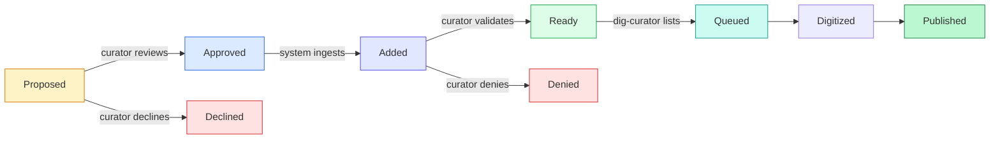

# View Map

What pages exist, what each one is *for*, and how they are held together.

The existing demos have one page per entity — Documents, Proposals, Additions,
Projects, Categories, Intentions, Dig. Lists, Tasks, Plugins, Hooks — in one
flat sidebar. That organisation answers *where is the data*. It does not answer
*what am I here to do*, so every actor is shown all ten entries and left to work
out which two concern them.

This map reorganises the front of the application around **stages of one
pipeline**, and leaves the entity pages behind it as reference.

---

## 1. Page, view, lens

Three levels, deliberately distinct:

| | What it is | Who defines it | Addressable |
|---|---|---|---|
| **Page** | a route; owns the chrome and the four size variants | design | yes — a URL |
| **View** | page + actor + fixed scope + columns + actions | design, via the §6 declaration in [[view-rules]] | yes |
| **Lens** | a saved filter *inside* a view | the user, at runtime | yes, per user |

**A view's scope is fixed and not removable.** *Proposal Review* is always
proposals in the curator's own proposal custody; clearing every filter does not widen it
to proposals in somebody else's subject area. That is what separates a view
from a lens, and it is why a view can promise an actor that what they are
looking at is their whole job.

**Scope is not the default filter**, and the two are easy to confuse. Proposal
Review *opens* on the proposals awaiting review, because that is the work — but
`Declined` and `Withdrawn` are one filter change away ([[status-model]] §6).
Fixed scope is what the view can never show; the default filter is what it
happens to show first. Putting a stage in the scope would make the declined
ones unreachable, which is the mistake this distinction exists to prevent.

**One page hosts more than one view only when the same actor switches between
them.** Otherwise each view gets its own route. Two reasons: a route can be
linked to and landed on from a notification, and [[view-rules]] §4.2 already
says an actor holding one role sees no switcher — so for most people a switcher
is chrome that never changes anything.

> **Consequence for what we have already built.** `documents.html` carried
> three role views behind a switcher. *Validation* and list building become
> separate routes over the same entity, and the switcher is replaced by
> navigation. What stays on Documents is the reader's view — which, once a
> request and its document are recognised as one row (§2.1), is not a second
> page but the same page at a narrower reach.

---

## 2. The pipeline and its four views

One asked-for item moves through stages. Every stage where a **person** does
work has exactly one view for it, and exactly one actor who does it.



| # | View | Route | Actor | One row is | Scope |
|---|------|-------|-------|---------|-------|
| 1 | **Documents** — *My Documents* | `/documents` | anyone | a document: its askers, then its current iteration | authorship ([[relationships]] §5.1), or the grant's scope |
| 2 | **Proposal Review** | `/review/proposals` | curator | a document awaiting a decision, with all its askers | stage = Proposed, custody |
| 3 | **Validation** | `/review/documents` | curator | an iteration a defect holds | iterations with defects — outstanding, denied or accepted — at any progress, or forbidden; custody |
| 4 | **Digitization Lists** | `/lists` · `/lists/new` · `/lists/:id/edit` | dig-curator | a list; in the editor, an iteration → a list | lists: `list.read`'s scope · pool: Ready ∧ not listed |

**Ingest has no view of its own.** It is machinery, not judgement, and its one
piece of human work — an ingest that failed — is a status, *Could not be
added*, filtered for in Documents (§2.1). There used to be an *Additions* view
for it; an addition is a proposal approved at the moment it is made
([[status-model]] §2.8), so it enters through *propose* and never needed a
page of its own.

Every one of these is a view over the *same* pipeline at a different stage, and
the use cases each serves are [[document-use-cases]]. That is the property
worth preserving: a request never disappears between two views, it moves from
one to the next, and every view can say which view has it now.

### 1 — Documents

The one view that crosses entities, and the one every actor has. **The user
does not care whether their item is currently a proposal, an addition or a
document**, so one row is one document — its askers from the moment of
asking, and its current iteration from approval on. Earlier iterations (the
2019 scan behind the 2029 rescan) are in the detail pane, not extra rows.

This is only possible because `iteration.request_id` links a document back to
the request that produced it ([[relationships]] §5.1). Without that link the
view can show a request up to approval and then loses it.

**Reach sets the label, not the page** ([[navigation]] §1.1). With
`request.read_own` alone it is **My Documents**: authorship scope, public
reason text only ([[view-rules]] §4.3), the public vocabulary of §4. With
`iteration.read` it is **Documents**: the grant's scope, internal reasons,
and *Mine* as a filter.

- **propose** is the primary CTA: **one dialog holding one list of items**,
  filled by whichever way is to hand and mixed freely — *type it* (identifier
  type, value, volume or issue), *catalog search*, *paste list*, *file upload*
  (CSV / TXT: identifier; volume or issue; why), *barcode scan*, *photo
  capture*. **Every item is checked as it lands**, the same way whichever way
  it came in: the catalog gives the identifier — catalog ID plus the volume or
  issue ([[document-identity]]) — and VERA then looks itself up. So each row
  already says what submitting will do:

  | Check says | Submitting |
  |---|---|
  | *New* | proposes it |
  | *In VERA* + its status | **ask for this too** — joins that work ([[status-model]] §2.7) |
  | *Which volume?* | nothing until a volume is chosen or the item removed — never the whole run by accident |
  | *Not in the catalog* / *not a known identifier* | skipped and listed in the report, never guessed |
  | *Already yours* | skipped — the person already asks for it, and a second ask would only repeat the first |

  Then **details** — why (an item's own reason wins), and for somebody holding
  `request.decide` the category, priority and **approve now** for the *new*
  items only ([[status-model]] §2.8) — and a report: *3 proposed · 4 joined ·
  1 skipped*. One item is a request; several are **one batch**, the unit the
  report is read by and the unit an admin retries if ingest fails.
- **catalog search reaches every catalog VERA has an adapter for** — all the
  searchable ones at once, or one picked; each result names its catalog. A
  catalog whose adapter **cannot search** (`search` off on the instance —
  no API, or one too slow or restricted to query live) is not dropped: it is
  listed under the results as *not searchable from here*, with a link to open
  it and **what to copy** there — the adapter says, e.g. *the Permanent link
  under the full record*. Pasting that link back is read by the same adapter
  into an identifier, and the item is checked like any other. A link that
  points at a search page rather than a record is refused with how to get the
  right one. Record links are accepted in a pasted list too
- **barcode scan is continuous** and has its own tab. A hardware scanner is a
  keyboard — it types the code and presses Enter — so *Start scanning* opens a
  focused field that adds on every Enter, clears, and waits: ten books are ten
  scans and **no clicks**. Each scan answers in a line (*added*, *already in
  VERA — you will join it*, *already on the list*, *not in the catalog*); the
  field shows *paused* if it loses focus, Esc or *Stop* ends the session, and
  reaching the limit ends it too. A scanner needs no plugin
- **photo capture is not a slower barcode scan** and has its own tab. A photo
  is *read*: identifiers if there are any, and otherwise the **text** — title,
  author, place and year, extent, shelf mark — which is the only way in for a
  catalog card or a title page that never had an ISBN. The plugin matches what
  it read against the catalog and returns **candidates, each with why it
  matched** (*title, author, year and shelf mark match* · *title partly, year
  differs*); low-confidence readings are marked. Reading can be wrong, so
  nothing is added until somebody picks — and *none of these* goes to catalog
  search
- **ways that need a plugin are absent without one** ([[view-rules]] §4
  rule 4): scanning **with the camera** needs a barcode reader, *photo
  capture* a cover recognition plugin — both *Input* plugins. *Paste list* is always there, but
  **auto-detect** of each line's identifier type needs an identifier detector;
  without one the user picks the type and every line is read as it. Typed
  entry, catalog search and a file with columns need nothing
- **at most N at once** according to the person's roles. Reader and staff
  roles set 10 by default; curator, dig-curator and admin explicitly set
  `null` (unlimited). A person with several roles gets the highest limit, or
  unlimited if any role sets `null`. The dialog shows the effective limit
  beside the count, and what does not fit is reported rather than silently
  dropped. `request.decide` itself does not change the limit
- **ingest failures** are the status *Could not be added*, with **group by
  batch** — the batch is the unit an admin retries. Retry and the raw source
  payload sit in the detail pane and on the batch header, **absent** for
  anybody without `addition.retry` / `.read_payload` — there is no deleting
  an addition (decided 2026-09-26); a curator
  holding `addition.read` sees the failure text and nothing to press. A reader
  sees *being added*.
- **per-record actions** — withdraw my own proposal (only while undecided),
  reclassify, cancel and resume, set the
  link that publishes it (`iteration.publish`), and for an admin overrule a
  restriction — each absent without its permission. Nobody forbids by hand:
  only rules do. None of them is a queue, so none earns a view; they are
  things you do to a record you already have open.
- **no approve, no deny.** Deciding is Proposal Review's and Validation's;
  Documents shows where a decision is pending and links there.
- provenance lives in the [[status-log]], not a separate box

### 2 — Proposal Review

Curator decides whether an asked-for item should enter the pipeline at all.

- scope: proposals at stage Proposed that a **proposal custody** I am a member
  of matches (`request.decide@custody`), or every one (`@any`). A proposal has
  no category until it is approved, so category custody cannot place it; a
  proposal custody is a name with members, edited by admins, and *Custody*
  plugins put proposals into it — a jq rule over the request, the document and
  the catalog record. The one **fallback** custody catches what no plugin
  placed, and its rows say so ([[proposal-custody]]). A decider may approve
  into any category.
- a proposal into a project already approved carries the flag *after the
  project's approval* and is decided here on its own, with the project's
  priority pre-filled
- one row per document, not per proposal — five asks, one decision
  ([[status-model]] §2.7)
- *All* is every decision; the shared watchlist *Awaiting a decision* leaves
  out `Declined` and `Withdrawn`, and the view reopens on whichever tab the
  curator last used ([[filtering]] §4.2) — out of the way, never absent
  ([[status-model]] §6)
- decisions: **approve** or **decline** *(reason)*
- approving is where **category and priority are set** — this is the only place
  a human classifies a request, and everything downstream depends on it
- **existing copies** are shown on the row — *Kramerius: Published*, with its
  link. Approving over one is **approve as rescan**, one item at a time
  ([[status-model]] §2)
- **held requests** arrive here too: an *approve now* or a plugin's
  `additions` entry that found a copy, marked *asked to be added*
  ([[status-model]] §2.8)
- bulk approve is allowed and **skips rescans**; bulk decline is not — a
  decline carries a reason

### 3 — Validation

Curator checks an ingested document's **metadata** before it is allowed to be
digitized. Metadata only: a prohibition is a restriction and an existing copy
is a fact on the request ([[status-model]] §2), so neither is judged here.

- scope: iterations in categories under custody that have defects
  (outstanding, denied or accepted), at any progress, or a restriction.
  Opens on *Review needed*; the rest are filters
- default filter: status = Review Needed ([[view-rules]] §4.5)
- defects include **missing data** and **no catalog record**; each is repaired
  in the catalog and picked up by *Recheck* — only a page count is entered
  here (decided 2026-10-06)
- decisions: accept (one defect or all), revoke, deny *(reason)*. No forbid —
  only rules forbid; the *Forbidden* filter shows those items, and a curator
  can message an admin
- edits: category, priority, the page count
- a defect found **after** digitization lands here too, shown as *Published ·
  review needed* ([[status-model]] §4)

### 4 — Digitization Lists

Digitization manager turns ready documents into lists a scanning operation can
execute against, and looks after the lists once they exist. **One page, three
surfaces** — it used to be two entries, *Digitization Lists Generation* and
*Digitization Lists*, and it is one because the same actor switches between
them in one sitting, which is the condition §1 sets for a page hosting more
than one view.

| Surface | Route | Layout | Requires |
|---|---|---|---|
| **browse** | `/lists`, `/lists/:id` | **master–detail** — lists on the left; the chosen list in the pane: dates, intention, members, planned against delivered | `list.read` |
| **new** | `/lists/new` | **the editor**, starting empty — or pre-filled by *Generate* | `list.create` |
| **edit** | `/lists/:id/edit` | **the editor**, starting from the list | `list.edit` |

**Creating and editing are one editor**, because a new list is an empty list.
Two layouts would make a dig-curator who knows how to build a list relearn it
to fix one.

**The editor is the browse pane, moved.** *Edit* on a list in browse takes the
list's preview — the header the detail pane was showing — to the **top of the
page**, and opens a two-pane split under it:

```
┌──────────────────────────────────────────────────────────────────┐
│  Periodicals — October     1 Oct → 31 Oct    Intention: Periodic │
│  4 812 / 5 000 pages   Regional 38% ▮▮▮▮▮▯  Monographs 20% ▮▮▮▯  │
│  +12 −3 since opened                            Discard   Save   │
├────────────────────────────────┬─────────────────────────────────┤
│  On this list                  │  All ready documents            │
│  ☐ title · pages · category    │  ☐ title · pages · category     │
│  ☐ …                     → out │  ☐ …                      in ←  │
└────────────────────────────────┴─────────────────────────────────┘
```

- **top: the list itself** — name, dates, what it **counts towards**
  (derived and read-only, pages per intention — [[intentions]] §5), pages
  against the target, and the **fill per category** against one intention's
  mix (the one it was generated with, else Overall; pickable). It is
  the thing being built, so it stays in view while the panes scroll
- **left: the documents on this list.** Removing one returns it to the pool —
  `list_id` cleared, back to `Ready` ([[status-model]] §2.5) — which is not a
  cancellation and needs no reason
- **right: all documents the list can take** — `Ready` and not on a list, the
  pool. The category tree becomes a **filter** here rather than a third pane:
  the per-category fill at the top already answers what the tree was for
- selection and bulk move exist in both panes, and here only
  ([[view-rules]] §5.5)
- **edits are a draft** until *Save*. The top counts the change — *+12 −3* —
  so nothing moves in the browse view, or in anybody's *Scheduled* status,
  until it is meant to
- the same shape at `large` and `notebook`; `large` spends its width on more
  columns in each pane, not on a third one

**Two ways to fill it**, and they are no longer two paths:

- **by hand** — move rows from the right to the left
- **Generate** — a button in the editor that opens a **dialog** over one of
  the configured *list generator* plugins, **rule-based** or **AI-based**
  ([[intentions]] §4). **If none is configured, there is no button.**
  - the dialog asks for **pages** (required), **categories** (optional — all
    if left out) and **shape by** — one intention, which supplies the scope
    (funding, subtree) and the mix, recursive down the tree ([[intentions]]
    §1, §3.2). It is **pre-set to Overall**, which always exists
    ([[intentions]] §3.1), or to the intention whose card it was opened from.
    A *correcting* run from a tracking intention arrives with an explicit
    per-category allocation, shown and accepted before generating
  - one generator configured: no picker. Several: a picker, each labelled
    with its class, so an AI pick is never mistaken for a rule
  - on an existing list the current members are fixed and the generator tops
    up towards *pages*
  - the result **pre-fills the left pane** — each pick marked *generated*,
    with its reason on the row — and the shortfall report lands in the top
    strip. The dig-curator adjusts by hand and saves; nothing is saved by
    generating
  - nothing is attached by generating: the list records **provenance** —
    the intention, the mix as it was, the pages, the generator. What it
    counts towards follows from what ends up on it; the editor warns when
    that leaves out the intention it was generated with ([[intentions]] §5)

Also:

- the generation provenance records *why* a generated list exists; a
  hand-built one says it in its name
- an item that gained an **existing copy after approval** carries a warning in
  the pool, so it is never listed without being seen ([[registry-status]] §10)
- **delete** is in the browse pane (`list.delete`); it returns every member to
  the pool, because lists are deleted, not cancelled ([[status-model]] §2.6).
  A Done list has no Delete
- **Mark Done** moves every member to `Digitized`, except those marked **could
  not be digitized** — set per item, with a message. Items can also be
  **cancelled** from the list, with a reason (decided 2026-09-26)
- a member that gains a blocker stays on the list, **flagged**, in browse and
  in the editor; the dig-curator decides whether to take it off
- the pool says what review is still holding back — *N more in Periodicals are
  waiting in review* — so a short pool explains itself
- moving a list's dates **warns** before Save when it would stop counting
  towards an intention
- someone holding `list.read` alone gets browse only — *New list* and *Edit*
  are **absent**, not disabled

---

## 3. Everything else

The four views above are the front. The other pages stay, as reference and
administration — you go to them to *set something up*, not to move work along:

| Page | For |
|------|-----|
| Projects | dig-curator |
| Categories | curator |
| Intentions | dig-curator |
| Tasks | admin |
| Users & Groups (Access) | admin |
| Plugins | admin |
| Hooks | admin |

**One flat list, no groups** ([[navigation]] §2) — these are not a category of
pages, only the ones this map has least to say about.

**Documents comes first because everybody has it.** For a reader it *is* the
application — what they asked for, and what happened to it. Staff has the same
reach, with a higher daily proposal limit. For everyone else it is where a record is
opened to be acted on outside a queue. It is also the clearest case for why no
nav entry carries a count: the only number it could show most people is *how
many documents exist*, which is not a claim that anything is waiting for you
([[navigation]] §8.3 gives the two actors for whom it is).

**Access** is new and unavoidable: [[relationships]] makes users, groups, roles
and category custody four separate things, and nothing currently draws them.

**Granting custody** is `category.grant_custody` ([[permissions]] §3), and it
takes a scope like anything else: at `custody` it means *within my own subtree*,
so a curator holding *Periodicals* may bring somebody onto
*Periodicals / Regional* without an administrator and cannot touch *Monographs*.
Because custody inherits downward ([[relationships]] §5.2), the grant they make
is bounded by the grant they hold — **delegation cannot widen**. Granting at a
root stays `any`.

**Rules for the navigation**

1. An entry the actor cannot reach is **absent, not disabled** — the same rule
   as properties in [[view-rules]] §4.4. The list is assembled per entry:
   grants compose, so somebody may hold *My Documents* and *Projects* and
   nothing else, and see those two entries ([[navigation]] §2 rule 2).
2. ~~Entries carry a count~~ — **dropped**. A bare number beside a nav
   entry does not say what it counts. Counts live on Watchlists, where the
   panel itemises them, and a view's own volume lives in its page header
   ([[navigation]] §2).
3. An entity page is reachable from any record that references it. The sidebar
   is how you get there without a record in hand, not the only way.
4. A view is never reachable from two entries. If a view seems to belong in
   two, it is two views.

The entries themselves — all twelve, their order, their rail abbreviations
and what the sidebar becomes at each tier — are [[navigation]]. Rules 1 and 2
above are restated there, because the shell is where they are enforced.

What each of the twelve **contains**, and what it deliberately does not, is
[[view-catalog]].

---

## 4. Which view has it now

Every stage answers this, and every view shows it. This is what lets *My
Requests* tell a reader where their item sits without exposing the machinery.

| Stage | Held by | View | Reader is told |
|-------|---------|------|----------------|
| Proposed | curator | Proposal Review | "Waiting for review" |
| Declined | — | — | "Not accepted" + public reason |
| Approved | the system — an admin if it fails | Documents | "Being added" |
| Added | curator | Validation | "Being checked" |
| Denied / Forbidden | — | — | public reason ([[view-rules]] §4.3) |
| Ready | dig-curator | Digitization Lists — the editor's pool | "Waiting to be scheduled" |
| Queued | operations | Digitization Lists | "Scheduled" + list |
| Digitized / Published | — | — | "Available" + outbound link |

The right-hand column is the public vocabulary. It is intentionally shorter than
the internal one: a reader needs to know whether to wait, and nothing else.

---

## 5. Open questions

- ~~**Reading an ingest failure without being able to retry it**~~ —
  **answered: two permissions.** `addition.read` is custody-scoped and held by
  curators; `addition.retry` is `any` and held by admins ([[permissions]] §3).
  The curator who approved a proposal sees the batch and the failure text, with
  every action **absent** rather than disabled — so they can ask a specific
  question instead of a vague one.
- ~~**Does a curator review proposals and validate documents in one sitting?**~~
  — **answered: no, keep them apart.** Each view targets one workflow, so views
  2 and 4 stay separate routes and the one-route-per-view rule holds
  everywhere. The switcher is gone from this map entirely.
- ~~**Where do system-discovered documents enter?**~~ — **answered: whichever
  the plugin is configured for**, see §6.
- ~~**Status vocabulary**~~ — **answered** in [[status-model]]. Stage and status
  are not the same axis, and neither is stored: both are derived from four
  stored axes (decision, restriction, validation, progress). The stage names
  used here map to them in [[status-model]] §5, and the public vocabulary in §4
  above is a third, coarser projection.

---

## 6. Where system-discovered documents enter

**Per plugin, by configuration** — one setting on the plugin, nowhere else,
not on the agent's user record (decided 2026-09-26). A **harvester** plugin
carries two settings; a registry adapter never proposes anything, so harvesting
Kramerius is a harvester plugin of its own:

| Setting | What it is |
|---------|-----------|
| **agent name** | the name its discoveries are attributed to — *ISSN harvester*, *Kramerius harvester* |
| **entry point** | `proposals` — goes through review like anything else · `additions` — approved on arrival, like a curator's *approve now* |

`proposals` is for a plugin whose judgement a curator wants to check; `additions`
is for one that is already trusted, or that only re-discovers things previously
decided. Both are legitimate, which is why it is a setting rather than a rule.

### 6.1 Both paths still create a request

This is the consequence worth taking deliberately: **an agent is a requester.**
Rather than the `additions` path producing an iteration that traces back to
nothing, both paths create a `Request` whose `created_by` is the agent, and the
entry point sets its opening decision ([[status-model]] §2):

| Entry point | Request created with | Enters at |
|---|---|---|
| `proposals` | `decision = Pending` | Proposal Review — view 2 |
| `additions` | `Pending` + an approve intent, applied after the checks — attributed to the agent | ingest — or Proposal Review if a copy exists ([[status-model]] §2.8) |

Three things fall out of this, all of them things otherwise needing special
cases:

1. **Provenance is uniform.** *Who asked for this* has an answer for every
   iteration — a person or a named agent — so the Documents requester column
   never renders blank and never needs a "system" placeholder.
2. **A curator can tell them apart for free**, which was the open question. The
   requester is the agent's name; no extra flag, no extra column.
3. **`iteration.request_id` stops needing a null case.** [[relationships]] §2
   currently marks it optional with *null = system-discovered*. Under this model
   nothing is authorless, so it can become mandatory — and §5.1's "appears in
   nobody's My Documents" becomes "appears in the agent's", which an admin can
   actually look at.

> `TODO(Plugins):` **agent identity.** An agent is a requester, so it needs
> whatever `request.created_by` points at. Making agents ordinary user records
> flagged as non-human is the cheapest answer — custody, authorship and the
> status log then work unchanged — but it is the plugin model that decides
> whether a plugin owns one agent or several, and what happens to an agent's
> past requests when its plugin is removed. Settle it alongside `defect_key`
> ([[status-model]] §2).

## Related

- [[view-rules]] — points, filtering, search, actors, actions
- [[relationships]] — the model these views query
- [[navigation]] — the sidebar these pages appear in
- [[status-model]] — §5, the stage names in §2 above as a projection of the axes
