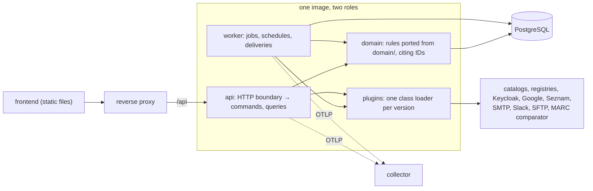

# The Java backend

> **Settled.** Drafted on 2026-10-30; B1, B2, B6 and where it lives settled on 2026-10-30,
> and B3–B5, B7–B9 on 2026-11-04. The backend starts once [what comes first](#what-comes-first) is done; the
> engine stops at its step 3
> ([DEC-0022](../decisions/DEC-0022-the-engine-stops-at-asking-and-deciding.md)). Each choice below is numbered `B1`… so it can be settled, changed or rejected one at a
> time, as the engine's `E1`… were.

## What it is for

The backend is VERA in production: the engine's API, rules and jobs, on PostgreSQL, with real
plugins in place of the fakes. It is done when:
- the recordings of the mock's answers and the user-journey tests pass against it
  **unchanged**, as the recordings of steps 1 to 3 pass against the engine;
- the real plugins of the [plugin catalog](plugin-catalog.md) run in it;
- it is deployed beside the old VERA, the old data is moved by hand, and the old VERA is
  switched off.

The engine stays as built: the development server for access, asking and deciding, and a
working model of the server's shape.

What it is not: a redesign. Where the backend would like to differ, the reference and the
contract change first, then the mock and its recordings, and the backend follows.

## Shape



The layers are the engine's, one for one: the boundary checks the contract; a **command** per
act checks permission, scope and state and writes the change, its log entries and its hook
events in one transaction; a **query** per page read model; **jobs** on a clock. A file in the
engine has a counterpart in the backend under the same name, so a rule is found in both by its
ID.

## Load

VERA is small ([prod-profile.md](prod-profile.md)): 16 staff users, about 20 proposals a day per
proposer in scanner bursts of up to 35 a minute, 17 000 documents, a few hundred runs a month,
and public requests growing towards a few a day. One API process and one worker hold this with
room to spare. Nothing below is there for scale: no message broker, no cache, no search engine,
no second database.

## Proposed

### B1. Stack

Settled on 2026-10-30. Java 25 (LTS), Spring Boot 4 on virtual threads, Spring MVC, Gradle with the Kotlin DSL.

- Spring Boot for what comes with it: Actuator's health probes, RFC 9457 `ProblemDetail`
  (which the contract's problem already is), the OpenTelemetry Java agent's coverage, and
  people who know it.
- **No Spring Security.** Sessions, login and permissions are VERA's own (E14, E15, the
  [permissions](../reference/access/permissions.md)); Spring Security's session and OAuth2
  client models would have to be bent to fit, and an Identity instance is configured at runtime,
  not in application properties. A servlet filter reads the session cookie; commands check
  permissions with the ported rules. Password hashing takes `spring-security-crypto` alone
  (Argon2id).

Rejected: Quarkus (its gain is native images and start-up time, which VERA does not need);
Javalin or Helidon SE (closest to the engine's plain `Bun.serve`, but each piece Spring brings
would be written by hand).

### B2. The contract: an OpenAPI document, and the API layer by hand

Settled on 2026-10-30. The contract stays in TypeScript and stays the source. From the endpoint table
(`contract/src/endpoints.ts`), a script writes:
- `contract/openapi.json`: zod 4's `z.toJSONSchema` per schema, one operation per entry, its
  refusal codes as an extension (`x-vera-codes`), `public` and `redirects` likewise;
- the check in `make docs-check`'s manner, that the file is not stale.

The file is written by `make openapi`, and `make openapi-check` checks it for staleness.

The backend **does not generate code** from it. It:
1. writes its request and answer types by hand, as Java records and sealed interfaces;
2. checks every request against the document's schema at the boundary, with a JSON Schema
   validator (`networknt/json-schema-validator`), answering 400 or 422 exactly as E11 says, and
   applying the schema's defaults as zod's parse does;
3. checks every answer against the schema too, in development and tests, answering 500
   `contract.response` as the engine does; in production it logs the mismatch and answers;
4. at start-up, compares the routes it serves with the document's operations and refuses to
   start if they differ, as the engine "serves exactly the table".

Why not generate: the contract leans on what OpenAPI generators handle badly, 25 unions and
discriminated unions (a cadence, a filter, a scope), nullable against optional, defaults; and 7
refinements and transforms that JSON Schema cannot carry at all. Generated Java for those is
worse than written Java, and what keeps the two sides together is not the types but the checks:
the boundary validation above, the contract tests, and Schemathesis generating cases from the
same document. The refinements a schema cannot carry are listed in the document's descriptions
and enforced in the backend by hand, each with a test.

### B3. The rules: ported, held together by shared cases

Settled on 2026-11-04. The Java rules are the source. The backend ports what it uses (permissions
and scopes, status and the badge, schedules and cadences, value ranges, counting and mixes,
properties) to plain Java with no framework, in a `domain` module. `domain/src` is TypeScript,
which the frontend keeps using to decide what to show and offer.

The rule cases (`domain/cases/*.json`: input, expected output, the rule ID) are the Java domain's
tests, read by JUnit. The frontend's TypeScript rules must pass the same cases, so a rule changed
in Java breaks the frontend's tests until TypeScript follows. The TypeScript engine is dropped
once the backend serves all it serves, and the Java backend with its seeding takes its place;
until then the cases hold both. The Java seeding is also how a development or demo instance is
set up (decided on 2026-11-13), not only the tests. Java code cites rule IDs as the engine does, and `make docs-check`
reads `backend/` for cited IDs too.

### B4. PostgreSQL, with migrations

Settled on 2026-11-04. PostgreSQL 18, run by CloudNativePG in production. The schema is written
new for the Java backend; nothing of the old VERA's is kept, and no code moves its data (decided
on 2026-10-30: people move what is needed by hand). The engine's schema files (`engine/schema/`,
one per area) are a reference for what is stored, not a source to translate. Where they carry
something only the TypeScript engine needed (JSON text columns, ISO text times), the Java schema
does it PostgreSQL's way (`jsonb`, `timestamptz`); the `CHECK` lists and text IDs are kept (the
contract's IDs are strings, and seeds name rows by them).

From the first production deploy, E9 no longer holds: every schema change is a migration,
written by hand, reviewed, never edited once applied, with its rollback. Liquibase with SQL
changelogs, because it carries the rollback beside the change.

Data access with jOOQ, its classes generated in the build against a PostgreSQL started by
Testcontainers with the migrations applied: typed SQL, joins written out, no lazy loading. Lists, facets and the overview pages are queries over indexes;
`pg_trgm` for the text filters. At 17 000 documents there is no case for a search engine; the old
VERA's reindex runs (4 000 of its 4 862 runs) go away with it.

### B5. Jobs: one table, claimed with `SKIP LOCKED`

Settled on 2026-11-04. The engine's job model, unchanged in meaning (E10): a job is due at a moment of the clock, runs
once, and each kind sets its own next attempt
([HOOK-retry](../reference/integrations/hooks.md#hook-retry)); runs show on Tasks; a job keeps the
trace context of the act that queued it.

What changes is how a job holds the database. In the engine a job runs in one transaction,
plugin calls included, which is fine for fakes that answer at once. Real plugins hang: the old
VERA's failures took minutes to hours. So a job runs in two parts:
1. **call:** outside any transaction, each plugin call with its instance's timeout;
2. **apply:** one short transaction that writes what the calls answered, or marks the run failed
   and writes nothing else.

Workers claim due jobs with `SELECT … FOR UPDATE SKIP LOCKED` and a lease, so a worker that dies
leaves its job to be claimed again. The clock is a `java.time.Clock` bean: the wall clock in
production, a stored, movable one under the test profile (B8). Schedules fall on the library's
wall clock, `Europe/Prague`, through daylight saving
([ROLE-library-day](../reference/access/roles.md#role-library-day)).

Rejected: Quartz, JobRunr, db-scheduler. Each brings its own tables and retry model, and VERA's
runs, with their items, outcomes and per-kind next attempts, would sit beside them rather than in
them.

### B6. Plugins: a plugin API, and one class loader per version

A `plugin-api` module is the plugin contract, 1.x
([PLG-contract](../reference/integrations/plugins.md#plg-contract)): one interface per kind
([PLG-kinds](../reference/integrations/plugins.md#plg-kinds)), the value types they take and
answer, and a context giving an instance its configuration, its secrets, an HTTP client, a
logger and the clock. It depends on nothing but the JDK, and its versions follow semver: a minor
version only adds.

A plugin is a JAR with `META-INF/vera-plugin.json`: the implementation, its version, the contract
version, and everything it declares ([PLG-declares](../reference/integrations/plugins.md#plg-declares)).
- **Upload** ([PLG-upload](../reference/integrations/plugins.md#plg-upload)) reads only that file,
  never runs the code, and shows what the version adds and retires. The JAR is stored in the
  database by its SHA-256.
- **Loading:** each installed version gets its own class loader, parent-last except for
  `plugin-api` and the JDK, so two versions, and two plugins' libraries, never clash.
- **Calls** go through one wrapper: the timeout, the span
  ([OBS-trace-through](../reference/integrations/observability.md#obs-trace-through)), the
  outcome *answered*, *unavailable* or *refused*, secrets passed in and never logged
  ([PLG-secrets](../reference/integrations/plugins.md#plg-secrets)).
- **The shipped implementations** of the [plugin catalog](plugin-catalog.md) are built as the same
  JARs, from `backend/plugins/`, and installed by the installation seed. They get no privilege an
  uploaded plugin would not.

**Signed** (settled on 2026-10-30). An uploaded plugin runs inside VERA with VERA's rights, so
the administrator's permission is not enough on its own:
- a plugin is signed with `jarsigner`, the JDK's own JAR signing: a Gradle task in
  `backend/plugins/`, MZK's key in CI;
- the installation's trusted certificates come from its deployment (a Helm secret), never from a
  page in VERA, so an administrator's account alone cannot add one;
- upload opens the JAR verified and refuses it unless every entry, the declarations file
  included, is signed by a trusted certificate; the signer is shown beside the version;
- an outside author's plugin is either reviewed and signed by MZK, or their certificate is added
  to the deployment.

Signing proves where a plugin came from, not that it is safe: it stops a stolen administrator
session from installing code, not a trusted signer's mistake.

### B6a. The plugin interfaces, and what a version can do

> Decided ([DEC-0019](../decisions/DEC-0019-plugin-api-and-capabilities.md), 2026-10-30 and
> 2026-10-31). B6 says `plugin-api` holds one interface per kind; this says what
> goes in them and where it is written first.

- **Written once, before the backend.** Each kind's operations, what each takes and answers, and
  its refusals are in [plugin-api.md](../reference/integrations/plugin-api.md)
  ([PLG-api-kinds](../reference/integrations/plugin-api.md#plg-api-kinds)), with zod types in
  `domain/src/plugin-api/`. The engine's fakes implement those types; `plugin-api` is written from
  them by hand, as the OpenAPI document is from the endpoint table (B2).
- **One interface per kind for what every implementation does**, and one per optional
  operation: `CatalogAdapter` (`read`), with `LinkReader` (`readLink`), `SearchableCatalog`
  (`search`), `ChangeFeed` (`changes`) and `MirroredCatalog` (`sync`) beside it; `Input` with
  `BarcodeReader`, `PhotoReader` and `EntryLinkInput`, and no `inputMode`. Type detection is
  VERA calling every enabled `Identifier`'s `recognise`, not an interface. A call
  answers or throws one of the outcomes B6 names: `PluginUnavailable`, or `PluginRefused` with a
  code from the kind's closed list
  ([PLG-api-outcome](../reference/integrations/plugin-api.md#plg-api-outcome)).
- **What a version can do is declared**, in `vera-plugin.json` as `operations`, beside the rest
  of its declarations, so upload and Plugins know it without running code. When the version
  loads, `pluginhost` compares the declared operations with the optional interfaces the class
  implements; a version where they differ is refused at upload.
- **An instance narrows, never widens**: its settings may switch a declared operation off (search
  off for one catalog). The propose dialog's ways in, *Generate*, the classifier's suggestion and
  the rest read what enabled instances declare and keep
  ([PLG-api-capabilities](../reference/integrations/plugin-api.md#plg-api-capabilities)).
- **Cursors** live in a `plugin_cursor` table (instance, operation, the plugin's text), written in
  the apply transaction with what the call answered
  ([PLG-api-cursor](../reference/integrations/plugin-api.md#plg-api-cursor)).
- **The catalog mirror** is a `catalog_mirror` table per installation: instance, catalog id,
  title, units, identifiers, the record as `jsonb`, fetched at, and a `tsvector` over the search
  text with a GIN index, plus an index on identifiers. A `sync` run is a chain of calls, each
  page applied in its own transaction with its cursor, so a first fetch of a whole catalog
  resumes after a restart. Catalog search over an instance with a mirror is a query VERA runs,
  not a plugin call; the context gives `read` a read-only view of its own instance's rows
  ([PLG-api-mirror](../reference/integrations/plugin-api.md#plg-api-mirror)). The engine keeps
  the same in SQLite with FTS5.
- **Record changes** come on the instance's schedules: each run calls `sync` or `changes`, and
  every changed id VERA holds runs that document's record-change triggers
  ([PLG-api-record-change](../reference/integrations/plugin-api.md#plg-api-record-change)).
- **A JSON Schema for `vera-plugin.json`**, from `declarationsSchema`, published with
  `plugin-api`, so an outside author checks a package before it is signed.

### B7. Login and sessions

Settled on 2026-11-04. E14, E15 and E16 carry over as they are: the `vera_session` cookie, its SHA-256 stored, the
sliding limits, flows of 10 minutes, the return within VERA, sign-up and reset tokens stored by
hash.
- `OidcIdentity` uses the Nimbus OAuth 2.0 / OpenID Connect SDK: discovery, the authorization code
  flow with PKCE, ID token checks. One instance per provider (Keycloak, Google, Seznam), each
  configured on Plugins.
- `LocalAccounts` checks passwords kept by VERA in `login` with Argon2id through its context; its
  mail goes through the Delivery channel named by `mail_channel`. Unverified sign-ups are
  removed by a job (`SignUpExpiryJob`).
- B1's “no Spring Security” stands: Java libraries are used inside VERA's own design (Nimbus
  for OIDC, `spring-security-crypto` for Argon2id, a servlet filter for the session cookie).
- Writing acts are protected by `SameSite=Lax` and by refusing a body that is not
  `application/json`, as the engine does.

### B8. Tests: the recordings, over HTTP

Settled on 2026-11-04. The backend is accepted by tests it did not write:

| Tests | How they reach the backend |
|---|---|
| recordings of the mock's answers ([what comes first](#what-comes-first)) | `bun test` with `VERA_API_URL` set, over HTTP |
| user journeys | Playwright: the frontend's live mode with `VITE_API_PROXY_TARGET` at the backend |
| API fuzzing | Schemathesis over `contract/openapi.json` |
| the shared rule cases (B3) | JUnit |
| the backend's own | JUnit with Testcontainers PostgreSQL: migrations, jobs, plugin loading, the real plugins against recorded answers |

For that, the backend serves the control endpoints of [engine.md](engine.md#control-endpoints)
(`/_engine/reset`, `clock`, `outbox`, `jobs/run`, `sessions`, `identity`) and loads the same seeds
from `seeds/`. They live in a `testing` module, wired only under the `test` profile, and
the production image does not contain it.

`GET /_engine/endpoints` names what a server serves. The replay leaves an unserved read out of its
scenario, and skips a scenario with an unserved act.

It also needs the **fakes**: a fake per plugin kind, driven by the seed's data, behaving as the
mock's and the engine's, as written down ([what comes first](#what-comes-first), 6; [the fakes' behaviour](fakes.md)). They are built as plugins (B6), so loading them exercises the same path the real ones
take.

A reset per test is fast enough with PostgreSQL's template databases: the seed is loaded once
into a template, and a reset drops the database and creates it again from the template.
Tests running in parallel get one backend each, on its own database.

### B9. Packages: a feature per group of acts

Settled on 2026-11-04. Everything is under `cz.mzk.vera`. The Gradle modules split what may depend on what; inside
`app`, the packages split by feature, and each feature holds its layers as files.

**Modules**, each depending only on those before it:

| Module | Packages | Holds |
|---|---|---|
| `plugin-api` | `cz.mzk.vera.plugin`, one subpackage per kind (`.identity`, `.catalog`, `.registry`, …) | the plugin contract (B6) |
| `domain` | `cz.mzk.vera.domain.*`, one package per file of `domain/src` (`.permissions`, `.status`, `.schedules`, `.mixes`, …) | the ported rules (B3), pure |
| `app` | `cz.mzk.vera.<feature>` and the shared packages below | the backend |
| `testing` | `cz.mzk.vera.testing.control`, `.seeds`, `.fakes.<kind>` | `/_engine`, seeds, fakes (B8) |
| `plugins/<name>` | `cz.mzk.vera.plugins.<name>` | one shipped implementation each |

**Features.** A feature is a section of [acts](../reference/access/acts.md), so a rule's act and
its code are found under the same name; it serves the contract modules beside it. A page with no
acts of its own goes with the acts it shows.

| Feature | Acts | Contract modules |
|---|---|---|
| `login` | logging in, sign-up, reset, logging out | `login` |
| `account` | the person's own settings | `user-settings`, `notification-preferences`, `push` |
| `access` | Users & Groups | `access` |
| `proposals` | Proposing, the entry link, the library day | `proposals` |
| `requests` | Request review, custody placement, retrying a batch | `requests`, `additions` |
| `ingest` | none: the ingest job ([LC-ITER-ingest](../reference/lifecycles/iteration.md#lc-iter-ingest)) | |
| `documents` | none: Documents and My Documents | `documents` |
| `iterations` | Iterations, publication links | `iterations` |
| `validations` | Validation verdicts | `validations` |
| `lists` | Digitization lists | `lists` |
| `projects` | Projects | `projects` |
| `intentions` | Intentions and repeats, generating | `intentions`, `intention-filters` |
| `categories` | Categories | `categories`, `category-filters` |
| `mixes` | Mixes | `mixes`, `mix-catalog`, `mix-filters` |
| `properties` | Properties | `properties` |
| `watchlists` | Watchlists, their sends | `watchlists` |
| `tasks` | Tasks and schedules | `tasks`, `schedules` |
| `plugins` | Plugins: instances, upload, moving a version | `plugins` |
| `hooks` | Hooks, deliveries | `hooks` |
| `messages` | Messages | `messages` |
| `reference` | none: the reference data views resolve names through | `reference` |

**Inside a feature**, for `requests`:

```text
cz.mzk.vera.requests/
  RequestsController.java   the table's routes, thin: parse, call, answer
  RequestsContract.java     the contract's shapes, nested records and sealed interfaces,
                            one-for-one with contract/src/requests.ts
  RequestCommands.java      one method per act, citing its ID, each its own transaction
  RequestQueries.java       one method per read model
  RequestRepository.java    jOOQ; package-private
  RequestJobs.java          the job kinds it owns (placing again, L8)
```

A small feature keeps fewer files; a large one splits a file into a subpackage when it grows
(`intentions.generation`).

**Shared packages**, which never import a feature:

| Package | Holds |
|---|---|
| `web` | the boundary: the contract check against the OpenAPI document, the route check at start-up, refusals as problems |
| `session` | the session cookie filter and the `Caller` a command is given |
| `db` | jOOQ, transactions, the generated table classes |
| `clock` | the clock (B5) |
| `jobs` | the queue, the worker loop, the `JobKind` interface a feature implements |
| `pluginhost` | loading, verifying and calling plugins (B6) |
| `log` | writing log entries, the event codes ([L23](../ledger.md#built-2026-11-03)) |
| `events` | recording hook events in the act's transaction ([L33](../ledger.md#l33-hook-events)) |
| `telemetry` | the attribute allow-list, the act and run on each record |

**Between features**:
- a feature writes only its own tables, through its own package-private repository; its queries may
  read other features' tables in one SQL query, read-only (decided 2026-11-05, BK3 decision 3);
- it calls another feature only through that feature's commands or queries (approving a proposal
  asks `iterations` for the iteration, and `ingest` for the job);
- no cycles between features.

Spring Modulith's verification checks all three in one test, with each top-level package as a
module. Only its verification is used: its event registry is not, since hook events are written by
`events` in the act's own transaction.

The engine's folders take the same feature names as it grows, so a file in one is found in the
other by the same path.

## What comes first

Before the backend starts, so that it is judged by tests it did not write
([DEC-0022](../decisions/DEC-0022-the-engine-stops-at-asking-and-deciding.md)):

1. **Every endpoint in the table.** `contract/src/endpoints.ts` holds the endpoints the engine
   serves; the rest of the API, which only the mock serves, is added there too, with its schemas
   and refusal codes. Nothing serves an entry the engine lacks; it is the spec.
2. **The OpenAPI document** (B2), made from the endpoint table.
3. **Recordings over HTTP.** The recordings of the mock's answers (`engine/test/base-*.json`)
   are replayed by a package of their own that speaks only to `/api` and `/_engine` at a base
   URL; whatever needs the database stays an engine test. A recording is made for every area,
   for every dev person and for scenarios of acts followed by the pages they change, by scripts
   kept in the repository. Against the engine, the areas it serves pass; against the backend,
   all of them must.
4. **Rule cases as data** (B3), starting with permissions, status and schedules.
5. **The seed format written down**: a JSON Schema for a seed (E13), since a second loader will
   read it.
6. **The fakes' behaviour written down** per kind: what each answers from which seed data, and
   how it fails, as the mock and the engine play it ([the fakes' behaviour](fakes.md)). The backend's fakes are written from that.
7. **The plugin API written down** (B6a): each kind's operations, outcomes and declared
   capabilities as types in `domain/src/plugin-api/`, and `operations` in the declarations, read
   by the dialogs instead of instance settings and `inputMode`.

The 422 body is settled: the fields in `errors` are named by JSON Pointer, each with a code
([ACT-refusal-code](../reference/access/acts.md#act-refusal-code)), and tests compare codes and
fields, never message texts.

## Repository and build

Settled on 2026-10-30. The backend lives in this repository, under `backend/`, so a change to the contract and its
backend change are one commit:

```text
backend/
  settings.gradle.kts
  plugin-api/      the plugin contract 1.x; no dependencies
  domain/          the ported rules (B3); no framework
  app/             the features and the shared packages (B9); api and worker roles
  testing/         control endpoints, seed loader, fakes; test profile only
  plugins/         the shipped implementations, one Gradle project each
```

`make backend`, `make backend-test`, `make backend-contract` (the contract tests against a running
backend) and `make backend-journeys` sit beside the engine's targets. The [Java conventions](java.md)
were written during step 1 from what step 1 settled. The backend starts on the backend, API,
persistence and Helm layers.

## Running it

For the local step-1 backend:

- `make backend` runs it in the foreground;
- `make backend-db` starts PostgreSQL;
- `make backend-replay` starts the database and backend, replays the recordings, then stops the backend.

- **One image, two roles**: `VERA_ROLE=api`, `worker`, or `all` for a small installation. The
  worker runs jobs, schedules, hook deliveries and watchlist sends; the API never waits on them.
- **A Helm chart** in `deploy/helm/vera/`: the API, the worker, the frontend's static files
  behind the proxy, CloudNativePG for PostgreSQL, migrations as a pre-upgrade hook job.
- **Telemetry**: with `VERA_OTEL_ENDPOINT` set, `make backend` and `backend-bg` attach the
  Gradle-fetched OpenTelemetry Java agent 2.33.1. System properties set `service.name=vera-backend`,
  `vera.role` from `VERA_ROLE`, disable HTTP request and response header capture, and enable JDBC
  statement sanitization. Server spans use the agent's HTTP route template; query strings, headers,
  cookies and SQL parameters are not exported. The `otel-extension` Gradle module registers an
  exporter wrapper through `AutoConfigurationCustomizerProvider`; it keeps the engine's telemetry
  attributes plus HTTP method, route and status, sanitized database system and statement, and
  VERA's user, act, job and plugin attributes. User ids are attached only to non-reader acts.
  `EventRecorder` sets `vera.act`; `JobRunner` creates `job <kind>` spans parented from the queued
  W3C trace context; `PluginCalls` records each instance and outcome. `logstash-logback-encoder`
  writes JSON lines to stdout, including level, logger, message, trace/span ids and known act/job
  MDC fields; the agent's Logback appender exports logs over OTLP. The worker polls the audit outbox
  every five seconds in ordered batches of 500 via OTLP/HTTP JSON and deletes accepted rows only.
  Without an endpoint there are no agent spans or logs, and audit rows remain queued. Tests assert
  the span allow-list, act identity, plugin attributes, trace propagation and audit delivery, as
  the engine's `telemetry/rules.test.ts` does.
- **Configuration** by environment variables, secrets from the cluster; plugin secrets in the
  database, encrypted with a key from the environment.

## Order of work

Following the engine's steps, so each lands with its recordings already made:

1. **Skeleton:** (built 2026-11-04) the Gradle build, PostgreSQL and the first migrations, the
   boundary check against the OpenAPI document, the clock, the seed loader, `/_engine` reset,
   clock, sessions and endpoints, plus the session and login entries. The replay judges it
   through `GET /_engine/endpoints`.
2. **Access:** (built 2026-11-05) sessions, the Identity plugins with their fakes, sign-up,
   Users & Groups, judged by the recorded sign-in, access and access-act scenarios. Its index,
   role and custody impacts, and custody acts are built in machinery. The 7-day removal of
   unverified sign-ups is a job (B5, B7). The real `OidcIdentity` and `LocalAccounts` plugins wait
   for step 5. The real `EntryLink` plugin against the portal also waits for step 5.
3. **Asking and deciding:** (built 2026-11-07) judged by the recorded records, filters, proposal
   and decision scenarios. Suggesting again after a change waits for runs with the jobs (B5).
   The Plugins acts, including `proposal-refusal-codes`, are built in machinery.
   The entry link `/ask` is built; its real plugin waits for step 5. The catalog
   mirror's `sync` and stored catalog tiers wait for the real catalog adapters; the mirror's
   tables and their filling from the fakes came early, decided with the user on 2026-11-07.
   **Ingest and review:** (built 2026-11-07) judged by the recorded record acts. Jobs (B5) are
   built; the registry check schedule and runs for Tasks are built in machinery;
   the Link and Publication detector kinds (the link acts read links from instance
   configuration) and the real plugins to step 5.
   **Lists and projects:** (built 2026-11-09), judged by the recorded list, project and property
   scenarios; properties were served here. Step 5 leaves generation, drafts, shapes and generators
   to planning; intention and mix acts to planning (intentions and mixes are stored from the seed,
   and project acts write a project's own intention); placing proposals again after a custody
   change, the Schedules page and start-day moves are built in machinery; and the real plugins
   wait for their step.
   **Planning** (built 2026-11-09), judged by the recorded category, mix, intention and list
   generation scenarios. Beyond those recordings, planning records configuration codes for its acts.
   Repeats make their occurrences through an `intention.repeat` job; the List generator draws the
   whole draft through the plugin API, with fakes for the seed's two generators. Planning leaves
   volume testing to production data (E6). **Machinery** (built 2026-11-12), judged by the recorded
   plugin, task, schedule, hook, watchlist, message and Users & Groups scenarios. Beyond the
   recordings, plugin versions upload as signed JARs checked against the deployment's trusted
   certificates; registry checks have schedules and runs for Tasks; start-day moves queue
   `list.start` jobs; `plugin.run` jobs do real work in chunks, each kind's items as PLG-run-items
   says; `schedule.fire` jobs run schedules; every hookable code fires with its full payload, and
   event deliveries and their backoff are jobs; watchlist entries are matched and sent as jobs, mail
   is batched per person in fifteen minutes, manage links are signed, and browser push is real Web
   Push (L35); deleting a custody or changing a Custody instance places its open proposals again in
   a `custody.place` run (L8); Plugins, Hooks and Schedules acts record their configuration codes
   (L7). Machinery leaves the real plugins (SMTP, chat, OIDC and the rest) to step 5; the
   collector's audit table and dashboards to deployment; the frontend's Schedules rows for repeats
   (L26); names in each language (L75); and showing a version's signer (L77). After it, on
   2026-11-12, a proposal's checks moved after the submit with a preview in Propose, and a document
   follows a replaced catalog record (L78). Steps 4 to 7 are built here first; the engine does not
   serve them
   ([DEC-0022](../decisions/DEC-0022-the-engine-stops-at-asking-and-deciding.md)).
4. **Every journey passes** against the backend.
5. **The real plugins**, in the order the first installation needs them: `OidcIdentity` (MZK
   Keycloak), `LocalAccounts`, `AlephOaiCatalogAdapter`, `KrameriusRegistry`, `MarcComparator`,
   `SmtpMailer`, then the rest of the catalog.
6. **Deployment** beside the old VERA, a trial with the curators, the old data moved by hand,
   then the switch.
