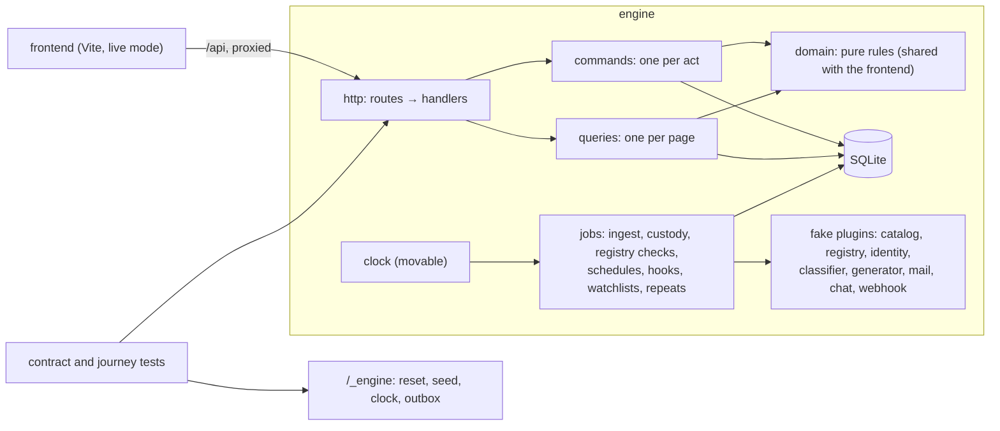

# The engine

> **Draft plan for part 4, 2026-10-14.** Written ahead so it can be refined with the user
> journeys. Nothing here is built. Its shape was settled on 2026-10-15 (below).

## What it is for

The engine is a local server, in Bun with SQLite, that serves VERA's real API to the frontend.
Today the frontend talks to an in-browser mock that resets on reload and cannot share state
between roles. The engine replaces that.

It is:
- **real enough to use:** a reader proposes on one dev server and the curator sees it on
  another; state survives a reload; time can be moved forward;
- **the executable spec:** every rule in the [reference](../reference/) that the server owns is
  enforced here, citing its ID;
- **the yardstick for the Java backend:** the contract tests and the user-journey tests run
  against the engine now and against the backend later, unchanged.

It is not a production server: there is no real catalog, registry, identity provider or mail.
Each of those is a fake plugin.

## Shape

- **Contract.** The routes are `contract/src/routes.ts`; the request and response shapes are
  the zod schemas in `contract/src/`. The engine parses every request and checks every
  response against them.
- **Commands.** One command per act in [acts](../reference/access/acts.md). Each command:
  1. checks the permission and scope;
  2. checks the state, refusing with the status and code the act lists;
  3. writes the change, its log entries and its hook events in one transaction.
- **Queries.** One per page read model (the overview endpoints), computed from SQLite.
- **Domain.** The pure functions in `domain/src` (permissions, status, counting,
  mixes) are used as they are, so the frontend and the engine cannot disagree.
- **Jobs.** Ingest, custody placement, registry checks, scheduled runs, hook deliveries,
  watchlist membership and repeats run on the engine's clock. They are triggered by commands
  and by the clock, and are visible as runs on Tasks.
- **Fakes.** Every plugin kind has a fake implementation, driven by seed data: the catalog is
  the mock's catalog fixture, and mail and chat land in an outbox the tests can read.

## Dev servers and signing in

The frontend's existing live mode proxies `/api` to the engine (`VITE_API_MODE=live`,
`VITE_API_PROXY_TARGET`).

- **Real login** runs against the fake Identity providers: first login, default role, match by
  email, mappings at each login ([L4](../ledger.md#l4-logging-in)).
- **One person per dev server** (`make dev-roles`) keeps working. Cookies are shared across
  ports on `localhost`, so each dev server's proxy adds a development-only header naming its
  fixture person. The engine honours that header only in development.

## Control endpoints

Development and tests only, under `/_engine`:

| Endpoint | Does |
|---|---|
| `POST /_engine/reset` | drop the database and load a named seed |
| `POST /_engine/clock` | set or advance the clock; due jobs run |
| `GET /_engine/outbox` | the mail, chat and webhook messages the fakes "sent" |
| `POST /_engine/jobs/run` | run due jobs now |

## Seeds

The first seed is the mock's fixtures, converted once, so every page looks as it does today. Each
user journey names the state it starts from; a seed can be the base plus a few rows.

## Tests

| Kind | Runs against | Proves |
|---|---|---|
| contract | the engine over HTTP | every endpoint: shape, permission, refusal codes |
| rules | the engine's commands | each rule ID cited in a test name |
| user journeys | Playwright: the frontend in live mode against the engine | each [user journey](../user-journeys/) end to end |

The Java backend later passes the contract and journey tests unchanged.

## Order of work

Readers' and curators' acts come first, so the core journey works as early as possible:
1. **Skeleton:** the server, SQLite, migrations, the seed, the clock, `/_engine`, the contract
   check, and the dev servers switched to live mode.
2. **Access:** the session, login with fake identities, roles, groups, custodies, Users
   management.
3. **Asking and deciding:** propose, check, custody placement, Requests, approve and decline,
   My Documents.
4. **Ingest and review:** the ingest job, validation and restriction fakes, Documents
   Validations, the iteration acts (including resume, overrule and withdraw, which are not built
   yet).
5. **Lists and projects:** the pool, lists, Done, projects and their decisions.
   [from-ask-to-scan](../user-journeys/cross-role/from-ask-to-scan.md) passes here.
6. **Planning:** categories, mixes, intentions, counting, generation, repeats.
7. **Machinery:** plugins, runs, schedules, hooks and deliveries, watchlists and notifications.
8. **Retire the mock:** every journey passes against the engine.

## Settled

Decided on 2026-10-15:
- **E1. Contract:** routes and zod schemas move into a shared `contract/` package, which frontend
  and engine import, and which produces an OpenAPI document for the Java backend.
- **E2. Domain:** `frontend/src/domain` moves into a shared `domain/` package. The engine never
  imports from `frontend/`.
- **E3. HTTP:** plain `Bun.serve`, validating with the contract's schemas; no router library.
- **E4. The MSW mock:** retired once every journey passes against the engine; component tests use
  small fixtures.
- **E5. Vocabulary:** event codes, log subjects and the hook payload's fields
  ([L7](../ledger.md#l7-access-and-planning-changes-are-not-logged),
  [L23](../ledger.md#l23-event-codes), [L49](../ledger.md#l49-hook-payload)) are settled in one
  pass before step 3.
- **E6. Volume:** a large seed variant for lists and generation at volume. Seeds are later
  reshaped after looking at production databases.
