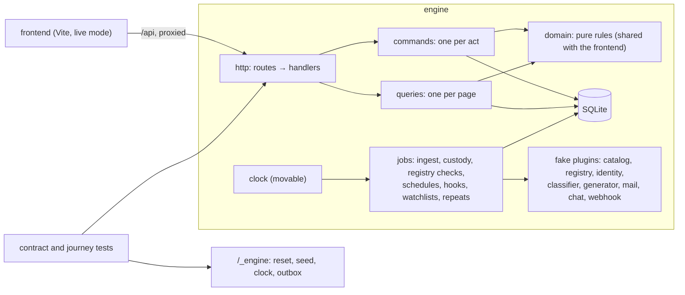

# The engine

> **Plan for part 4.** Drafted on 2026-10-14 and settled on 2026-10-15 (below). Step 1, the
> skeleton, is built (2026-10-16); the later steps are not.

## What it is for

The engine is a local server, in Bun with SQLite, that serves VERA's real API to the frontend.
Today the frontend talks to an in-browser mock that resets on reload and cannot share state
between roles. The engine replaces that.

It is:
- **real enough to use:** a reader proposes on one dev server and the curator sees it on
  another; state survives a reload; time can be moved forward;
- **the executable spec:** every rule in the [reference](../reference/) that the server owns is
  enforced here, citing its ID;
- **the yardstick for the Java backend:** the contract tests and the user-journey tests run
  against the engine now and against the backend later, unchanged.

It is not a production server: there is no real catalog, registry, identity provider or mail.
Each of those is a fake plugin.

## Shape

- **Contract.** The routes are `contract/src/routes.ts`; the request and response shapes are
  the zod schemas in `contract/src/`. The engine parses every request and checks every
  response against them.
- **Commands.** One command per act in [acts](../reference/access/acts.md). Each command:
  1. checks the permission and scope;
  2. checks the state, refusing with the status and code the act lists;
  3. writes the change, its log entries and its hook events in one transaction.
- **Queries.** One per page read model (the overview endpoints), computed from SQLite.
- **Domain.** The pure functions in `domain/src` (permissions, status, counting,
  mixes) are used as they are, so the frontend and the engine cannot disagree.
- **Jobs.** Ingest, custody placement, registry checks, scheduled runs, hook deliveries,
  watchlist membership and repeats run on the engine's clock. They are triggered by commands
  and by the clock, and are visible as runs on Tasks.
- **Fakes.** Every plugin kind has a fake implementation, driven by seed data: the catalog is
  the mock's catalog fixture, and mail and chat land in an outbox the tests can read.

## Dev servers and signing in

The frontend's live mode proxies `/api` to the engine (`VITE_API_MODE=live`,
`VITE_API_PROXY_TARGET`), and `/_engine/identity` too, for the fake providers' page.

- **Real login** runs against fake Identity providers: Keycloak, eduID, Google and Seznam are a
  development page listing the seed's fake accounts; local accounts log in with a username and
  password. First login, the default role, match by email and the mappings at each login apply
  as in production ([ACCESS-first-login](../reference/access/people.md#access-first-login)).
- **One person per dev server** (`make dev-roles`): each role's server listens on its own
  loopback address (`127.0.0.1:5201` for admin, `127.0.0.2:5202` for curator, …), so each browser
  window keeps its own session cookie; cookies are per host, not per port.
- **Tests** open a session for a user with `POST /_engine/sessions`.

## Control endpoints

Development and tests only, under `/_engine`:

| Endpoint | Does |
|---|---|
| `POST /_engine/reset` | drop the database and load a named seed |
| `POST /_engine/clock` | set or advance the clock; due jobs run |
| `GET /_engine/outbox` | the mail, chat and webhook messages the fakes "sent" |
| `POST /_engine/jobs/run` | run due jobs now |
| `POST /_engine/sessions` | open a session for a user, `{ userId }`, with its cookie |
| `GET /_engine/identity/:instanceId` | the fake provider's page for a login under way |

## Seeds

The first seed is the mock's fixtures, converted once, so every page looks as it does today. Each
user journey names the state it starts from; a seed can be the base plus a few rows.

Seeds are static JSON files in `engine/seeds/`: `base`, and `minimal` for the engine's own tests.
Seeding functions that generate data at volume come later; what they generate is settled then
(E6, E13).

## Tests

| Kind | Runs against | Proves |
|---|---|---|
| contract | the engine over HTTP | every endpoint: shape, permission, refusal codes |
| rules | the engine's commands | each rule ID cited in a test name |
| user journeys | Playwright: the frontend in live mode against the engine | each [user journey](../user-journeys/) end to end |

The Java backend later passes the contract and journey tests unchanged.

## Order of work

Readers' and curators' acts come first, so the core journey works as early as possible:
1. **Skeleton** (built 2026-10-16): the server, SQLite, the schema, the seed, the clock,
   `/_engine`, the contract check, and the dev servers switched to live mode. Its one endpoint is
   `GET /api/session`.
2. **Access** (built 2026-10-29): sessions with a sliding cookie, login through the Identity
   plugins against fake providers, local sign-up with email verification and password reset,
   Users & Groups, the account and the settings.
3. **Asking and deciding:** propose, check, custody placement, Requests, approve and decline,
   My Documents.
4. **Ingest and review:** the ingest job, validation and restriction fakes, Documents
   Validations, the iteration acts (including resume, overrule and withdraw, which are not built
   yet).
5. **Lists and projects:** the pool, lists, Done, projects and their decisions.
   [from-ask-to-scan](../user-journeys/cross-role/from-ask-to-scan.md) passes here.
6. **Planning:** categories, mixes, intentions, counting, generation, repeats.
7. **Machinery:** plugins, runs, schedules, hooks and deliveries, watchlists and notifications.
8. **Retire the mock:** every journey passes against the engine.

## Settled

Decided on 2026-10-15:
- **E1. Contract:** routes and zod schemas move into a shared `contract/` package, which frontend
  and engine import, and which produces an OpenAPI document for the Java backend.
- **E2. Domain:** `frontend/src/domain` moves into a shared `domain/` package. The engine never
  imports from `frontend/`.
- **E3. HTTP:** plain `Bun.serve`, validating with the contract's schemas; no router library.
- **E4. The MSW mock:** retired once every journey passes against the engine; component tests use
  small fixtures.
- **E5. Vocabulary:** event codes, log subjects and the hook payload's fields
  ([L7](../ledger.md#l7-access-and-planning-changes-are-not-logged),
  [L23](../ledger.md#l23-event-codes), [L49](../ledger.md#l49-hook-payload)) are settled in one
  pass before step 3.
- **E6. Volume:** a large seed variant for lists and generation at volume. Seeds are later
  reshaped after looking at production databases.

Decided on 2026-10-16, with step 1:
- **E1, continued.** For the OpenAPI document, the contract gets a table of each endpoint's method
  and path with the schemas it takes and answers, filled in as the engine's endpoints are built,
  from step 2.
- **E7. Workspace:** the repository root is a Bun workspace (`frontend`, `contract`, `domain`,
  `engine`) with one lockfile and one Biome configuration. A package is imported by module
  (`@vera/contract/documents`), with no barrel. The category and intention filters are in the
  contract.
- **E8. Tests:** one runner, `bun test`. The frontend moves from vitest in a task of its own.
- **E9. Database:** `engine/.data/vera.sqlite`, not in git, kept across restarts. It is built
  from the SQL files in `engine/schema/`, one per area, and never migrated: nothing in it is
  kept, so when the files change the engine rebuilds it from the seed it held. One table per
  entity, join tables for memberships, a JSON column for a value list such as a role's grants,
  and order by insertion.
- **E10. Clock and jobs:** the clock is kept in the database and only moves forward; going back
  is a reset to a seed. It runs with the wall clock in development and stands still in tests. A
  job that fails is rolled back and marked failed. The queue never retries one: each kind sets
  its next attempt by its own rule ([HOOK-retry](../reference/integrations/hooks.md#hook-retry)).
- **E11. The contract check:** a body that is not JSON is 400; input outside the schema is 422,
  naming the fields; an answer outside the schema is 500 with code `contract.response`; an
  unknown path is 404 and a wrong method 405. A 401 carries no code; the other refusals take the
  codes the mock used.
- **E12. Dev servers:** each dev server's proxy sends `X-Vera-Dev-Person` with its fixture
  person's profile, which the seed maps to a user. The engine honours it, and serves `/_engine`,
  only with `VERA_ENGINE_DEVELOPMENT=1`. The engine runs on port 8080, and the dev servers use it
  by default; `API_MODE=mock` gives the in-browser mock until step 8.
- **E13. Seeds:** a seed holds its name, its moment, the dev servers' fixture people, the records
  by collection and the fakes' data. Each step loads the collections its tables hold. The base
  seed's converter is not kept; `engine/test/base-sessions.json` records the sessions the mock
  gave, and a test proves the engine gives the same.

Decided on 2026-10-16 and 2026-10-29, built with step 2:
- **E12, amended.** The dev header is gone. A session cookie names the caller; each role's dev
  server has a loopback address of its own, and tests open a session through `/_engine/sessions`.
- **E13, amended.** Seeds hold no dev people. A seed may extend one other: `base` extends
  `installation`, which holds what VERA installs, the six shipped roles and the fallback custody;
  the child's own fields win and its collections merge in by id.
- **E14. Sessions:** a random token in an HttpOnly, SameSite=Lax cookie, `vera_session`, stored
  only as its SHA-256. A session slides, 30 minutes idle and 12 hours at most, its cookie
  reissued on every answer. Logging out, suspension and a password reset end sessions.
- **E15. Login:** an Identity plugin does the provider's work and answers who the person is; the
  engine never sees a provider's tokens. Redirect logins are flows good for 10 minutes and go
  back only to a path within VERA (one function in the contract, shared with the client). The
  fake providers are a development page over the seed's fake accounts. A local account keeps the
  first password typed for a seed account, and its own for one created by sign-up.
- **E16. Sign-up:** pending sign-ups and reset links are stored by their token's SHA-256; their
  mail goes to the outbox; a job deletes an unverified sign-up after 7 days
  ([DEC-0016](../decisions/DEC-0016-local-sign-up.md)).
- **E1, built.** The endpoint table in `contract/src/endpoints.ts` holds every endpoint step 2
  serves, each marked public or redirecting where it is, and the engine serves exactly the table.

> **Open.** The session limits are placeholders until the library sets its own. Renewal through
> the Identity plugin (`renew`) is not built: a session lives on its own limits. The OpenAPI
> document is made from the endpoint table once step 3's endpoints are in. Sign-up limits only
> per email; a limit per address waits for the proxy's client address.
