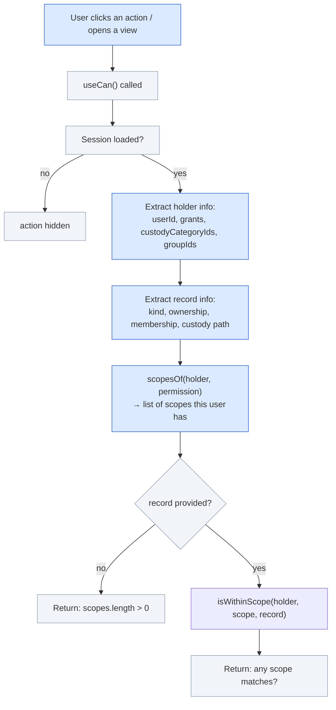

# The `can()` Check

How VERA decides whether a signed-in user may perform an action. This is the runtime
permission check that gates every UI action, row, and filter.

## The flow



## The session object

The session (from `frontend/src/domain/entities.ts`) is the `ScopeHolder` that carries
everything needed for a `can()` check:

```ts
interface Session {
  user: { id: string; name: string; kind: "person" | "agent" };
  roleIds: string[];                          // roles from rolesOf()
  grants: Grant[];                            // union of all role grants
  custodyCategoryIds: string[];               // categories in custody (with downward inheritance)
  groupIds: string[];                         // groups the user is in
}
```

The grants are pre-computed from the user's roles by `grantsOf()` in `domain/access.ts`.

## The record object

Each view passes a `ScopedRecord` describing the record being acted upon. The shape depends
on the record kind (`domain/permissions.ts`):

```ts
type ScopedRecord =
  | { kind: "proposal"; askerIds: string[] }
  | { kind: "iteration"; categoryPathIds: string[] }
  | { kind: "category"; categoryPathIds: string[] }
  | { kind: "project"; managerId: string; memberIds: string[]; memberGroupIds: string[] }
  | { kind: "run"; startedById: string }
  | { kind: "unscoped" };
```

## Where `can()` is used

Every action definition declares the permission it requires. The view renders the action
only when `can()` returns true:

```ts
// Example from a feature page
const can = useCan();
const canApprove = can("request.decide");

{canApprove && <ApproveButton proposal={proposal} />}
```

Filters also use `can()` — a property that can't be read is not filterable, preventing
a filter from becoming an oracle for probing records the user cannot see.

## Enforcement levels

The permission system is enforced at five levels:

| Level | Rule | Example |
|---|---|---|
| 1. **Actions** | Action absent if permission missing | No Approve button |
| 2. **Rows** | View scope = intersection of grant scope and view scope | Curator sees only custody items |
| 3. **Properties** | Field absent if not readable | Category field hidden from non-custody users |
| 4. **Filters** | Filterable only if readable | No filter on hidden properties |
| 5. **Reason text** | Public vs. internal per role grade | Internal decline reason withheld |

The server decides again — the frontend only hides what can't be done.
