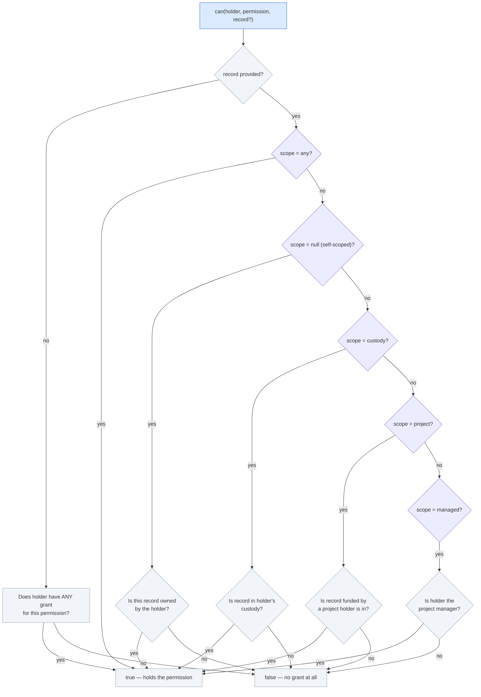
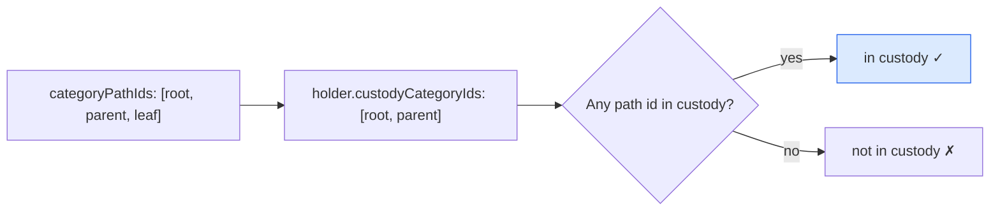

# Scope Resolution

How a grant's scope — `custody`, `project`, `managed`, `any` — resolves against a
specific record when `can()` is called. Extracted from `frontend/src/domain/permissions.ts`.

## The decision tree



## Record kinds

The `ScopedRecord` interface in `domain/permissions.ts` defines the record shapes:

| Kind | Fields | Resolves with |
|---|---|---|
| `proposal` | `askerIds` | `any`, `custody` (proposal custody), `project`, `managed` |
| `iteration` | `categoryPathIds` | `any`, `custody` (category subtree), `project`, `managed` |
| `category` | `categoryPathIds` | `any`, `custody` (category subtree), `project`, `managed` |
| `project` | `managerId`, `memberIds`, `memberGroupIds` | `any`, `project`, `managed` |
| `run` | `startedById` | `any`, `managed` |
| `unscoped` | — | `any` only |

## Scope resolution detail

### `any`

Always true. No record check needed.

### `null` (self-scoped)

The permission is scoped to the actor's own records. Resolved by **ownership**:

| Record kind | Ownership check |
|---|---|
| `proposal` | `askerIds.includes(userId)` |
| `run` | `startedById === userId` |
| `project` | `managerId === userId` |
| `iteration` | `false` (not applicable) |
| `category` | `false` (not applicable) |
| `unscoped` | `false` (not applicable) |

### `custody`

The record must be in a category the holder has custody of. Custody includes the category
and its entire subtree (inherits downward).



For **proposals**, `custody` resolves through **proposal custody** (who is in the custody
that the Custody plugins assigned to this proposal), not category custody.

### `project`

The record must be funded by a project the holder is a member of. For project records,
membership is checked against `managerId`, `memberIds`, and `memberGroupIds`.

### `managed`

The holder must be the **manager** of a project. Only applies to project records.

## How the code resolves it

The `can()` function in `frontend/src/domain/permissions.ts`:

```ts
function can(holder: ScopeHolder, permission: Permission, record?: ScopedRecord): boolean {
  const scopes = scopesOf(holder, permission);  // all scopes this holder has for this perm
  if (record === undefined) return scopes.length > 0;
  return scopes.some((scope) => isWithinScope(holder, scope, record));
}
```

The `isWithinScope()` function dispatches on the scope value and the record kind, as
shown in the decision tree above.

The `useCan()` hook in `frontend/src/hooks/use-can.ts` wraps this:

```ts
export function useCan(): (permission: Permission, record?: ScopedRecord) => boolean {
  const { data: session } = useSessionQuery();
  return (permission, record) => session !== undefined && can(session, permission, record);
}
```

Actions that the user may not do are **absent** (not visible), not disabled. This is
enforced by every view's rendering logic.
