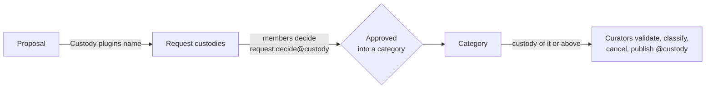

# Custody and projects

What people are responsible for. A role says what a person may do; custody and project
membership say what they may do it to, through the `custody`, `project` and `managed` scopes
([scopes](scopes.md)).

| | Answers | Held by | Reached through |
|---|---|---|---|
| **Category custody** | which approved work is mine | people, or groups | `@custody` on iterations, validations, categories, additions |
| **Request custody** | which proposals I decide | people, or groups | `@custody` on proposals |
| **Project membership** | which funded work I am on | the manager, members, member groups | `@project`, `@managed` |

## Category custody

#### ACCESS-category-custody

A person has custody of a category when they hold it directly, or when a group they are in
holds it. Custody of a category covers every category below it
([SCOPE-custody-category](scopes.md#scope-custody-category)).

#### ACCESS-grant-custody

Custody is granted on Categories with `category.grant_custody`, which sets the people (never
agents) and groups holding custody of one category. At `custody` this reaches only the granter's
own subtree; at `any`, every category.

## Request custody

#### ACCESS-request-custody

A request custody is a named set of people and groups who look after proposals before
approval. Its members are people (never agents) or groups.

#### ACCESS-membership-not-capability

Being a member reaches nothing on its own. A member decides its proposals only with
`request.decide` at `custody`, and only sees them with `request.read` at `custody`. A member
with neither reaches nothing, and Users & Groups says so.

#### ACCESS-custody-by-plugins

Which custodies a proposal is in is always the Custody plugins' answer and is never set by hand.
Each enabled Custody instance returns a list of custody names for a proposal; the proposal is in
the union of the names returned by all instances. A name that is not a custody is ignored.

*Why:* *why is this proposal here* is then always a rule that can be read. To move a proposal,
change the rule.

#### ACCESS-one-decision

Several askers of the same document make one proposal, placed by the union of what the rules
answer for each ask. Members of every custody it is in see it and may decide it. There is no
owner among them, and the first decision decides for everyone.

#### ACCESS-fallback

Exactly one custody is the fallback. It is created at installation; it cannot be deleted or
renamed. It holds every proposal no rule placed anywhere, and nothing else, so no proposal is
ever unreachable. Its members are edited like any other's. With no members, only holders of
`request.decide@any` reach it.

#### ACCESS-custody-live

Custody is evaluated again whenever a proposal or its facts change, and over every open proposal
when a Custody instance changes or a custody is deleted. A proposal can move between custodies,
or in and out of the fallback, as facts arrive. Decided proposals are never placed again.

> **Open — [L8](../../ledger.md#l8-placing-again-is-a-run).** Placing open proposals again, after
> a Custody instance changes or a custody is deleted, is to be a run on Tasks. The mock places them
> at once, and only on delete.

#### ACCESS-custody-delete

A custody other than the fallback can be deleted even while a rule still names it. Its open
proposals are placed again; those it alone held land in the fallback. The impact is shown first:
how many open proposals it holds, how many go to the fallback, and which rules name it.

#### ACCESS-custody-rename

Renaming a custody stops the rules that return its old name from placing proposals in it, until
those rules are changed.

#### ACCESS-custody-ends

After approval request custody is over. The chosen category decides custody from then on, and
a decider may approve into any leaf, including one outside their own category custody.

## Project membership

#### ACCESS-project-members

A project has one manager, members and member groups. A person is on a project when they:
- manage it;
- are a member;
- are in a member group.

Membership is changed with `project.manage_members`.

#### ACCESS-project-propose

A person may propose into a project they are on, unless the project is Rejected.
