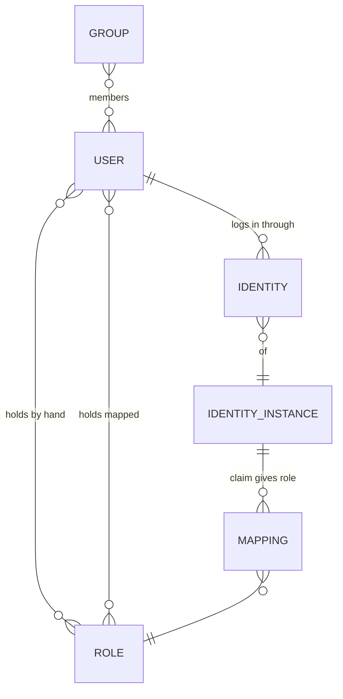

# People

Who uses VERA, how they get in, how they come to hold their roles, and what groups do. What
people are responsible for (custody and projects) is in [custody](custody.md).

## Users

#### ACCESS-user-kinds

A user is a person or an agent. An agent is a plugin that proposes like a person: it is created
with its plugin, never logs in, has no identity, and holds the roles it was created with. Its
proposals enter where it says (*Requests*, through review, or *Additions*, approved already).

#### ACCESS-user-name

A user's name and email come from their identity provider. A local account's are typed in when
it is created.

## Logging in

#### ACCESS-identity-instance

Each enabled Identity plugin instance is one way to log in. Several can be enabled at once.
Each instance has these settings:

| Setting | What it does |
|---|---|
| label | the text of its entry on the login page |
| order | its place on the login page |
| user id claim | which claim identifies the user |
| default role | the role a first-time user gets, or none |
| match by email | whether a first login links to an existing user with the same verified email |
| mappings | claims, each giving a role |

#### ACCESS-identity-key

A user is found by their identity: the instance and the value of its user id claim. A name is
never used to find one. The same username at two providers is two identities, and two users
unless they are linked.

#### ACCESS-user-claim-fixed

An instance's user id claim cannot be changed once anyone has logged in through it.

*Why:* changing it would turn every existing user into a new one at their next login.

#### ACCESS-first-login

A first login through an instance creates a user with the instance's default role and whatever
its mappings give. With *match by email* on, a first login whose verified email belongs to an
existing user is linked to that user instead.

#### ACCESS-no-access-yet

A user who holds no role sees only *You have no access yet*, and Users & Groups lists them for
an admin to give a role ([PERM-self-scoped](permissions.md#perm-self-scoped)).

#### ACCESS-login-page

The login page shows one entry per enabled Identity instance, in their order. An instance that
logs in with a form (local accounts) shows a form; any other shows a button that redirects.
With a single redirecting instance there is no login page.

#### ACCESS-last-identity

The last enabled Identity instance cannot be disabled or deleted.

*Why:* nobody could log in to turn one back on.

#### ACCESS-instance-disabled

When an Identity instance is disabled, it leaves the login page. Its users keep their records
and history, but cannot log in through it. Roles it mapped stay until their next login through
another instance.

#### ACCESS-link-identity

An admin can link another identity to an existing person, so one person has several ways in
and keeps one record, one set of roles and one history. The identity must not belong to anyone
else. An agent cannot have an identity.

An admin can unlink an identity, but never a person's last one: suspending is how to stop
somebody logging in ([ACCESS-suspend](#access-suspend)). The person, their roles and their
history stay.

#### ACCESS-local-account

An admin creates a local account for somebody with no institutional account: a name, a
username unique among local accounts, an optional email, and roles set by hand. This works only
while a local-accounts Identity instance is enabled. Everyone else appears at their first
login.

## How a role is held

#### ACCESS-role-ways

A person holds a role in one of two ways:
- **by hand**, set on Users & Groups;
- **mapped**, given by an Identity instance from a claim, or as its default role.

The same role may be held both ways; that is not a conflict. Removing the hand-set role leaves
the mapped one.

#### ACCESS-mapping-at-login

Mappings are evaluated at every login. A mapped role whose claim is gone is removed, and a new
match is added. Between logins nothing changes. To cut access at once, an admin removes roles by
hand.

#### ACCESS-suspend

An admin can suspend a person and restore them. While suspended, their login is refused and the
roles they hold, by hand or mapped, are kept but give nothing. Their groups, history and open
asks stay. Restoring gives back what they held. An agent is not suspended: it never logs in.

#### ACCESS-hand-untouched

A mapping never adds, removes or changes a role held by hand, and Users & Groups never writes a
mapped role. Mapped roles belong to the provider.

#### ACCESS-provenance

Every screen showing what somebody may do shows how they came to it:
- a role: *by hand*, or *mapped by MZK Keycloak from group mzk-staff*;
- custody and project membership: directly, or *via Periodicals Curators*.

A group's record shows what joining it confers.

*Why:* responsibility picked up through a group joined for another reason is invisible in a
list of what someone can reach, and obvious in a list of reasons.

## Groups

#### ACCESS-group

A group is a named set of people. It carries responsibility, never capability:
- category custody;
- request custody;
- project membership.

It gives no role ([ROLE-held-by-people](roles.md#role-held-by-people)).

*Why:* capability then reaches a person by one kind of act only, a role given to them, and never
as a side effect of joining a team.

#### ACCESS-group-name

Group, role and request custody names are each unique among their own kind.

## Managing access

#### ACCESS-read

`access.read` shows Users & Groups: every user, role, group and request custody, and what links
them. `access.manage` changes them, roles included.

#### ACCESS-last-manager

An act that would leave nobody holding `access.manage` is refused. This covers editing or
deleting a role and changing someone's roles.
