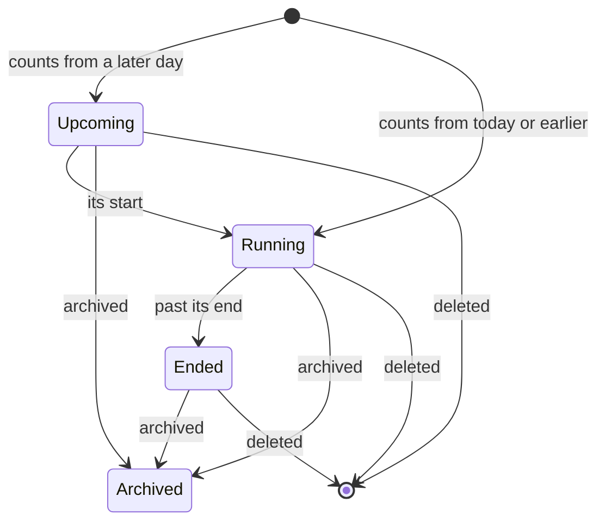

# Intention

From creation to archive. What an intention counts is in
[planning/intentions](../planning/intentions.md); the acts are in
[acts](../access/acts.md#intentions-and-repeats).

#### LC-INT-state

Upcoming, Running and Ended follow the window and are never written. Archived is an act.

#### LC-INT-counts-from

An intention's counting start is fixed once it is created. To count from another day, make a
new intention from it.

#### LC-INT-archive

Archiving preserves the intention as it was: its displayed figures, its mix tree with the
category names, and the exact mix revision. An archived intention is read-only, cannot be
unarchived, and keeps counting where its scope says. To work on it again, make a copy.

#### LC-INT-delete

Deleting is allowed only when it is not archived; whoever else uses its mix is untouched
([PLAN-mix](../planning/mixes.md#plan-mix)). Lists generated with it keep it as provenance.

#### LC-INT-overall

Overall is never archived or deleted, and always counts everything: any funding, the whole tree,
no target and no end.

#### LC-INT-project

A project's own intention is never archived, deleted or edited by itself: its name, funding,
window and target follow the project. Rejecting the project archives it.

#### LC-INT-repeat

A repeat makes its first occurrence when the next period starts, and one per period after that,
at midnight in Prague on the period's first day. Editing a repeat changes the occurrences it
makes from then on; those already made keep their own definition. A repeat may archive the
previous occurrence as it makes the next; the system archives it.

An occurrence takes the repeat's description, funding, scope, mix and target, counts from the
period's first day to its last, and is named by the repeat's pattern with the period in English:
`June 2026`, `Week 23, 2026` (the ISO week), `Q2 2026` (decided 2026-11-09; the language of
stored names is [L75](../../ledger.md#l75-names-in-each-language)). An occurrence made late is
only the current period's; periods missed are skipped.

A new intention's counting start is not prefilled: most intentions are made ahead of time, and a
default of today would be saved by mistake.

> **Open — [L26](../../ledger.md#l26-repeats).** The backend makes occurrences; the mock makes
> none. Repeats are to show on Schedules, with when the next occurrence is made.
