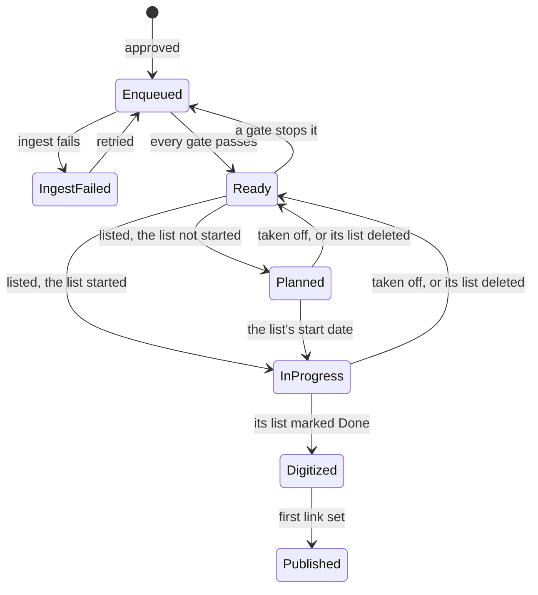

# Iteration

One attempt at a document, from approval to publication. Progress is one of the four axes
([STAT-axes](../model/status.md#stat-axes)); the gates decide when it moves
([STAT-gates](../model/status.md#stat-gates)).

#### LC-ITER-ingest

Approval puts the iteration in **Enqueued**. Ingest reads its catalog record and runs the
checks: restriction rules, validation rules, registries. A failed ingest is **Ingest failed**
until an administrator retries its batch.

#### LC-ITER-on-list

On a list, an item's progress follows the list: **Planned** before the list's start date,
**In progress** from it. Only *Mark Done* writes **Digitized**.

#### LC-ITER-off-list

Taken off a list, or when its list is deleted, an item goes back to **Ready**, or to
**Enqueued** if a gate now stops it. It keeps the deleted list's name as history.

#### LC-ITER-scanned

Once Digitized, progress never moves back. Its category and priority are fixed, and a page count
can no longer be entered: the scan has counted the pages. Checks still run, and their findings
show as a footnote.

#### LC-ITER-cancel

**Cancel** holds the item where it is, with a public and an internal reason; progress does not
change. A listed item comes off its list. Only an item not yet scanned can be cancelled.

#### LC-ITER-not-digitizable

**Could not be digitized** is a hold with the cause *Not digitizable*, set on a member of a
running list. The item stays on the list, marked, and *Mark Done* does not move it.

#### LC-ITER-resume

**Resume** lifts a hold. The item returns to the pool, not to its old list.

#### LC-ITER-reclassify

The category and priority change until the scan exists. Moved outside the person's custody, the
item becomes the business of the curators of its new category.

#### LC-ITER-rescan

A rescan is a new iteration of the same document, approved over an existing copy with a note.
The earlier iteration is history and takes no further acts.

#### LC-ITER-published

The first link where the scan can be read makes it **Published**. It stays Published while it
holds any link ([DEC-0014](../../decisions/DEC-0014-several-publication-links.md)).

#### LC-ITER-links

An iteration holds a set of links, each with where it is (the Link or Publication detector
instance that made it canonical, or *web address*), who set it and when. The same canonical
address is held once.
- **Primary:** the first link set is primary until someone makes another one primary. Wherever
  one link is shown or sent, it is the primary one.
- **People** add, replace, remove and make primary. The last link cannot be removed; a wrong one
  is replaced.
- **A Publication detector** only adds. It never removes or replaces a link a person set, and
  finding an address already held changes nothing.

