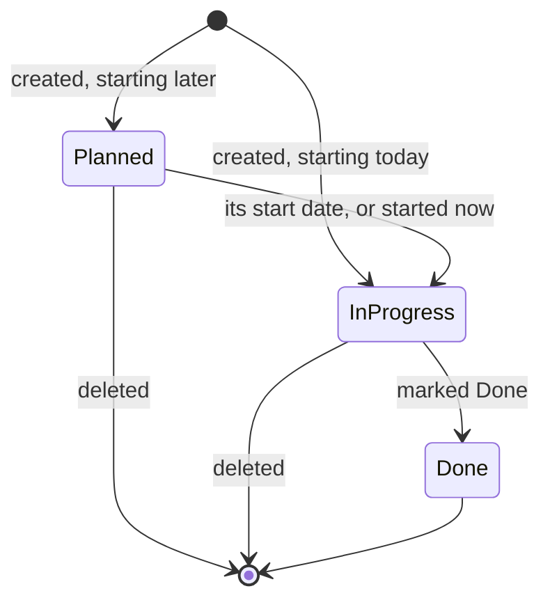

# Digitization list

From a draft to Done. The acts are in [acts](../access/acts.md#digitization-lists).

#### LC-LIST-state

A list is **Planned** before its start date and **In progress** from it. These two follow the
date and are never written. **Done** is an act. Each move fires a hook event
([HOOK-list-transitions](../integrations/hooks.md#hook-list-transitions)).

#### LC-LIST-start-now

A Planned list can be started early: *Start now* moves its start date to today, which makes it In
progress. It changes the date, not the state: the state still follows the date. It is logged
with the date it replaced. A list already In progress or Done cannot be started.

*Why:* list dates are calendar days, so starting means the start date is today, not a moment
within it.

#### LC-LIST-overdue

A list past its end date and not yet Done is **overdue**: someone has to say what was scanned.

#### LC-LIST-pool

The **pool** is what a list can take: items that are Ready, on no list, and pass every gate.
A list's members must each be in the pool or already on that list. One that another list took
meanwhile is refused, so no item is listed twice.

#### LC-LIST-blocked

A member that a gate stops after it was listed (forbidden, review needed, validation denied)
stays on the list, flagged, until the planner takes it off.

#### LC-LIST-done

*Mark Done* is allowed only while the list is In progress. Every member not scanned and not held
becomes Digitized on that day. The list's dates and members are then fixed for good.

#### LC-LIST-delete

A list is deleted, not cancelled, and needs no reason. Its members go back to the pool, or to
Enqueued where a gate now stops them. Each one's history keeps that it was on the list, by name.
A Done list is history and is not deleted.

#### LC-LIST-start-default

A list with no start date starts today.
