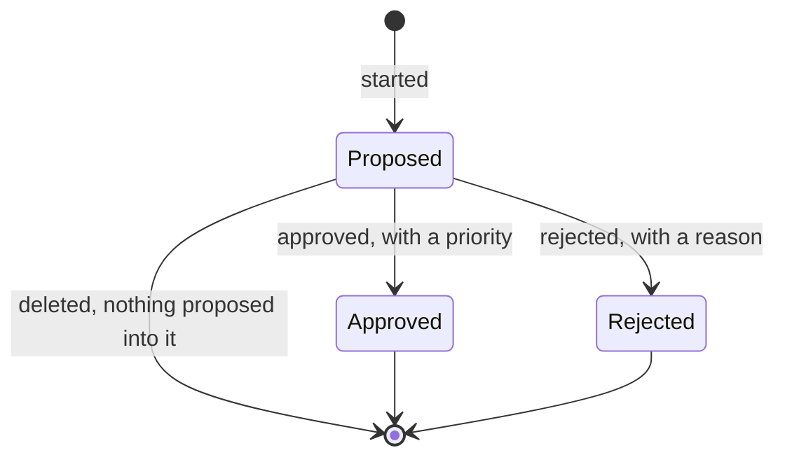

# Project

From a proposal to a decision. The acts are in [acts](../access/acts.md#projects).

#### LC-PROJ-start

A project starts **Proposed**. Whoever started it is its manager and only member.

#### LC-PROJ-own-intention

Every project has exactly one intention of its own, made with it. Its funding and window are the
project's and follow them. It holds the project's page target, and it starts without a mix. It
is listed on Intentions once the project is decided, and it changes and goes only with the
project.

#### LC-PROJ-period

A project's period (upcoming, active, ended) is worked out from its dates, never stored.

#### LC-PROJ-decide

The decision is final:
- **Approving** sets the priority its items get, once. It approves every proposal pending in the
  project at that moment, except those with an existing copy or whose copy check has not
  answered, which are left for review. A copy check rarely outlasts a project's decision, and a
  proposal made into the project after its approval is decided like any other.
- **Rejecting** declines the project's own pending asks with its reason, which every member
  reads, and archives its intention. A document others asked for outside the project stays
  theirs.

#### LC-PROJ-after-approval

On an Approved project the dates and the target can still change, since a grant can be extended.
The decision and the priority cannot. Its intention follows the new dates and is recounted.

#### LC-PROJ-members

Members are people or groups. The manager is always a member. Handing over the project keeps the
old manager a member until removed. A removed member's proposals stay in the project.

#### LC-PROJ-propose-into

Members may propose into a project while it is Proposed or Approved, not once it is Rejected.

#### LC-PROJ-delete

A project can be deleted only while nothing was ever proposed into it. Anything else is history.

#### LC-PROJ-sees-all

Whoever may decide projects sees every project, whatever their `project.read` scope.
