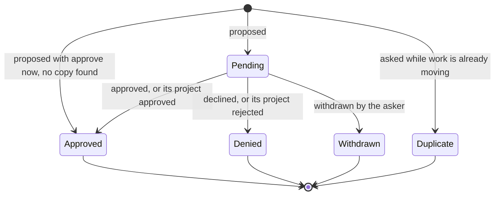

# Request

From an ask to a decision. The acts are in [acts](../access/acts.md#proposing).

#### LC-REQ-check

A new ask is looked up in the catalog first. It is one of:
- **not in the catalog**: refused;
- **which unit?**: the record has several units and none was named;
- **mine**: the asker already has an open ask for it, or an approved one whose attempt is not yet
  published or cancelled, so it is skipped;
- **in VERA**: someone else's work on it is already moving, so the ask joins it;
- **new**: nobody's work is moving on it, even if it was asked for before.

#### LC-REQ-join

An ask for a document whose work is already moving joins it:
- **Duplicate**, following the current iteration, when one exists;
- **Pending**, beside the other open asks, while it is still undecided.

A document whose current attempt is published or cancelled is not moving: a new ask for it is a
new proposal, decided as a rescan with the existing copy shown.

#### LC-REQ-one-iteration

One decision covers every open ask of a document. Approving creates one iteration:
- the oldest ask **originates** it, and its project funds it;
- every other ask **follows** it.

#### LC-REQ-approve-now

A person who may also decide can propose with *approve now*. An item with no existing copy is
approved at once. One with a copy, or whose check has not answered, stays Pending and is decided
like any other proposal: approving it over a copy is a rescan.

#### LC-REQ-checks-first

A proposal cannot be approved before its restriction and copy checks have answered once. It can
be declined at any time.

#### LC-REQ-final

A decision is final. A declined or withdrawn ask is history; asking again makes a new request.

#### LC-REQ-project

An ask made into a project waits for the project's decision when the project is Proposed:
- approving the project approves it;
- rejecting the project declines it with the project's reason.

An ask made into a project already Approved is reviewed like any other, and is marked so.
