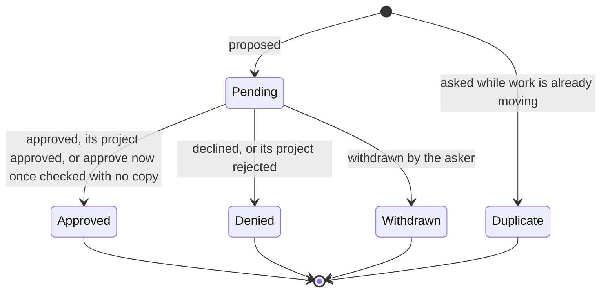

# Request

From an ask to a decision. The acts are in [acts](../access/acts.md#proposing).

#### LC-REQ-check

A new ask is looked up in the catalog first. It is one of:
- **not in the catalog**: refused;
- **which unit?**: the record has several units and none was named;
- **mine**: the asker already has an open ask for it, or an approved one whose attempt is not yet
  published or cancelled, so it is skipped;
- **in VERA**: someone else's work on it is already moving, so the ask joins it;
- **new**: nobody's work is moving on it, even if it was asked for before.

#### LC-REQ-join

An ask for a document whose work is already moving joins it:
- **Duplicate**, following the current iteration, when one exists;
- **Pending**, beside the other open asks, while it is still undecided.

A document whose current attempt is published or cancelled is not moving: a new ask for it is a
new proposal, decided as a rescan with the existing copy shown.

#### LC-REQ-one-iteration

One decision covers every open ask of a document. Approving creates one iteration:
- the oldest ask **originates** it, and its project funds it;
- every other ask **follows** it.

#### LC-REQ-approve-now

A person who may also decide can propose with *approve now*. Its checks run after the submit as
any other's ([LC-REQ-checks-job](#lc-req-checks-job)); until they answer, the item is held as
*checking*, and it is approved as soon as they answer with no existing copy. One with a copy stays
Pending and is decided like any other proposal: approving it over a copy is a rescan.

#### LC-REQ-checks-first

A proposal cannot be approved before its restriction and copy checks have answered once. It can
be declined at any time.

#### LC-REQ-checks-job

A new proposal's restriction and copy checks run after it is submitted, as a job, never during
the submit; until they answer, it is *being checked*. A plugin that fails or does not answer is
asked again later, and the proposal stays being checked meanwhile. Submitting never waits for a
registry.

#### LC-REQ-preview

Each item in *Propose…* and *Add…* previews the checks as it lands
([ACT-ways-in](../access/acts.md#act-ways-in)):
- an existing copy, with its link, for everyone, so a reader can read it instead of asking;
- the restriction findings (forbidden or not, until when, why) for staff only.

The preview asks the registry and restriction plugins with a short timeout; one that does not
answer in time says the item is checked after submitting. The preview only advises: the checks
after the submit decide.

#### LC-REQ-final

A decision is final. A declined or withdrawn ask is history; asking again makes a new request.

#### LC-REQ-project

An ask made into a project waits for the project's decision when the project is Proposed:
- approving the project approves it;
- rejecting the project declines it with the project's reason.

An ask made into a project already Approved is reviewed like any other, and is marked so.
