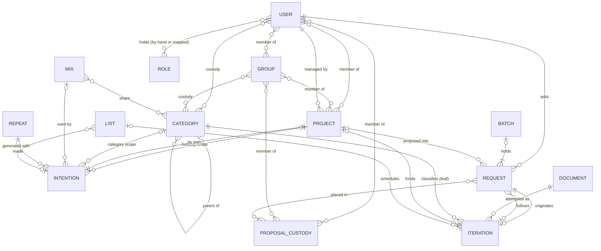

# Relationships

Every relationship between the [entities](entities.md), and the ones that deliberately do not
exist. **Holder** is the side that stores the link, and changes when the link changes.

## Access

| From | To | Card. | Holder |
|---|---|:-:|---|
| User | Role | M:N | the user, by hand or mapped ([ACCESS-role-ways](../access/people.md#access-role-ways)) |
| User | Group | M:N | the group's members |
| User, Group | Category | M:N | the category's custody holders |
| User, Group | Proposal custody | M:N | the custody's members |
| Request | Proposal custody | M:N | computed by the Custody plugins, never typed in |
| User, Group | Project | M:N | the project's members |
| Project | User (manager) | N:1 | the project; the creator until handed over |
| User | Identity | 1:N | the identity, unique per instance and external id |

## Planning

| From | To | Card. | Holder |
|---|---|:-:|---|
| Category | Category (parent) | N:1 | the category; none at the top level |
| Intention | Project (funding) | N:1 | the intention's funding: any, none, or one project |
| Intention | Project (its own) | 1:1 | the intention; a project has exactly one |
| Intention | Category (scope) | N:1 | the intention; none means the whole tree |
| Intention | Mix | N:1 | the intention, with an optional pinned revision; none means no mix |
| Intention | Repeat | N:1 | the intention made by the repeat |
| Mix | Category | M:N with a percentage | the mix's revision |
| List | Intention, Mix | N:1 | the list's generation record: provenance only |

## Work

| From | To | Card. | Holder |
|---|---|:-:|---|
| Iteration | Document | N:1 | the iteration; its attempt number orders them |
| Iteration | Category | N:1 | the iteration; required, always a leaf |
| Iteration | Project | N:1 | the iteration; the originating request's project |
| Iteration | List | N:1 | the iteration; none when not listed |
| Iteration | Request | N:1 | the iteration; required: the request that originated it |
| Request | User | N:1 | the request; a person or an agent, never nobody |
| Request | Batch | N:1 | the request; none for a single item |
| Request | Project | N:1 | the request; optional |
| Request | Iteration (follows) | N:1 | the request: a later ask follows the work already moving |

## The rules

#### REL-iteration-category

An iteration always has a category, and it is a leaf.

*Why:* an iteration with no category belongs to nobody's custody and appears in no curator's
queue. A share on a leaf is then the only share an item counts against.

#### REL-custody-any-node

Custody attaches at any node and reaches everything below it; classification attaches only at
leaves. The asymmetry is deliberate: custody is about people and subtrees, classification about
items.

#### REL-never-authorless

Every request has an asker, a person or an agent, and every iteration has the request that
originated it. Nothing enters VERA without an author.

#### REL-per-attempt

Category, priority, funding and the list are facts of the iteration, not of the document. A
rescan can be done in another line of work and paid for by another grant.

#### REL-groups-flat

Groups are flat: no group contains another.

*Why:* a second inheritance system beside the category tree, whose interaction nobody could
predict from a screen.

#### REL-share-per-set

A share is written per set of siblings, and a set adds up to at most 100. A category's share of
the whole is its percentage times its parent's, all the way up. A set under 100 is flagged, not
scaled; `0%` means deliberately excluded, and no entry means no share decided
([PLAN-mix-sets](../planning/mixes.md#plan-mix-sets)).

#### REL-list-provenance

A generated list records which intention, mix, revision and generator shaped it. That is
provenance only: what a list counts towards is worked out from its members and its start, never
stored ([PLAN-counting](../planning/intentions.md#plan-counting)).

#### REL-not-related

These relationships do not exist, and a view that needs one is built on a join with no answer:

| Not related | Why | Reach it through |
|---|---|---|
| User → Document | a person never owns an item | custody, or authorship of a request |
| Category ↔ Project | lines of work outlive any grant | an intention's funding and category scope |
| Intention → Document | an intention is a target, not a selection | its scope matched against iterations |
| Document → Category | classification is per attempt | the iteration |
| Document → Project | funding is per attempt | the iteration |
| Group → Role | capability reaches a person only as a role they hold | the user's roles |
| Group → Group | one inheritance system is enough | flat membership |
