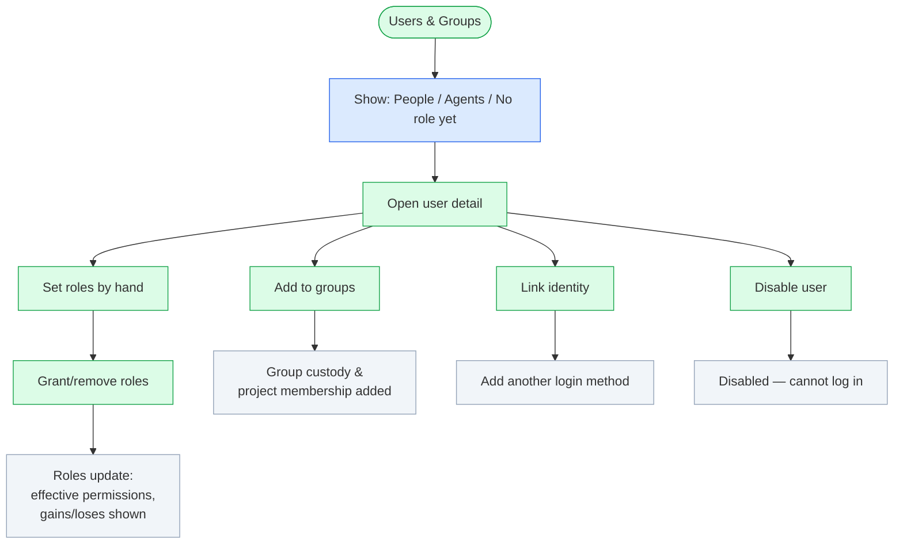
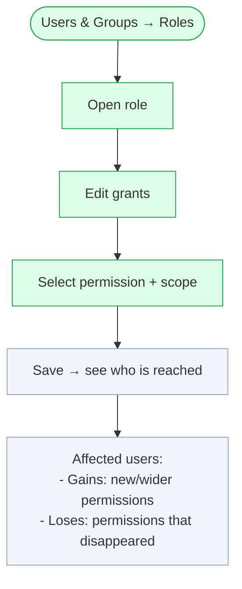
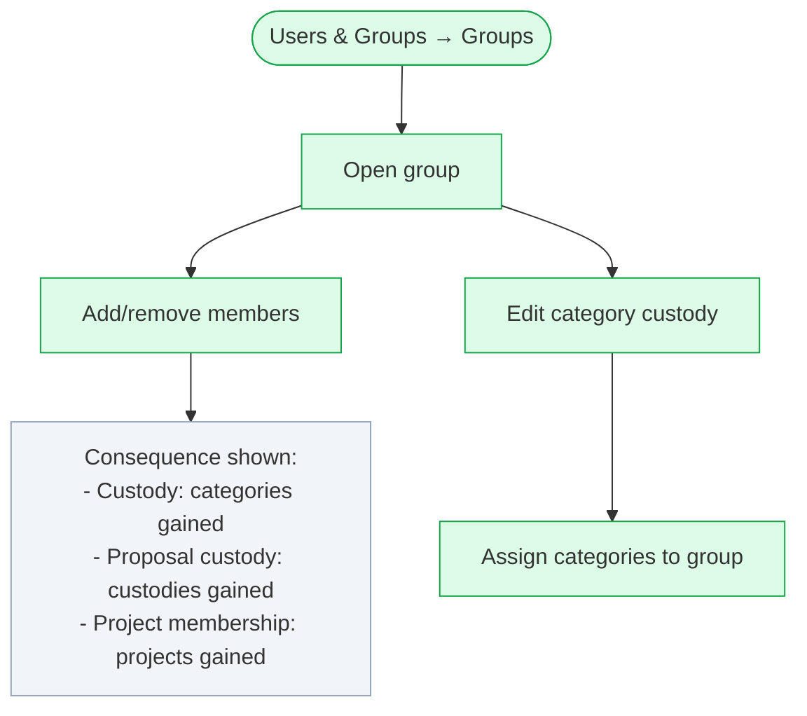
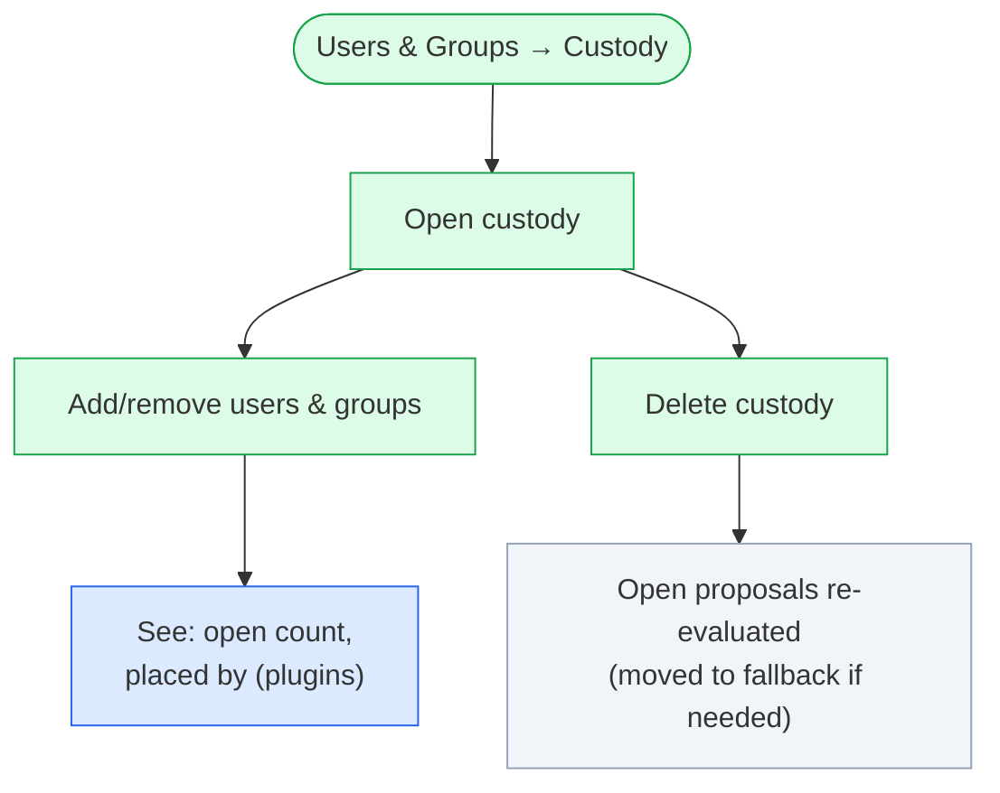
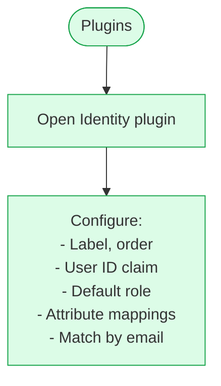
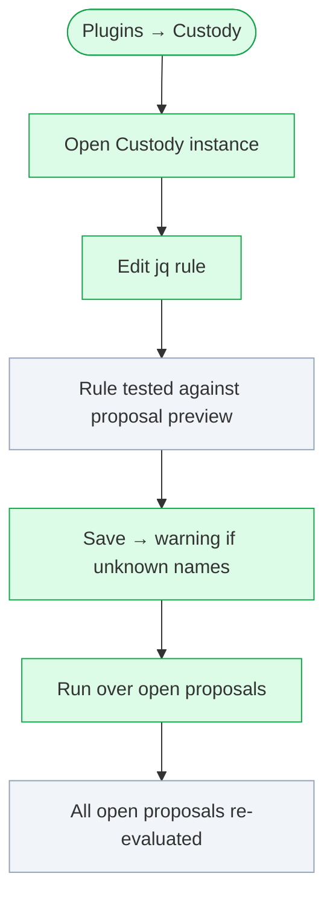
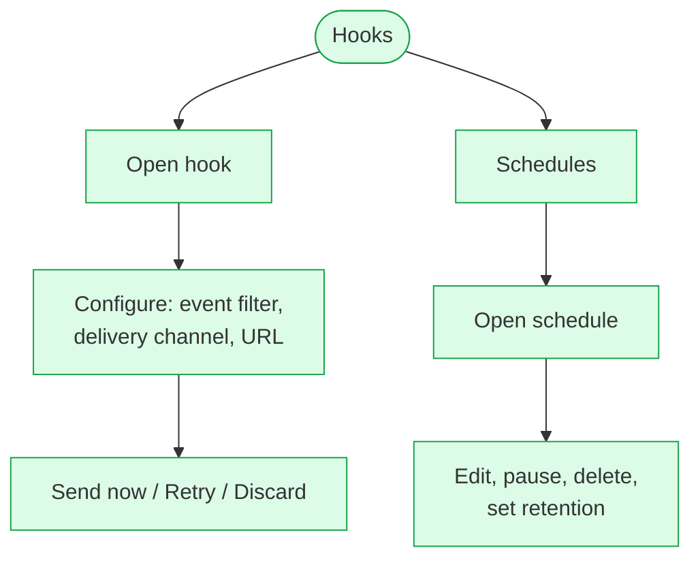
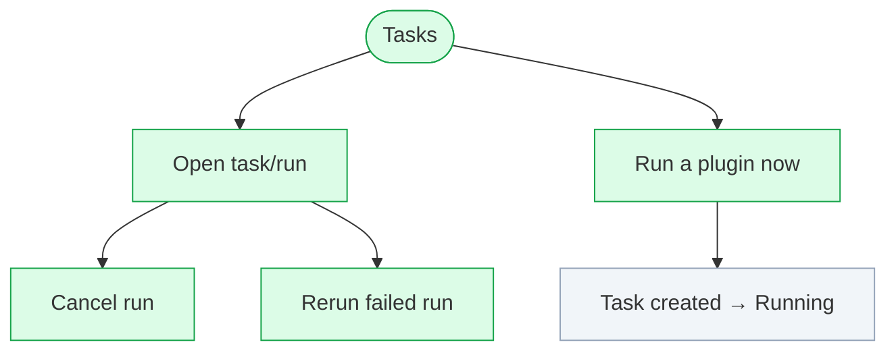
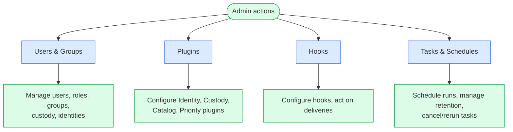

# Admin User Journey

The admin has full access to everything. They manage users, roles, groups, custody
assignments, plugins, hooks, schedules, and tasks.

**Holds**: all 60 permissions at `any`.

**Sidebar**: All entries — My Documents, Documents, Proposals, Documents Validations,
Digitization Lists, Projects, Categories, Intentions, Tasks, Schedules, Users & Groups,
Plugins, Hooks.

## Managing Users

- **`access.manage@any`** — manage all users, roles, groups, custody.
- A user's detail shows their roles with provenance: hand-set vs. mapped, and by which
  instance.
- **Provenance matters** — "staff — mapped by MZK Keycloak from group mzk-staff".

## Managing Roles

- The role editor only offers valid permission/scope combinations from the catalog.
- `includedRolesOf()` shows which roles this one includes (narrower roles whose grants
  are fully covered).
- The "who is reached" panel shows every user holding this role, with what they gain
  and lose.

## Managing Groups

- A group's detail shows **what holding it confers** — custody, proposal custody, projects.
- This makes the consequence of adding someone visible at the moment of adding them.
- Groups carry **custody and project membership**, never roles.

## Managing Proposal Custody

- **Exactly one fallback**, always exists, cannot be deleted.
- Deleting a custody triggers a re-run over all open proposals.
- The fallback catches what no plugin named.

## Managing Identity Plugins

- **`plugin.configure@any`** — configure all plugins including Identity.
- Changes to mappings take effect at the next login, not immediately.
- A disabled instance disappears from the login page.

## Managing Custody Plugins

- A rule change triggers a re-run over all open proposals.
- Unknown custody names in a rule trigger a warning on the Plugins page.
- **`plugin.run@any`** — run custody re-evaluation manually.

## Managing Hooks and Schedules

- **`hook.configure@any`** — configure hooks and act on deliveries.
- **`task.schedule@any`** — create, edit, pause, delete schedules.
- Hooks fire on events: `request.created`, `request.decided`, `iteration.ingested`, etc.

## Managing Tasks

- **`task.read@any`** — see all tasks (including others' runs).
- **`task.cancel@any`** — cancel any run.
- **`task.read_own`** — self-scoped, see the tasks I started.
- **`task.cancel`** — on my own runs, I only need `task.read_own`.

## Admin overview

The admin's day-to-day is primarily **Users & Groups** and **Plugins** — configuring the
identity system, managing role assignments, and maintaining custody plugin rules.