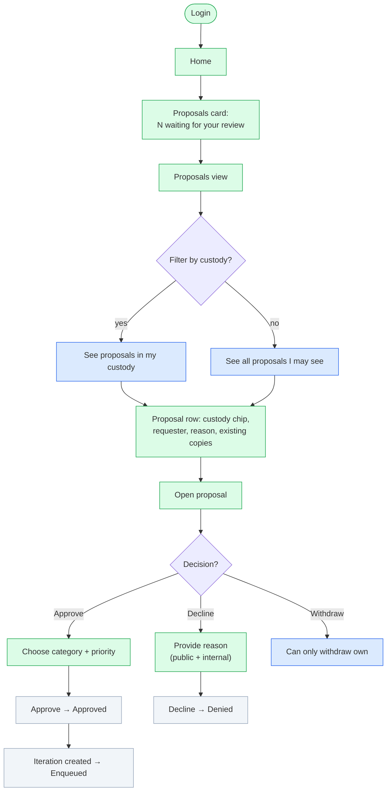
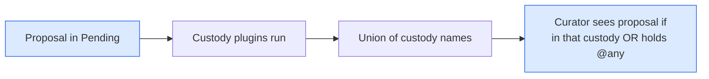
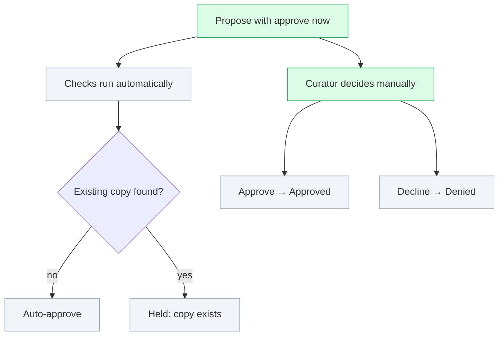
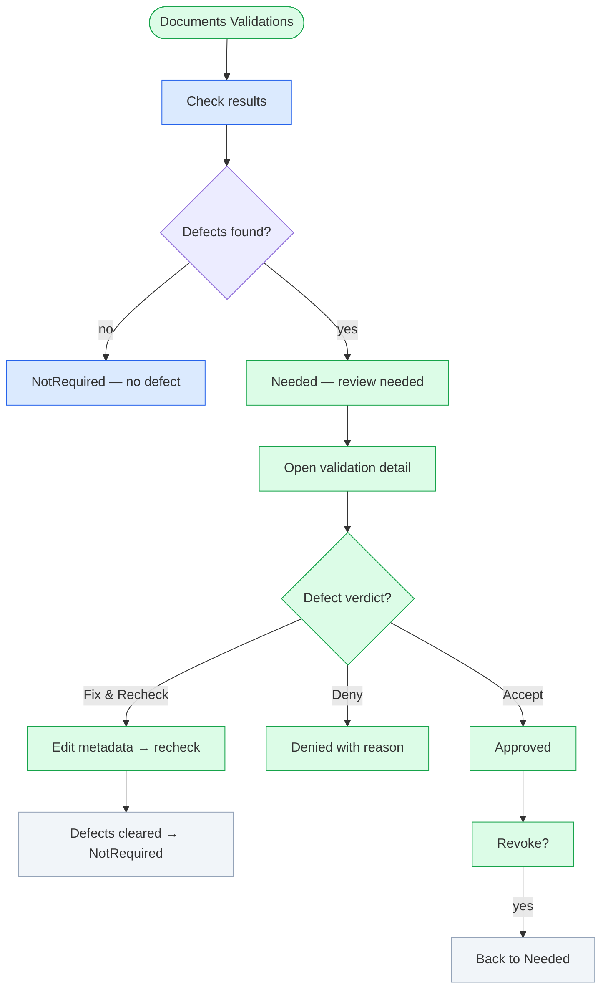
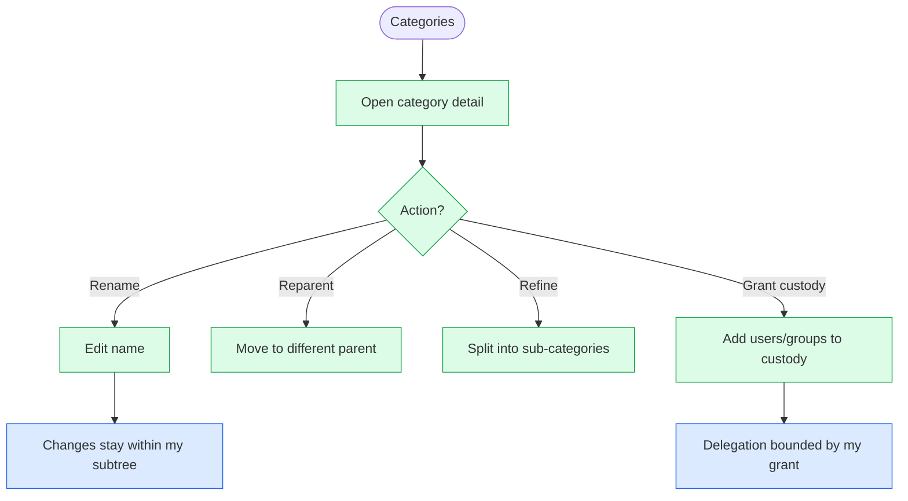
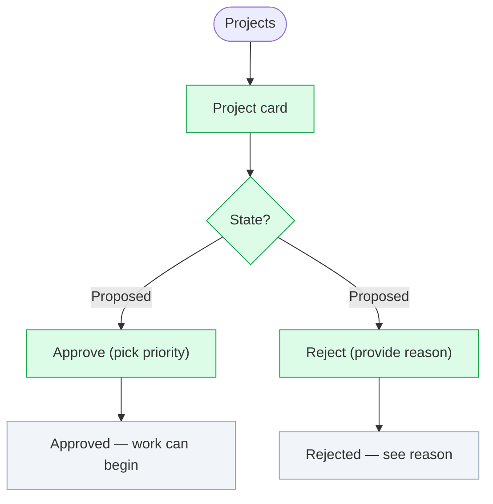
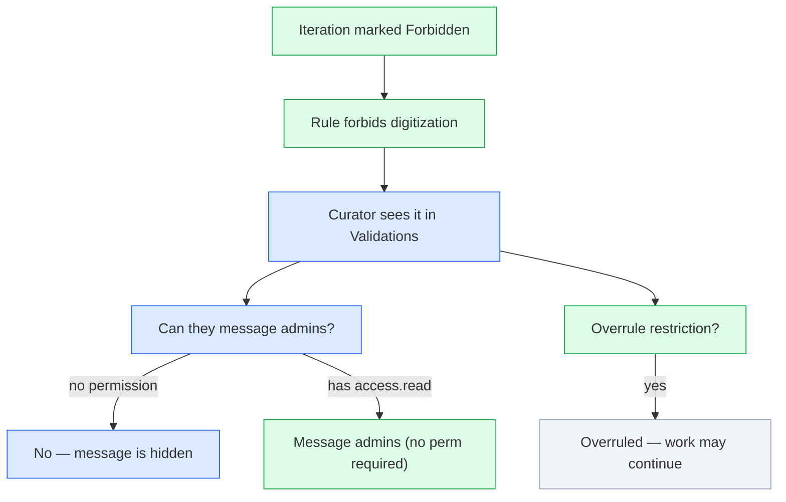

# Curator User Journey

The curator is VERA's core operator. They review proposals, approve or decline them,
validate iterations, reclassify metadata, manage category custody, and decide on
projects.

**Holds**: staff grants + proposal decision and validation grants at custody scope,
category custody actions, and `project.decide@any`.

**Sidebar**: Documents, Proposals, Documents Validations, Projects,
Categories, Tasks.

**Proposal limit**: Unlimited because the shipped curator role explicitly sets its
per-submission limit to `null`.

**Daily limit**: Unlimited because the shipped curator role explicitly sets `null`.
`request.decide` itself does not bypass a role's numeric daily limit.

## Login → Proposals Review

### Proposal custody check

- **`request.decide@custody`** — resolves through proposal custody. A curator sees and
  decides proposals in custodies they are members of.
- **`request.decide@any`** — admin sees all proposals.
- A curator holding both `curator` and `admin` roles gets the wider scope.

## Approving with checks

- **Approve now** is an intent the system applies after checks — shown only to someone
  holding `request.decide`.
- If checks find an existing copy, the request is held until a curator decides.
- A rescan (re-approving over existing copy) is `request.decide`, not a separate grant.

## Validating iterations

- **`validation.approve@custody`** — accept the outstanding defect set.
- **`validation.deny@custody`** — deny with reason (public + internal).
- **`validation.revoke@custody`** — take back an acceptance.
- **`iteration.recheck@custody`** — re-read from catalog, rerun checks.
- **`iteration.classify@custody`** — change category and priority.

## Managing categories

- **`category.edit@custody`** — at `custody`, moves stay within my own subtree.
- **`category.grant_custody@custody`** — at `custody`, means "within my own subtree".
- A curator holding Periodicals can bring someone onto Periodicals/Regional without admin.

## Managing project custody

- **`project.decide@any`** — approve or reject any Proposed project.
- A curator can decide projects even those in their own custody — project custody is
  about proposals, not projects.

## Restriction overruling

- **`restriction.overrule@any`** — only at `any`, deliberately. A curator cannot quietly
  lift prohibitions inside their own subtree. This act requires someone outside it.
