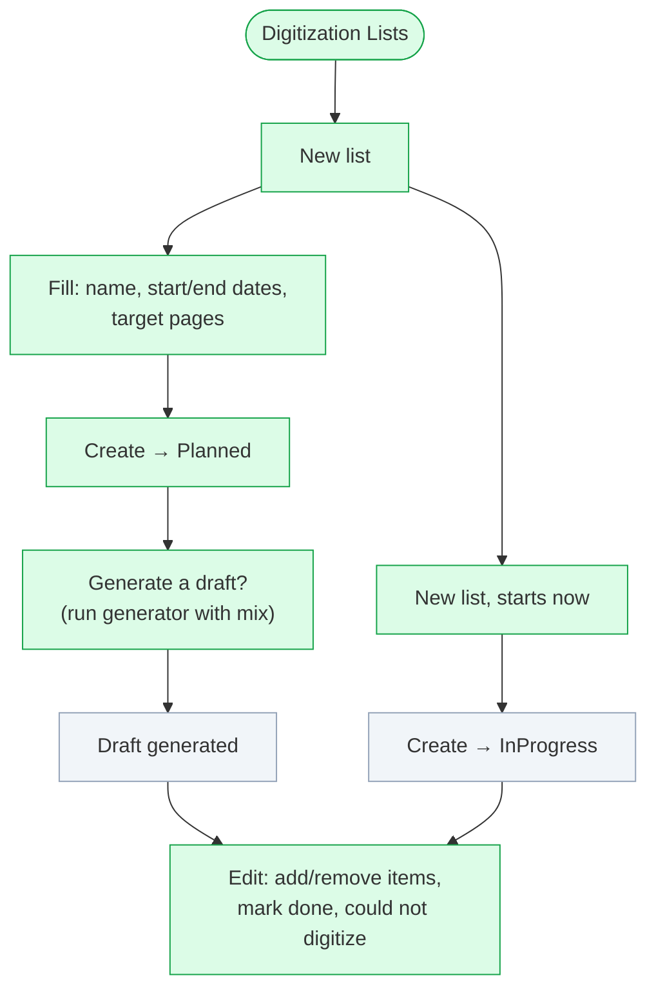
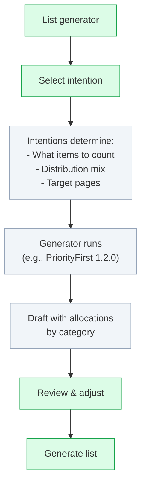
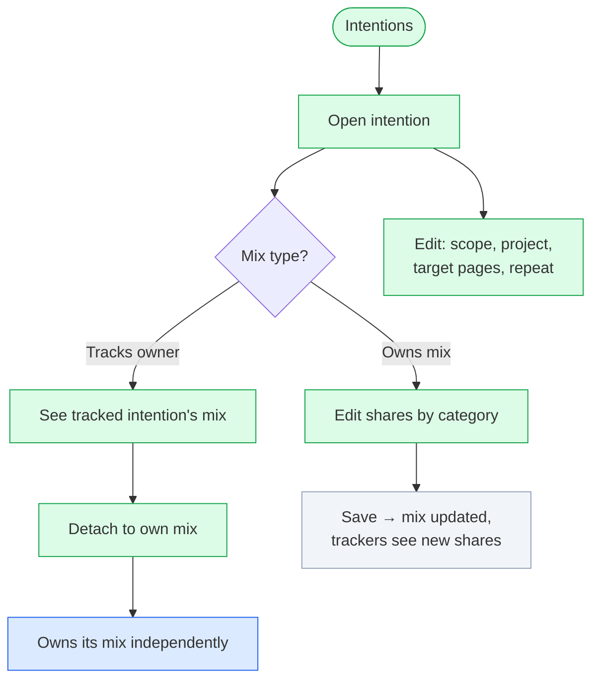
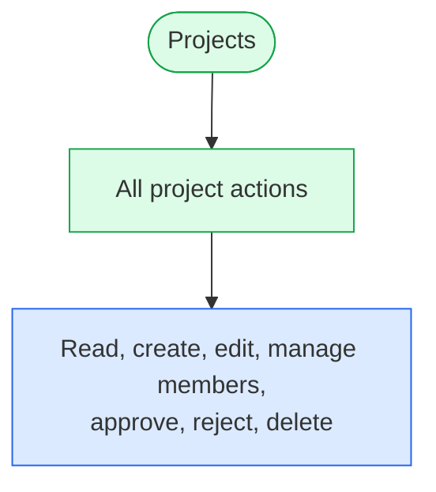
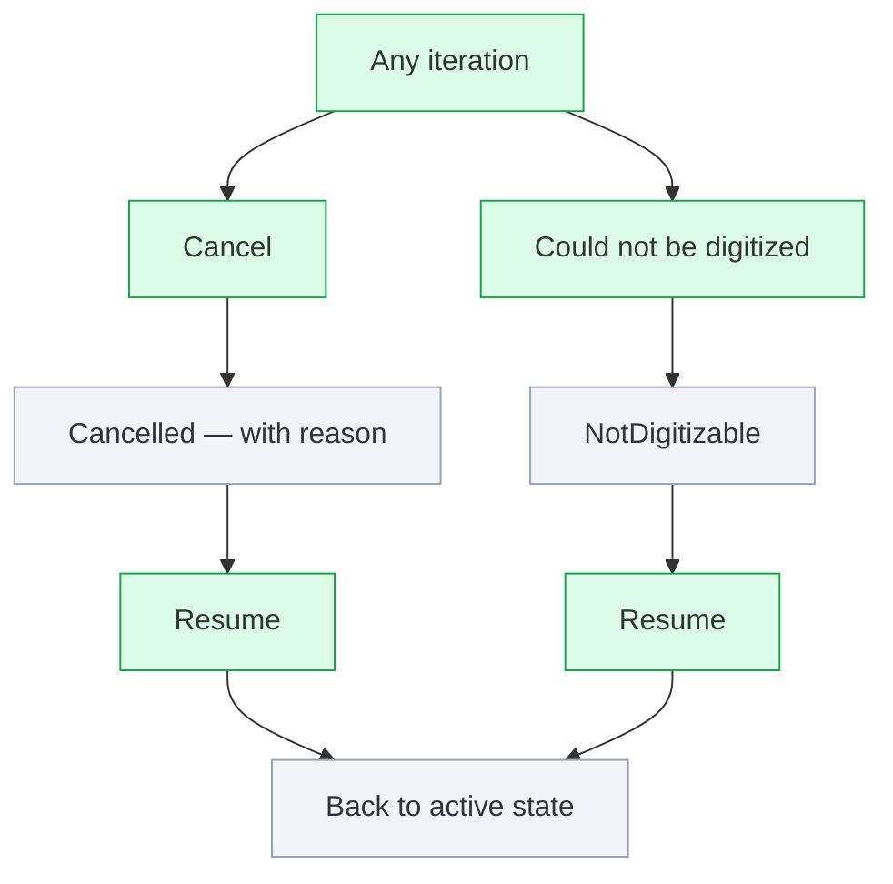

# Digitization Curator User Journey

The dig-curator plans and executes digitization: creating lists, running generators,
managing intentions and mixes, and coordinating the digitization workflow. They can
cancel and resume iterations across all categories.

**Holds**: curator grants + `list.*@any`, `intention.read@any`, `intention.edit@any`,
`project.*@any`, `iteration.cancel@any`, `iteration.resume@any`.

**Sidebar**: Documents, Proposals, Documents Validations,
Digitization Lists, Projects, Intentions, Categories, Tasks.

## Planning a digitization list

- **`list.create@any`** — create lists, including running generators.
- **`list.edit@any`** — edit membership, dates, Mark Done, Could not be digitized.
- **`list.delete@any`** — delete lists, return items to pool.
- **`list.read@any`** — see all lists.

## Generating from intentions

- **`intention.read@any`** — see all intentions.
- **`intention.edit@any`** — edit intentions, their mixes.

## Managing intentions and mixes

- **Tracks vs. Owns** — an intention either tracks an owner's mix or owns its own.
- **Detaching** creates an independent mix that won't change when the tracked owner changes.
- **`intention.edit_overall@any`** — NOT held by dig-curator. Only admin can edit the
  Overall mix.

## Project management

- **`project.*@any`** — all project permissions at `any`. A dig-curator can do everything
  with projects, including approve/reject.
- This makes dig-curators the primary project coordinators.

## Cancelling and resuming

- **`iteration.cancel@any`** — stop work on any iteration (not limited by custody).
- **`iteration.resume@any`** — restart a cancelled or NotDigitizable iteration.
- Cancel and resume are separately grantable — one can stop work without restarting.

## Digitization workflow overview

The dig-curator orchestrates this entire flow: putting iterations on lists, marking them
done, and publishing.
