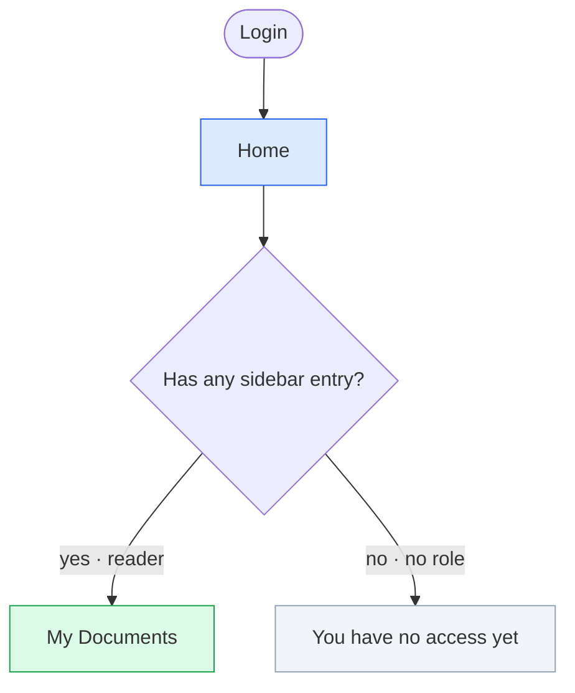
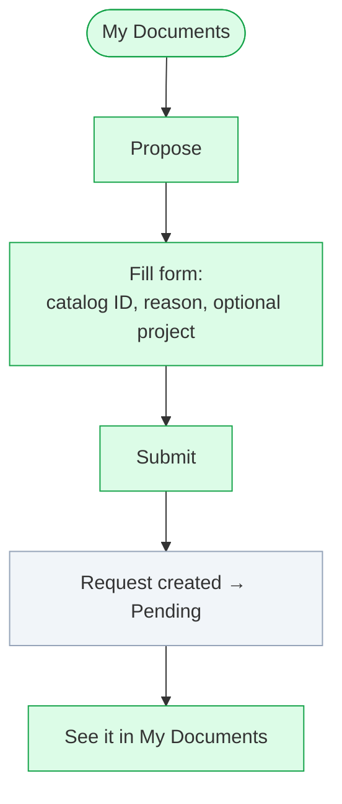
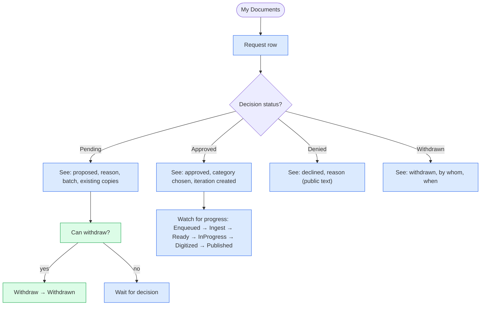

# Reader User Journey

A reader can propose items, track their requests, and see their own documents.
That's it — nothing about other people's records.

**Holds**: `request.create`, `request.read_own`, `request.withdraw_own`, `watch`
(all self-scoped, no scope column).

**Sidebar**: "My Documents" (only entry, so `/` redirects there).

**Proposal limit**: The reader role sets 10 items per submission.
External users are capped to prevent queue flooding.

**Daily limit**: Readers can submit 100 accepted items per calendar day by default.
The mock uses the library's Europe/Prague day. The remaining count appears in the
propose dialog.

## Login → Home

## Proposing an item

- **`request.create`** — self-scoped, anyone with it can propose.
- **Batch proposing** — `request.create` is used once per item; a batch is a way of
  submitting, not a power. The reader role sets 10 items per submission. A separate daily limit applies to
  accepted items across submissions (100 by default). The dialog shows the remaining
  count and warns when the daily limit is near or reached.
- **Project funding** — if the reader is a project member, their project appears on the
  propose form as a funding target.

## Tracking a request

- **`request.read_own`** — self-scoped, shows the requester's own requests and iterations.
- **`request.withdraw_own`** — self-scoped, can withdraw pending requests.
- After approval, the reader sees the iteration's progress but cannot act on it (no
  iteration permissions).

## What a reader CANNOT do

| Action | Why |
|---|---|
| See other people's requests | Needs `request.read@custody` or `@any` |
| Approve/decline proposals | Needs `request.decide` |
| Edit categories or metadata | Needs `category.edit` / `iteration.classify` |
| Create or manage lists | Needs `list.create` / `list.edit` |
| See validaitons | Needs `validation.approve` |
| Create projects | Needs `project.create` |
| See anything beyond own records | Self-scoped only |
