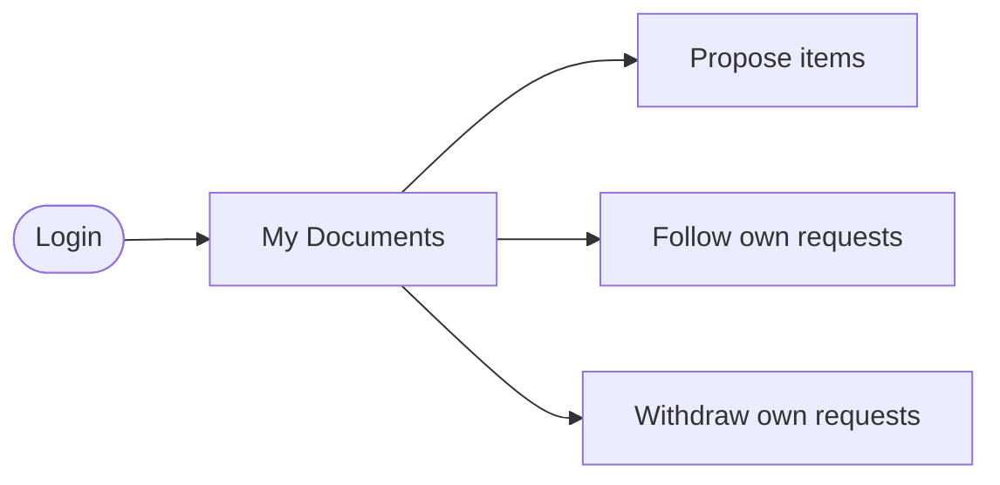

# Staff User Journey

The shipped staff role has the same grants as reader. Its sole difference is a
higher daily proposal limit. Staff can propose items, follow their own requests,
and withdraw their own requests. This role alone does not open Projects,
Categories, Tasks, or other people's documents.

**Holds**: `request.create`, `request.read_own`, `request.withdraw_own`, `watch`.

**Sidebar**: My Documents.

**Proposal limits**: 10 items per submission and 300 accepted items per library
calendar day. The reader role has the same per-submission limit and 100 per day.
The mock uses Europe/Prague time. The propose dialog shows the remaining count.

## Login → My Documents

If a staff user also holds another role, that role can add permissions. For
example, project access requires a separate role granting `project.read`;
membership alone does not grant the capability. Among roles granting
`request.create`, the highest proposal limit applies for each setting, and
`null` makes that setting unlimited.
