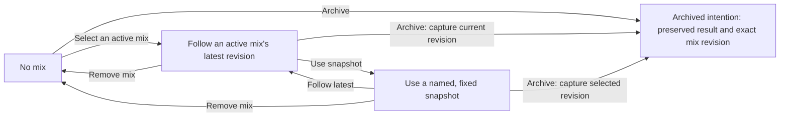

# Intention, Mix Selection, and Archive

The current model keeps intentions and mixes separate. An intention defines the
work it counts and may have a page target; it may also use a mix. A mix is an
independently named, reusable definition with immutable revisions. See
[`intentions-mixes-redesign.md`](../design/shared/entities/intentions-mixes-redesign.md)
for the decisions and open questions.

## Mix selection

New ordinary intentions offer the active Primary mix as a default selection.
Project intentions start without a mix: their work is selected by eligibility,
priority, and request age rather than category proportions. An explicit choice
of no mix stays absent during list generation. Changing which mix is Primary
does not retarget existing intentions or Overall output.

Following latest means later edits to that mix affect the intention's future
comparisons. A snapshot is a read-only revision; using one does not create a new
editable mix. **Create editable copy** does. The mix itself can be archived
without removing references to its revisions; followers and repeat templates
then pin its final revision.

## Archive and repeats

Archiving an intention preserves its displayed definition, counts, category
labels, and exact mix revision. The archived view is read-only. Later output or
mix edits do not rewrite that capture. Archiving an intention does not archive
the independently managed mix it used.

A repeat template may create intentions with or without a page target or mix.
When a new occurrence is created, the previous one can be archived with its
result preserved. The mock does not yet create occurrences on a calendar tick.

## Lists

An intention supplies a counting scope, optional target, and optional mix for
list generation. Lists are operational plans; archived intentions preserve the
result shown at archive time. Project intentions with no mix select eligible
work without a category allocation.
