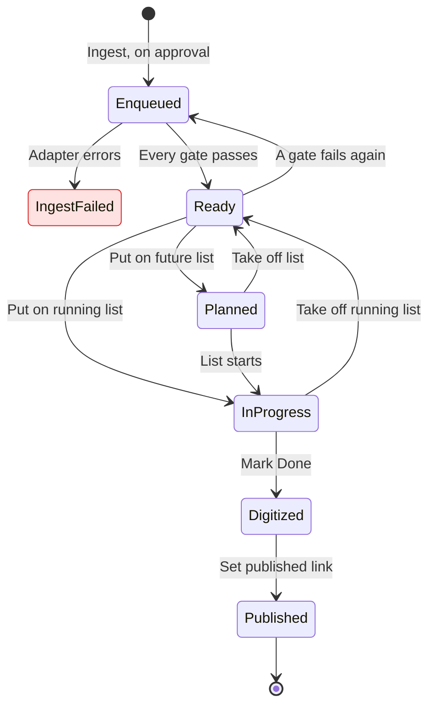
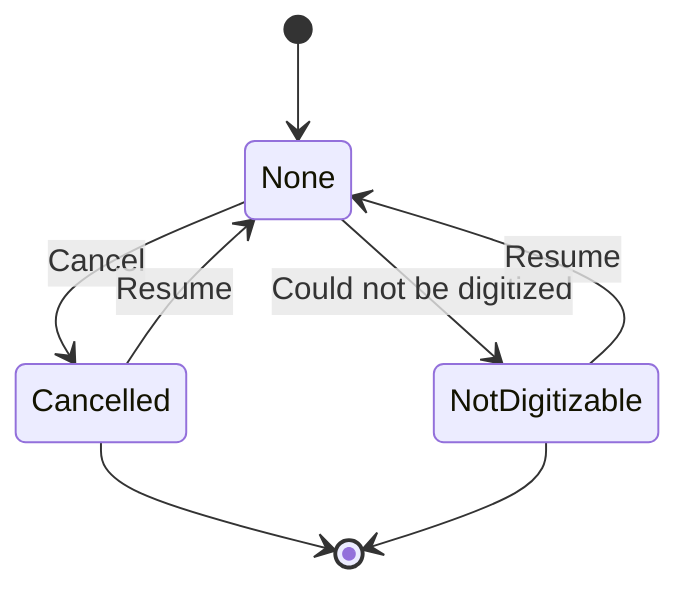
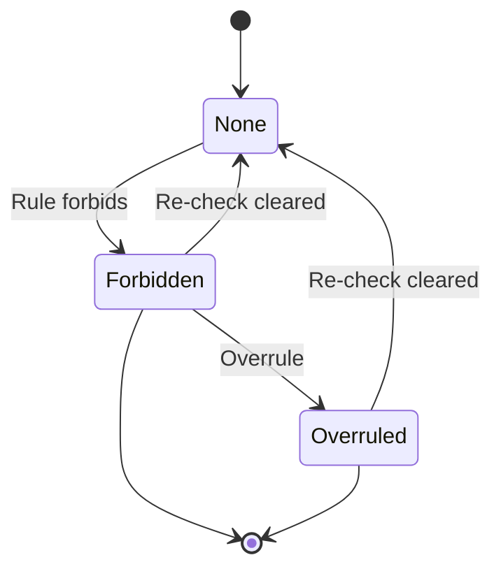
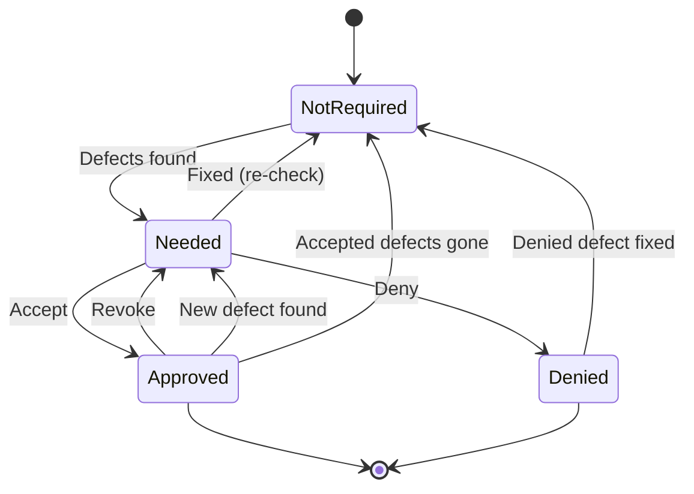

# Iteration Lifecycle

The iteration.progress and iteration.cancellation state machines. Extracted from
`docs/design/shared/model/workflows.js`.

## Progress states

| State | Description |
|---|---|
| **Enqueued** | Approved, waiting for ingest (initial from Approved) |
| **IngestFailed** | Could not be added to catalog |
| **Ready** | All gates passed, available for planning |
| **Planned** | On a future list |
| **InProgress** | On a running list, being digitized |
| **Digitized** | Marked Done, awaiting publishing |
| **Published** | Available at published link (terminal) |

## Cancellation states

| State | Description |
|---|---|
| **None** | Not cancelled (initial) |
| **Cancelled** | Cancelled by operator |
| **NotDigitizable** | Could not be digitized |

## Restriction states

| State | Description |
|---|---|
| **None** | Nothing forbids digitization (initial) |
| **Forbidden** | A rule forbids it |
| **Overruled** | Forbidden but overruled by admin |

## Validation states

| State | Description |
|---|---|
| **NotRequired** | No defects (initial) |
| **Needed** | Defects found, review needed |
| **Approved** | Defects accepted |
| **Denied** | Defects denied |

## Progress state diagram

## Cancellation state diagram

## Restriction state diagram

## Validation state diagram

## Actions (no state change)

| Action | Permission | Notes |
|---|---|---|
| `reclassify-doc` | `iteration.classify@custody` | Change category/priority (Documents view) |
| `reclassify-val` | `iteration.classify@custody` | Change category/priority (Validations view) |
| `relink` | `iteration.relink` | Relink catalog record |
| `edit-descriptive` | `iteration.edit_descriptive` | Edit descriptive metadata |
| `change-link` | `iteration.publish@custody` | Change published link |
| `fix` | `iteration.edit_descriptive` | Fix a defect field, triggers re-check |

## Key rules

- **Gates** — Enqueued → Ready requires all validation gates to pass. If a gate fails,
  the iteration goes back to Enqueued.
- **Marking Done** is an **action**, not a transition — it sets a flag, then the iteration
  moves to Digitized.
- **Cancellation** is separate from progress — a cancelled iteration can be resumed
  (`iteration.resume@custody`).
- **Restrictions** are set only by rules (plugins), never by people. Only admin can overrule.
- **Publishing** (`iteration.publish@custody`) is what makes an iteration Published — it
  sets or changes the published link.
