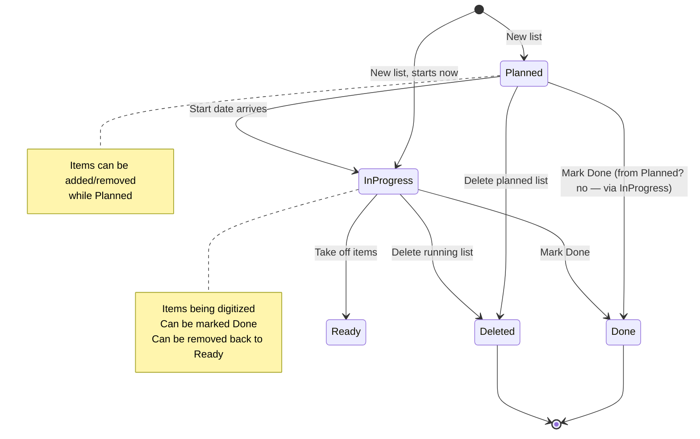

# List Lifecycle

The digitization list state machine. Extracted from `docs/design/shared/model/workflows.js`.

## States

| State | Description |
|---|---|
| **Planned** | Created, not yet started (initial) |
| **InProgress** | Started, items being digitized |
| **Done** | Marked Done (terminal) |
| **Deleted** | Deleted (terminal) |

## State diagram

## Transitions

### Person-triggered

| Transition | From → To | Permission | Page | Notes |
|---|---|---|---|---|
| `create` | → Planned | `list.create` | Lists | New list |
| `create-now` | → InProgress | `list.create` | Lists | New list, starts now |
| `done` | InProgress → Done | `list.edit` | Lists | Mark the list Done |
| `delete-planned` | Planned → Deleted | `list.delete` | Lists | Delete a planned list |
| `delete-running` | InProgress → Deleted | `list.delete` | Lists | Delete a running list |

### System-triggered

| Transition | From → To | Notes |
|---|---|---|
| `starts` | Planned → InProgress | Start date arrives |

### Actions (no state change)

| Action | Permission | Notes |
|---|---|---|
| `edit` | `list.edit` | Edit members and dates |
| `generate` | `list.create` | Generate a draft from intention/mix |
| `message` | (none) | Message the list author |

## Key rules

- **A running list cannot be deleted if it has items** — actually, it CAN be deleted,
  but items return to the Ready pool.
- **Done is an action** — `list.edit` on a running list sets the Done flag.
- **Generation** creates a draft list from an intention's mix — this is a list action,
  not a state transition.
- **Take off** — items can be removed from a list back to Ready.
- **List deletion** — returns all members to Ready pool.
