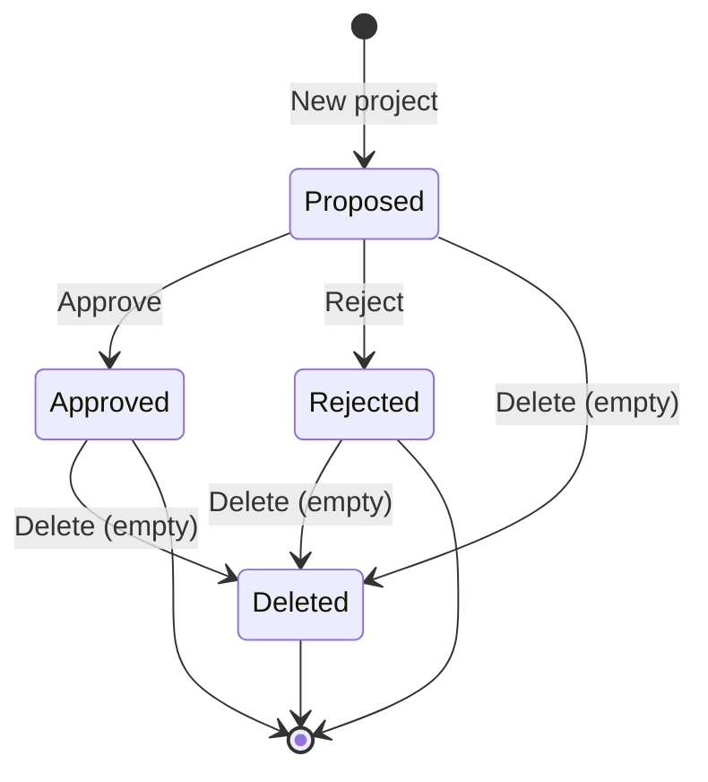

# Project Lifecycle

The project.state machine. Extracted from `docs/design/shared/model/workflows.js`.

## States

| State | Description |
|---|---|
| **Proposed** | Created, awaiting decision (initial) |
| **Approved** | Approved with priority |
| **Rejected** | Rejected with reason |
| **Deleted** | Deleted (terminal, only when empty) |

## State diagram

## Transitions

### Person-triggered

| Transition | From → To | Permission | Page | Notes |
|---|---|---|---|---|
| `create` | → Proposed | `project.create` | Projects | New project (creator = manager) |
| `approve` | Proposed → Approved | `project.decide@any` | Projects | Approve (pick priority) |
| `reject` | Proposed → Rejected | `project.decide@any` | Projects | Reject (provide reason) |
| `delete-proposed` | Proposed → Deleted | `project.delete@managed` | Projects | Delete, while empty |
| `delete-approved` | Approved → Deleted | `project.delete@managed` | Projects | Delete, while empty |
| `delete-rejected` | Rejected → Deleted | `project.delete@managed` | Projects | Delete, while empty |

### Actions (no state change)

| Action | Permission | Notes |
|---|---|---|
| `edit` | `project.edit@managed` | Edit details and dates |
| `members` | `project.manage_members@managed` | Add/remove members, hand over management |
| `message` | (none) | Message the manager |

## Key rules

- **Only Proposed projects can be approved or rejected.**
- **Any state** — a project can be deleted (from any state) if it has no proposals.
  Needs `project.delete@managed` — only the manager can do this (unless admin).
- **Manager handover** — `project.manage_members@managed` allows the manager to transfer
  management to another member. This is an action, not a state change.
- **Final states** — `Approved` and `Rejected` are the only meaningful endpoints.
  `Deleted` is cleanup.
- **Project funding** — once Approved, members can propose into the project with
  `request.create`. The project becomes a funding target on the propose form.
