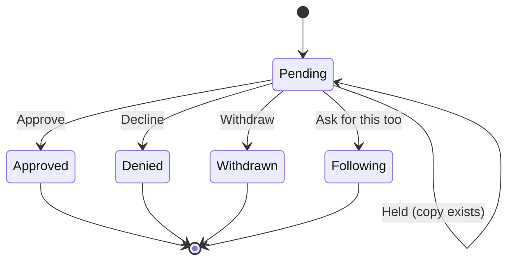

# Request Lifecycle

The request.decision state machine. Extracted from `docs/design/shared/model/workflows.js`.

## States

| State | Description |
|---|---|
| **Pending** | Request submitted, waiting for decision (initial) |
| **Approved** | Request approved, iteration created |
| **Denied** | Request declined |
| **Withdrawn** | Request withdrawn by requester |
| **Following** | Work already started elsewhere, this request follows it |

## State diagram

## Transitions

### Person-triggered

| Transition | From → To | Permission | Page | Notes |
|---|---|---|---|---|
| `propose` | → Pending | `request.create` | Documents | New proposal |
| `approve-now` | → Pending | `request.decide@custody` | Documents | Propose with approve intent |
| `harvest` | → Pending | (system) | — | Harvested by agent |
| `ask-too` | → Following | `request.create` | Documents | Follows existing work |
| `approve` | Pending → Approved | `request.decide@custody` | Proposals | Manual approval |
| `bulk-approve` | Pending → Approved | `request.decide@custody` | Proposals | Batch approval |
| `project-approve` | Pending → Approved | `project.decide@any` | Projects | Approve from project |
| `approve-on-check` | Pending → Approved | (system) | — | Checks found no copy |
| `held` | Pending → Pending | (system) | — | A copy exists, holds |
| `decline` | Pending → Denied | `request.decide@custody` | Proposals | Manual decline |
| `project-reject` | Pending → Denied | `project.decide@any` | Projects | Reject from project |
| `withdraw` | Pending → Withdrawn | `request.withdraw_own` | Documents | Withdraw own request |

### System-triggered

| Transition | From → To | Notes |
|---|---|---|
| `approve-on-check` | Pending → Approved | No existing copy found → auto-approve |
| `held` | Pending → Pending | Existing copy found → hold until decision |

## Actions (no state change)

| Action | Permission | Notes |
|---|---|---|
| (none) | — | Proposals have no edit actions; they are decided, not edited |

## Key rules

- **Union of custodies** — a proposal in multiple custodies is seen by all their members.
- **First to decide wins** — several askers or deciders: the first decision is final.
- **Approve now** — an intent applied after copy checks, not a separate permission.
- **Held items** — a proposal with an existing copy stays Pending until a curator decides.
- **Following** — if work already started elsewhere, the request follows that iteration.
