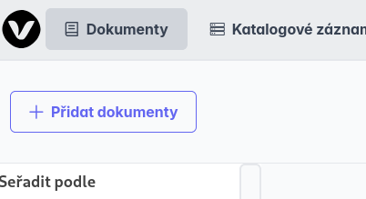
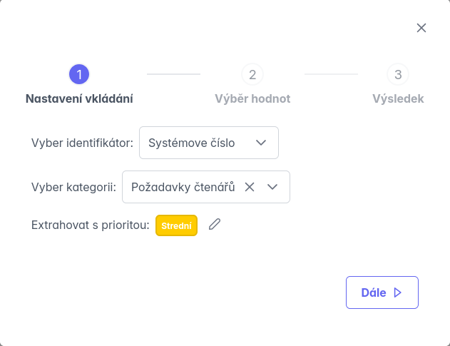
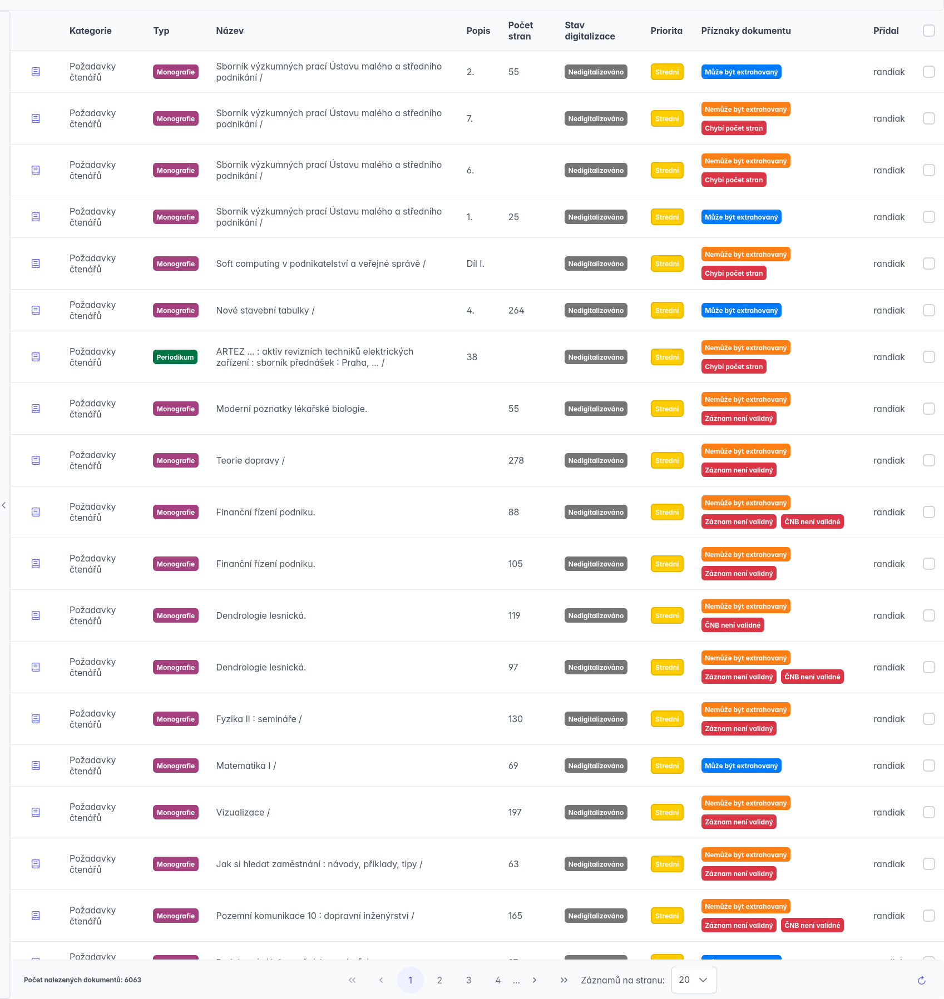
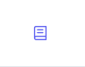
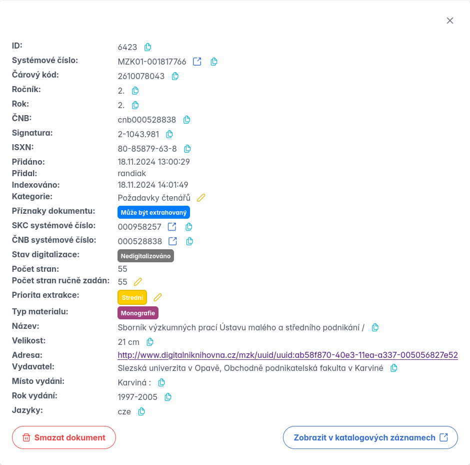
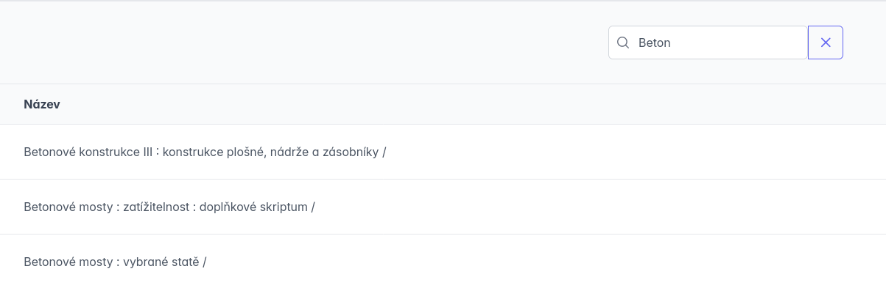
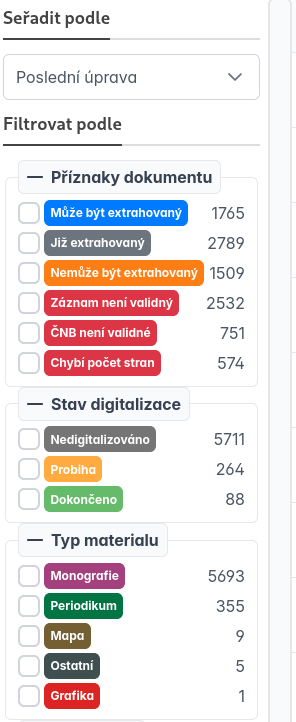
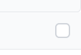
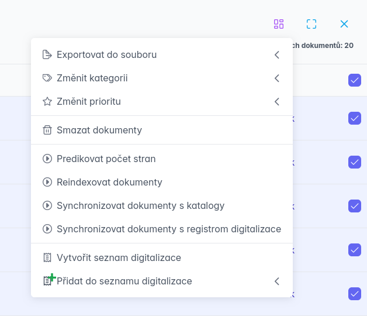

# Dokumenty

Záložka, ve které je možné přidávat, editovat a prohlížet dokumenty. Zobrazení této záložky je podmíněno tím, že uživatel má přidělenu roli s právem **Povoleno číst dokumenty**.

Obsahuje formulář pro přidávání dokumentů, samotné dokumenty, nástroje na jejich filtrování a editaci.

## Formulář pro přidávání dokumentů

Přidávání dokumentů je podmíněno tím, že uživatel má přidělenu roli s právem **Povoleno přidávat dokumenty**.

Formulář se zobrazí po kliknutí na tlačítko *Přidat dokumenty*.  

Práce s formulářem je popsána v dalších částech Wiki: *Přidávání dokumentů* a *Přidávání dokumentů – Výsledek*.  

## Tabulka dokumentů

Dokumenty se zobrazují v této tabulce, která obsahuje všechny základní informace o dokumentech.  

Další informace o dokumentech lze zobrazit kliknutím na toto tlačítko:  

Detaily dokumentu obsahují všechny informace, které jsou pro daný dokument veřejně dostupné. Z tohoto pohledu lze dokument také upravovat. Je možné měnit prioritu digitalizace, počet stran, kategorii nebo dokument případně smazat.  

Detaily dokumentu lze zavřít buď kliknutím na **X** v dialogovém okně, nebo opětovným kliknutím na tlačítko.  

## Filtrování dokumentů

Dokumenty lze filtrovat pomocí vyhledávání nebo pomocí facetů.

Vyhledávání využívá *fuzzy* logiku, což znamená, že najde i nepřesné shody.  
  
*Vyhledávání prohledává pole název, systémové číslo, ISXN a čárový kód.*

Dále je možné omezit vyhledávání dokumentů pomocí facetů v postranním panelu.  

## Akce nad dokumenty

Nad označenými dokumenty je možné provádět různé akce. Dokumenty lze označovat jednotlivě, nebo označit všechny na aktuální stránce (viz tlačítko na obrázku):  
  
Je také možné označit všechny dokumenty z vyhledávání:  

V závislosti na právech uživatele lze poté provádět různé akce nad označenými dokumenty:  

