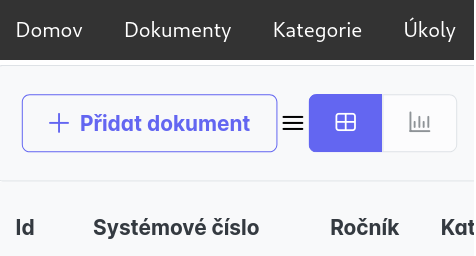
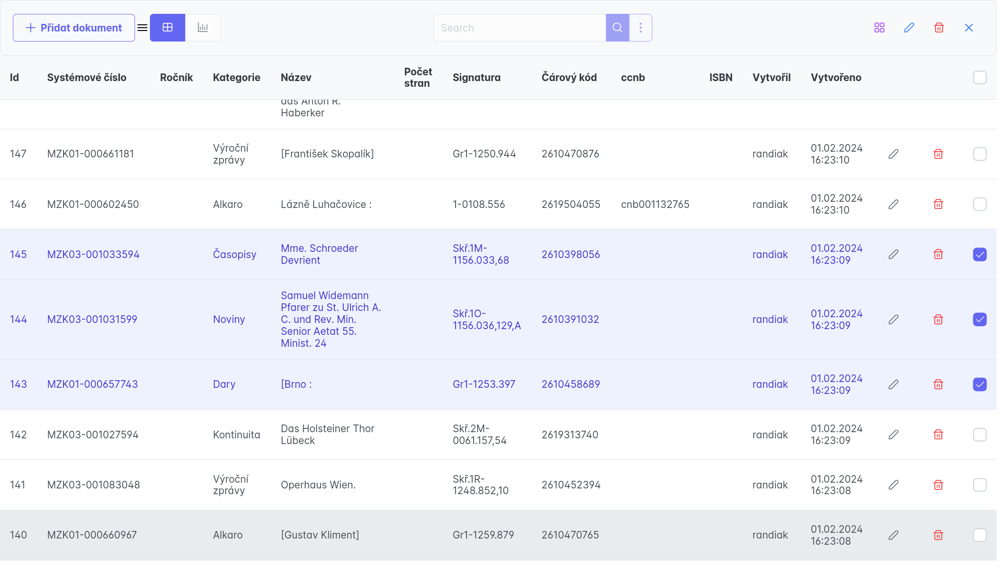
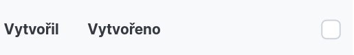

# Dokumenty
Záložka, v ktorej je možné pridávať, editovať a prehliadať dokumenty. Zobrazenie tejto záložky závisí na tom, či má daný user právo zobrazovať dokumenty (buď vlastné, oddelenia alebo všetky).

#### Pridávanie dokumentov
Na to aby užívateľ mohol pridávať dokumenty, potrebuje rolu, ktorá má povolené pridávanie dokumentov.
V závislosti na tom sa následne zobrazí/nezobrazí tlačítko v ľavom hornom rohu:

[Popis pridávania dokumentov](InsertDocuments.md)

#### Tabuľka s dokumentmi
Tabuľka sa načíta *lazy* spôsobom, to znamená, že pri scrollovaní sa pre každých x (cca je to 30) dokumentov, spraví požiadavka na server a načítajú sa ďalšie dokumety. Toto je dosť efektívne riešenie a vyzerá to prirodzene, no na pomalom internete to môže znamenať, že sa budú dokumenty zobrazovať pomalšie.

#### Editovanie a spúštanie procesov nad dokumentami
Editovanie dokumentov je podmienené právom editovať dokumenty. Toto právo sa delí pre vlastné dokumenty, dokumenty oddelenia alebo všetky dokumenty.
Dokumenty je možné editovať pomocou *ikony ceruzky*. Mazať pomocou *ikony popelnice*.
Je možné označiť ľubovoľný počet dokumentov.

Označené dokumenty je možné následne mazať alebo editovať. Pre skupinu dokumentov je zatiaľ možne editovať iba kategóriu, keďže to je jediné čo dáva zmysel z hľadiska štruktúry dát dokumentov.
Taktiež je možné pre tieto označené dokumenty spustiť nejakú úlohu. Stačí kliknúť na *prvú ikonku* a vybrať aká úloha sa má spustiť.

Týmto tlačítkom je možné označiť úplne všetky dokumenty vo vyhľadávaní (teda aj tie čo nie je vidno).

