# Přidávání dokumentů

Přidávání dokumentů je podmíněno tím, že uživatel má přidělenu roli s právem **Povoleno přidávat dokumenty**.

## Postup přidávání dokumentů:

- ### Klikněte na tlačítko *Přidat dokumenty*  
    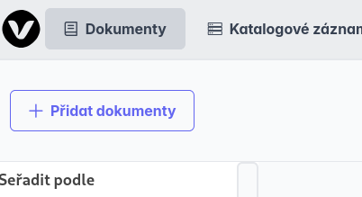

- ### Zobrazí se nastavení přidávání dokumentů  
    - Zvolená nastavení se ukládají, takže při dalším přidávání dokumentů se automaticky použijí naposledy uložená nastavení.  
        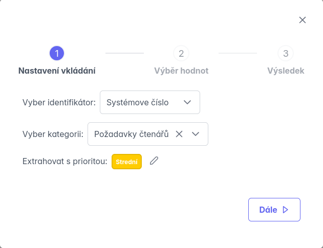
    - Je možné zvolit, jaký identifikátor použít.  
        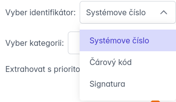
    - Nastavit, do jaké kategorie budou dokumenty vloženy.  
        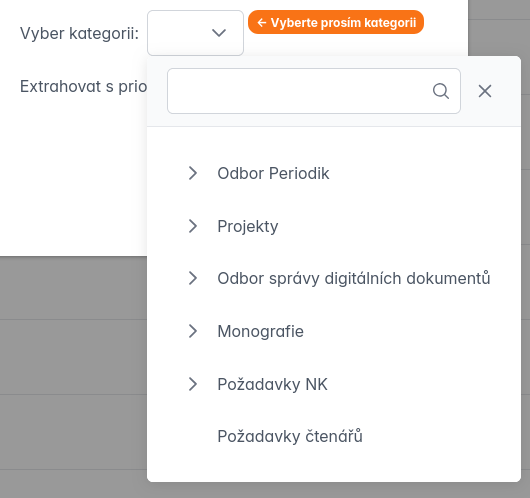
    - A určit, s jakou prioritou mají být tyto dokumenty digitalizovány.  
        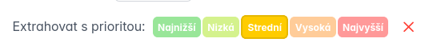

- ### Po nastavení požadovaných možností pokračujte kliknutím na tlačítko *Dále*.

- ### Dalším krokem je výběr konkrétních hodnot, podle kterých budou dokumenty vloženy. Na výběr je zadání hodnot do textového pole nebo nahrání hodnot ze souboru.  
    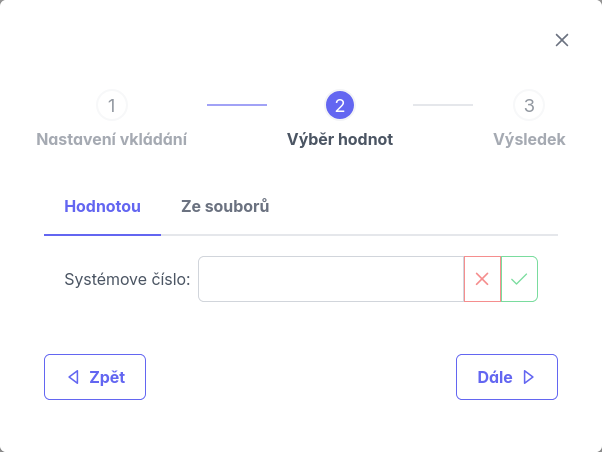
    - Při zadávání hodnot do textového pole je třeba hodnotu napsat a potvrdit ji.  
        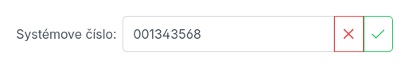
    - Úspěšné přidání dokumentu se zobrazí v tomto okně. Zpracování může v některých případech trvat až několik sekund, proto se doporučuje vkládat více dokumentů současně a kontrolovat je v posledním kroku.  
        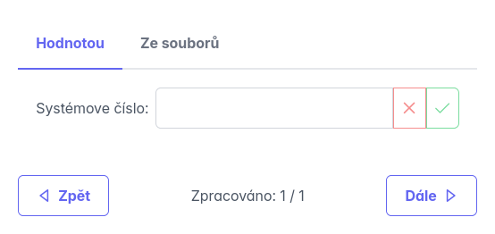
    - Pro přidání ze souboru vyberte možnost *Ze souborů* a zvolte soubor obsahující konkrétní identifikátory.  
        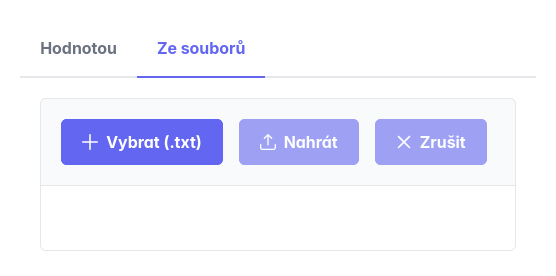
    - Po výběru souboru klikněte na tlačítko *Nahrát*.  
        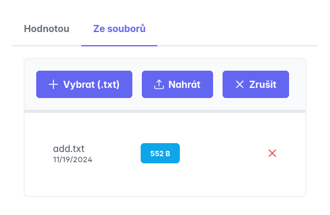
    - V tomto zobrazení je možné upravit nastavení přidávání dokumentů pro konkrétní identifikátory.  
        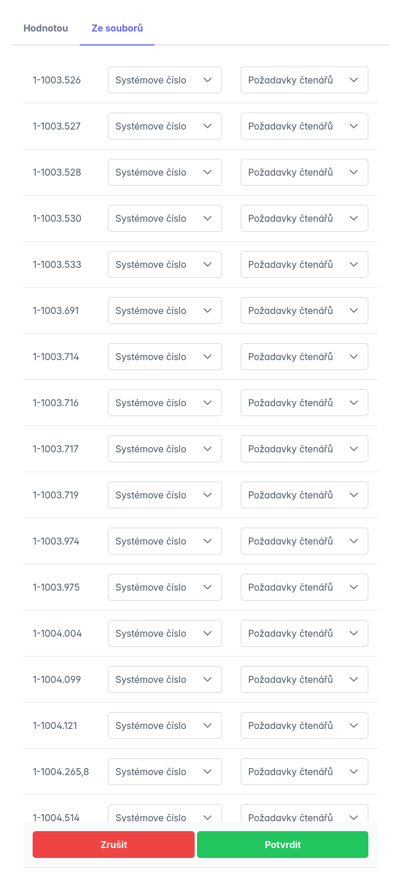
    - Přidávání zahájíte kliknutím na tlačítko *Potvrdit*. Stav přidávání je zobrazen v poli *Zpracováno:*.  
        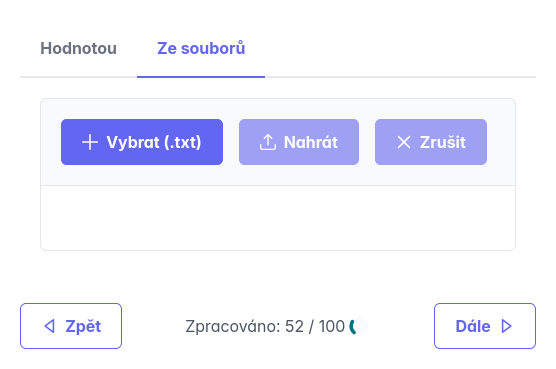
    - Přidávání dokumentů probíhá na serveru na pozadí, proto lze okno minimalizovat kliknutím na **X**.  
        
    - Pokud je přidávání minimalizováno, stav procesu lze sledovat na liště.  
        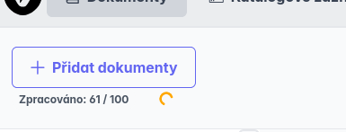

- ### Výsledky se postupně shromažďují v posledním kroku *Výsledek*. Pro přehled výsledků a práci s nimi přejděte na stránku ve Wiki **Výsledky přidávání**.  
    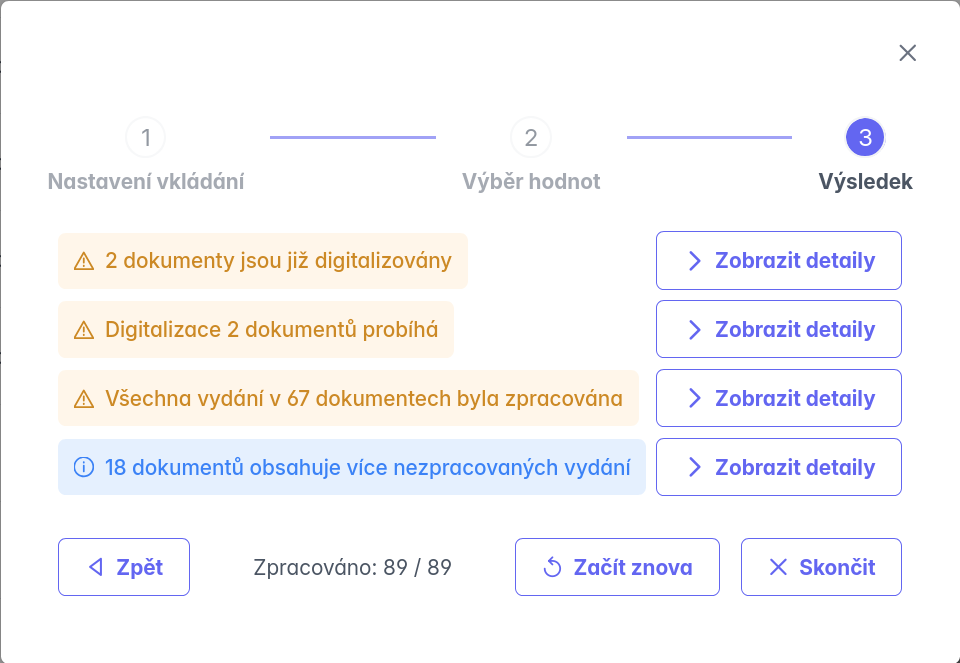
