# Výsledek přidávání dokumentů

V tomto kroku je možné zkontrolovat, jak dopadlo přidávání jednotlivých dokumentů.  

## Práce s výsledky

- Každý výsledek má k dispozici detaily, které lze zobrazit stisknutím tlačítka.  
    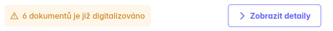
- Existuje několik typů detailů. V tomto případě se zobrazují identifikátory, které nebyly nalezeny v katalogu.  
    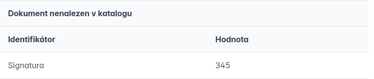
- Detaily lze zavřít a vrátit se na přehled.  
    
- Po prohlédnutí všech výsledků lze přidávání ukončit pomocí tlačítka *Skončit*. Tím se výsledky smažou. Pokud se pouze zavře okno, výsledky zůstanou k dispozici.  
    
- Je také možné zvolit *Začít znovu*, což vymaže aktuální výsledky a vrátí proces na nastavení přidávání dokumentů.  
    

## Typy výsledků

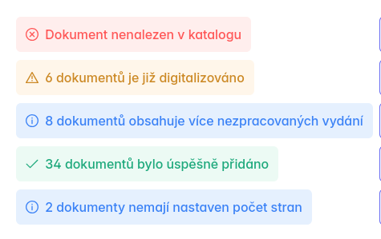

- **Dokument nelze zpracovat kvůli chybě připojení ke katalogu**
- **Dokument nelze zpracovat kvůli chybě při odpovědi katalogu** – VERA se nepodařilo zpracovat odpověď z katalogu, což může být způsobeno výpadkem katalogu nebo chybou v parsování.
- **Dokument nelze zpracovat kvůli neplatnému systémovému číslu**
- **Dokument nelze zpracovat kvůli neplatnému základu systémového čísla** – VERA pracuje pouze s bázemi *MZK01* a *MZK03*.
- **Dokument nenalezen v katalogu**
- **Dokument nelze zpracovat, v katalogu nalezeno více kandidátních záznamů** – VERA neobsahuje logiku pro výběr mezi více katalogovými záznamy. Zkuste vložit dokument jiným identifikátorem.
- **Dokument nelze zpracovat kvůli neplatnému záznamu v katalogu** – Pravděpodobně se jedná o smazaný katalogový záznam.
- **Dokument nelze zpracovat kvůli neplatnému stavu digitalizace**
- **Digitalizace dokumentu je zakázána** – Dokument obsahuje v katalogu poznámku *Nelze digi*.
- **Dokument je již digitalizován**
- **Digitalizace dokumentu probíhá**
- **Digitalizace dokumentu je naplánována**
- **Všechna vydání v dokumentu byla zpracována** – Všechna vydání jsou buď v procesu digitalizace podle registru digitalizace, nebo již byla přidána do VERY.
- **Dokument se stejnými identifikátory je již v databázi**
- **Dokument obsahuje více nezpracovaných vydání** – Je třeba vybrat, která vydání se mají přidat.
- **Dokument byl úspěšně přidán**
- **Dokument nemá nastaven počet stran** – Dokument byl přidán, ale chybí počet stran, který se nepodařilo předpovědět.
- **Dokument se nepodařilo zpracovat kvůli interní chybě v aplikaci VERA** – Chyba v implementaci aplikace. Kontaktujte vývojáře.

### Speciální chování některých typů výsledků

- **Dokument obsahuje více nezpracovaných vydání** – Je třeba vybrat konkrétní vydání.
- **Dokument nemá nastaven počet stran** – Počet stran lze dodatečně nastavit.

## Chyba při přidávání dokumentu

  
Detail chybového výsledku obsahuje identifikátory použité při přidávání dokumentu.

## Dokument v procesu digitalizace

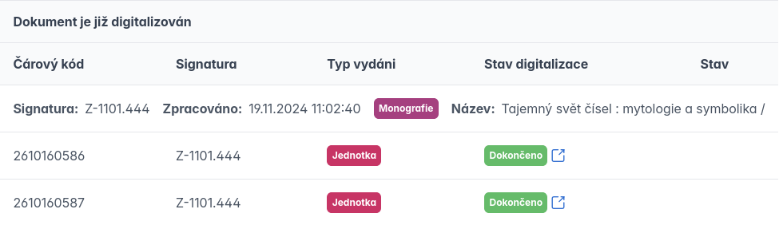  
Dokument byl nalezen, ale všechna jeho vydání jsou již v procesu digitalizace podle registru digitalizace. Po kliknutí na tlačítko *Externí odkaz* lze zobrazit konkrétní vydání v registru digitalizace.

## Všechna vydání zpracována

Tento výsledek může znamenat:  
- že všechna vydání jsou již přidána do VERY,  
    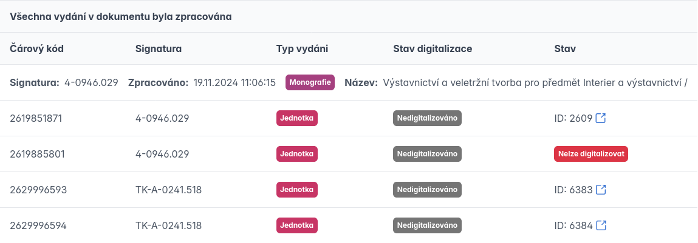
- že některá vydání mají v registru digitalizace určitý stav,  
    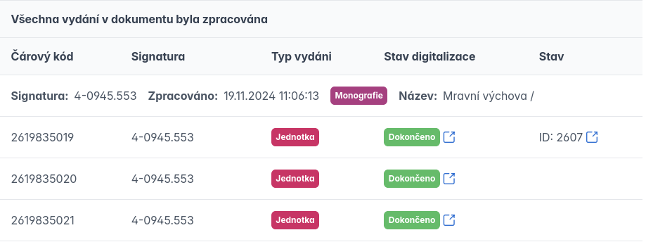
- nebo že je digitalizace vydání zakázána.  
    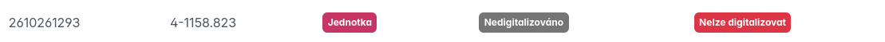

Zakázaná digitalizace se parsuje z poznámky *Nelze digi* v MZK katalogu.

## Dokument obsahuje více nezpracovaných vydání

Pokud dokument obsahuje více nezpracovaných vydání, je třeba vybrat konkrétní vydání, která budou přidána.  
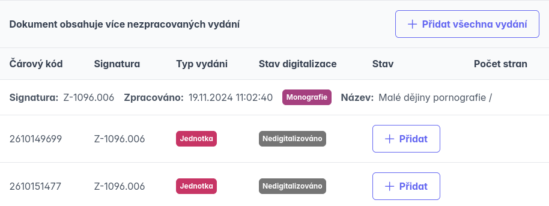

Je možné přidat všechna vydání na aktuální stránce tlačítkem *Přidat všechna vydání*.  
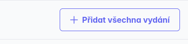

Po přidání se zobrazí tag *Nově přidáno* a odkaz na konkrétní VERA dokument u přidaných vydání.  
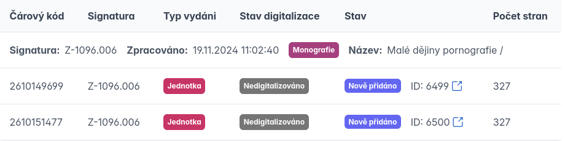

Pro hromadné přidávání vydání z více dokumentů lze zvýšit počet záznamů na stránce a stisknout *Přidat všechna vydání*.  
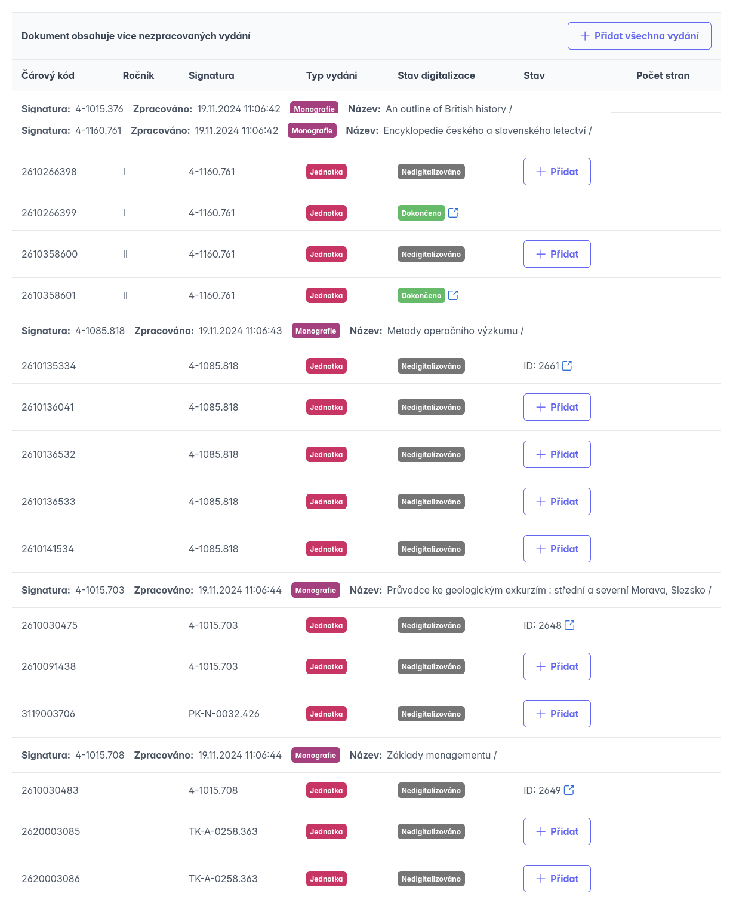

Výsledky přidávání se zobrazí stejně jako při přidávání v rámci jednoho dokumentu.  
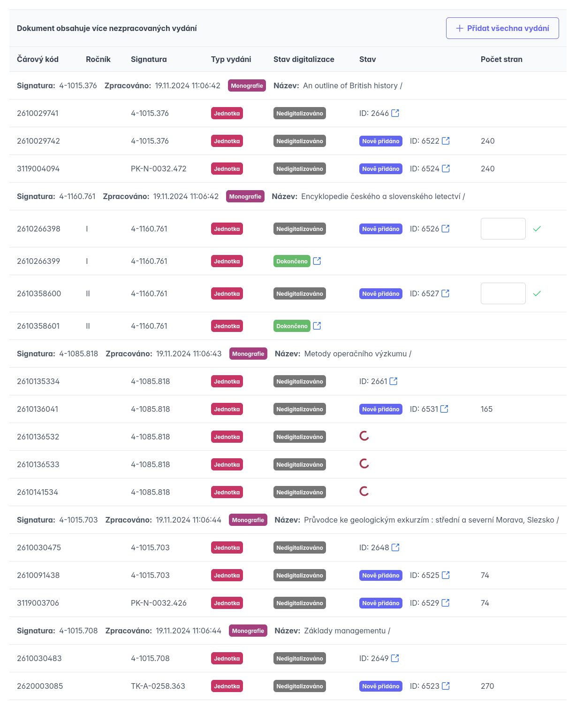

### Nastavení počtu stran

V tomto pohledu je také možné nastavit počet stran u přidaných vydání, pokud tento údaj chybí nebo se jej nepodařilo předpovědět. Stačí jej zadat do příslušného pole a potvrdit.  
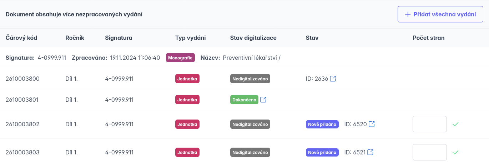

Počet stran bude poté zobrazen jako nastavený.  
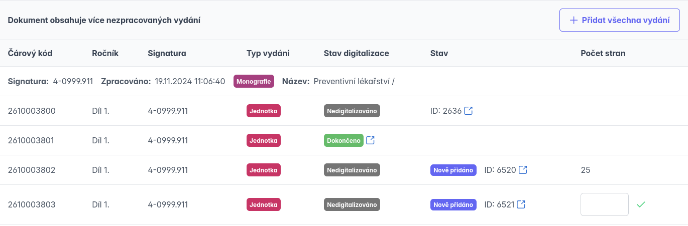

Při přechodu na dokument lze ověřit, že se počet stran skutečně nastavil.  
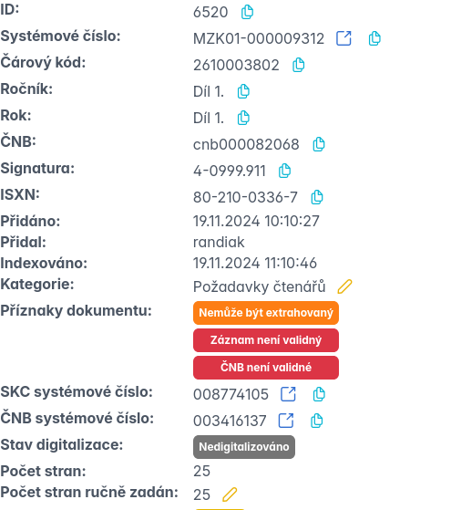

## Dokument nemá nastaven počet stran

Dokument byl přidán, ale chybí počet stran, který lze dodatečně nastavit vložením do příslušného textového pole a potvrzením. Po nastavení počtu stran se stav dokumentu změní na **Dokument byl úspěšně přidán**.  
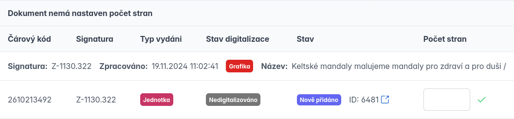

## Dokument byl úspěšně přidán

V tomto pohledu se zobrazují dokumenty, které byly úspěšně přidány a mají nastaven počet stran.  
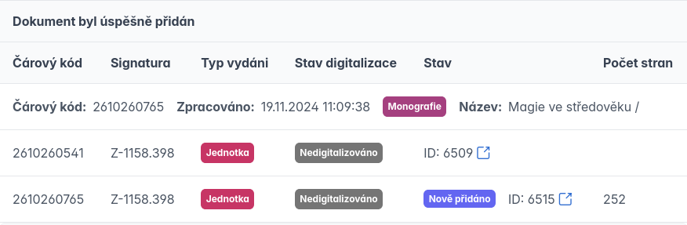

Vydání, která byla přidána, jsou označena tagem *Nově přidáno*. Všechna vydání obsažená ve VERE mají odkaz na konkrétní dokument ve VERA.
