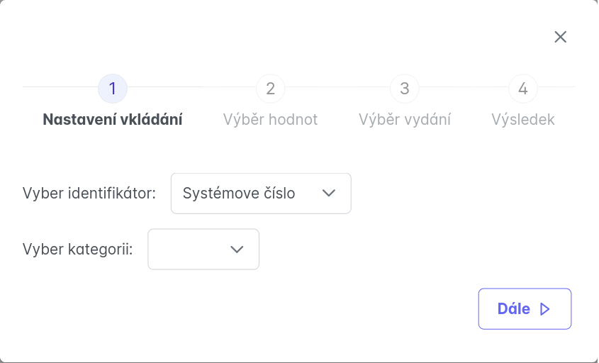
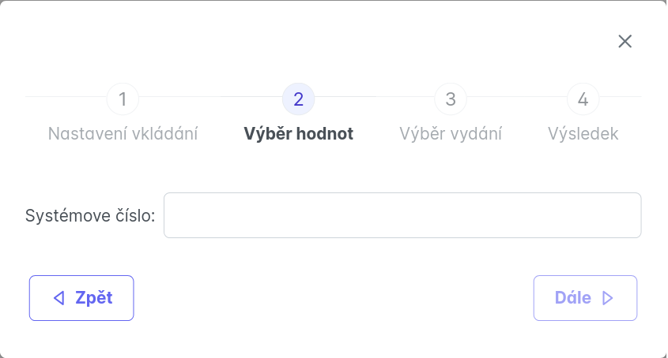
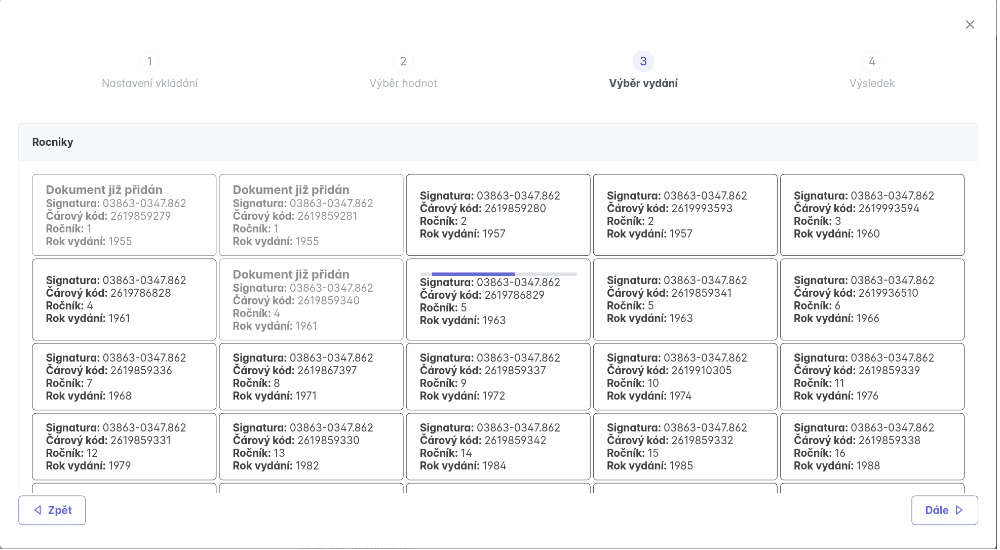
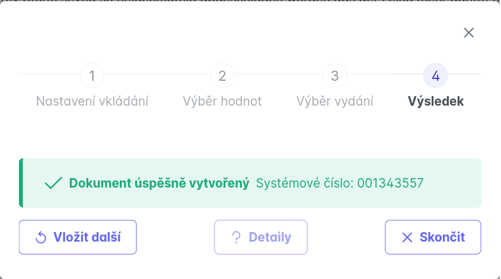
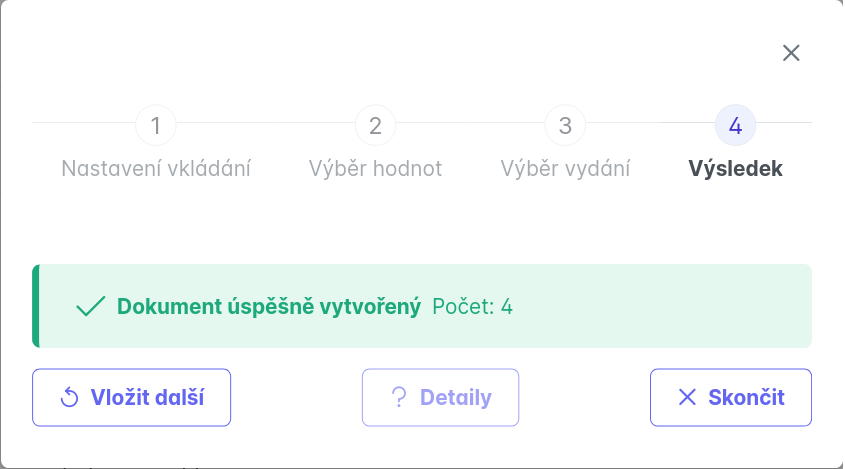
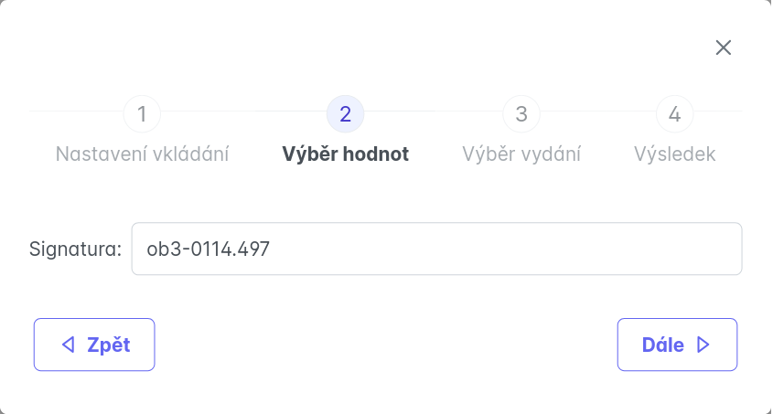

### Popis pridávania dokumentov
Pridávanie dokumentov sa skladá so štyroch krokov: Nastavenie, Výber hodnôt, Výber vydaní a Výsledok.
Dokumenty sa pomocou identifikátorou vyhľadávajú priamo v Aleph katalógu. Vyhľadávanie pre dané identifikátory funguje rovnako ako v Alephe (napríklad nie je case sensitive).

#### Nastavenie vkladania
V nastavení vkladania sa nastavujú dve hodnoty:
- Identifikátor pomocou, ktorého chceme pridať dokument/dokumenty. Momentálne sú podporované identifikátory *Systémové číslo*, *Čiarový kód* a *Signatúra*.
- Kategória do ktorej chceme tento dokument/dokumenty pridať. Výber kategórie nie je povinný, dokumenty sa dajú pridať aj bez toho aby patrili do nejakej kategórie.
- Možnosť sekvenčné vkladanie, ktorou sa po vložení dokumentu vrátite naspäť na výber hodnôt. Týmto spôsobom je možné vkládať dokumenty za sebou, do tej istej kategórie. Veľké využitie to má pri vkladáni identifikátorom čiarový kód a za pomoci čítačky.

#### Výber hodnoty
V tomto kroku sa vkladá hodnota pre identifikátor vybraný v predchádzajúcom kroku.

#### Výber vydaní
V závislosti na vybranom identifikátore a na tom či tento identifikátor označuje viacero fyzických dokumentov sa pod druhom kroku prejde do tohto kroku.
Pri vkladaní pomocou čiarového kódu je vždy dokument jednoznačne nájdený, tento krok sa preskakuje.
Pri vkladaní pomocou iných identifikátorou sa môže, nemusí, zobraziť výber ročníkov alebo edícií dokumentu.
Zobrazujú sa ročníky, edície so základnými údajmi, tak aby bolo možné jednoznačne vybrať konkrétny dokument.
Po kliknutí sa dokument vytvorí, ak je to možné.
Edícií alebo ročníkov je v tomto kroku možné vybrať ľubovoľný počet.

#### Výsledok
Posledný krok zobrazuje výsledok vkladania. Tento výsledok sa môže líšiť na základe toho koľko dokumentov bolo vložených.

Tlačítkom *Vložiť ďaľší* sa dá vrátiť naspäť do druhého kroku. Týmto spôsobom je možné napríklad pomocou čiarového kódu a čítačky vkladať dokumenty za sebou. Možnosť *Sekvenčné vkladanie* z prvého kroku, vie tento proces plne automatizovať, tým pádom stačí knihovníkovi len načítať čiarové kódy a dokumenty sa budú vkladať do preddefinovaje katégorie, bez toho aby sa musel knihovník dotknúť myšy/klávesnice.
Ďalšia možnosť *Detaily* zobrazí detailné výsledky pri vkládaní viacero dokumentov. Toto má využitie ak sa vkladal veľký počet dokumentov, a z agregovaných hlášok nie je možné vyčítať, ktoré dokumenty a prečo sa nepodarilo vložiť.

Niektoré ďalšie výsledky vkládania sú:

#### Doplňujúce informácie
- Vyhľadávanie pomocou Aleph katalógu nie je case sensitive. Teda napríklad "OB3-0114.497" a "ob3-0114.497" vráti rovnaký výsledok.

#### Plánovaný vývoj
- Pridávanie dokumentov so súbora. Bude možné takto pridať dokumenty, ktoré majú jednotný identifikátor, naraz, do jednej vybratej kategórie.
